# System Architecture

A one-page picture of brachify. Detail lives in
[project/COSC499-TEAM10-PROJECT-DOCS.md](../project/COSC499-TEAM10-PROJECT-DOCS.md).
When the two disagree, that file wins, and when that file disagrees with the code, the code wins.

*Reasoned from code*, read 2026-09-24. Runtime checks are marked *Verified* only where the project docs already recorded them.

## What the app does

A clinician exports a brachytherapy plan as DICOM. brachify builds a patient-specific cylinder with needle holes, an optional tandem, a notch, and an optional collar, then writes a printable mesh and a PDF reference sheet.

## Already built

This is the upstream app plus Team 10's changes to `src/`, listed under
[What Team 10 has added](#what-team-10-has-added). They are three Channels tab fixes, to how
the list shows its selection, to the spin box arrows, and so that a newly imported plan starts
with every channel enabled, none of which changes a diagram, a channel's own diameter, set in the
Channels tab's Selected Channel group and kept through Apply, each channel's status shown in
colour in the Channels list,
the Cylinder mm/cm display selector, where `LengthField` keeps dimensions in mm while the four
controls display either unit, and an Export tab that stays disabled until a cylinder exists. Team 10 has also added
`classes/dicom/structures.py`, a tested standalone RTSTRUCT decoder, attached onto
`DicomData` at import by `load_structures`, and a read-only Import-tab structure list
from `structure_list` (still no hide/show, opacity, or 3D display), and
`settings/needle_templates.py`, a tested needle template library that the Channels tab saves to and applies from,
and `settings/cylinder_templates.py`, a tested cylinder template library saved to `~/brachify/cylinder_templates.json`.

The four pictures below are the map. They are *Reasoned from code*. Everything about them lives
in this folder, and this README is the only place that says when and how to redraw them.

### Keeping the pictures current

Edit only the `.mmd` files in [diagrams/](diagrams/). Everything else is derived.

```bash
python docs/architecture/build.py          # re-render stale SVGs, refresh viewer.html
python docs/architecture/build.py --check  # change nothing, exit 1 if anything is stale
python docs/architecture/build.py --install-hook   # once per clone, builds on a .mmd commit, checks on a src/ commit
```

The build needs Node (it runs mermaid-cli through `npx`). Each SVG carries the hash of its source,
so `--check` cannot be fooled by timestamps. The hash is taken over LF line endings, so a Windows
checkout with CRLF matches a stamp written on macOS or Linux. It also fails when a diagram is not embedded below.

**Redraw when** signals, values, the view order, a model, `ShapeModel`, the display path, or what
Import reads or Export writes changes. Redraw all four in the same change, before the pull
request. If none of those changed, leave the pictures alone.

**The system architecture is also checked against `src/`.** `--check` fails when a module in
`src/classes/{dicom,mesh,pdf}/`, `src/settings/`, a `*_model.py` or a `*_view.py` is not named in
[system-architecture.mmd](diagrams/system-architecture.mmd). Adding a file therefore forces a
diagram edit. The check cannot see a change that adds no file, so also redraw that diagram when a
layer, a library, a file the app reads or writes, or the direction of a dependency changes. Edit
the `.mmd` by hand: each domain line (`mesh:`, `pdf:`, ...) lists the module names, and the other
boxes are prose.

Other documents link here and do not repeat this rule. If the rule changes, change it here.

| File | Role | Edit by hand? |
|---|---|---|
| `diagrams/**/*.mmd` | the diagram sources | yes |
| `diagrams/**/*.svg` | rendered pictures, shown below | no, run `build.py` |
| `viewer.html` | zoom and pan page, its list of pictures is generated | no, run `build.py` |
| `build.py` | the build and the check | when the tooling changes |

To zoom and pan when a picture gets crowded, open [viewer.html](viewer.html) in a browser. Scroll
zooms, drag moves, and each picture has its own size.

### System architecture

The whole application as layers, from the people and files outside it down to the libraries and
disk it stands on. Read it top to bottom: the plan and the settings come in through the views,
the views drive the models, the models call the domain services, and the services use the
libraries and disk. Two arrows point back up: outputs leave through the Export view, and
`shapes_changed` carries finished shapes from the models to the canvas.



| Layer | Contents | Source |
|---|---|---|
| External | TPS DICOM export, config JSON, tandem STEP file, STL and STEP out, PDF out | outside the repo |
| Presentation | `MainWindow`, the six views, `LengthField` and `LengthUnit`, the OpenCASCADE canvas | `src/windows/` |
| Application state | `RadiotherapyApp`, `NavigationModel`, `DicomModel`, the geometry models, `DisplayModel` and `ShapeModel` | `src/classes/app.py`, `src/windows/models/` |
| Domain services | DICOM readers, OpenCASCADE geometry, PDF sheet, config load and reset | `src/classes/dicom/`, `mesh/`, `pdf/`, `src/settings/` |
| Libraries | PySide6, pythonocc-core, pydicom, reportlab, matplotlib | conda environment |
| Local storage | `app.log`, `filepaths.json`, `needle_templates.json` and `cylinder_templates.json` in `~/brachify` | `src/classes/info.py`, `src/settings/needle_templates.py`, `src/settings/cylinder_templates.py` |

It is a single process desktop app. There is no server, database or network call. Views reach
other views by index and reach the models through `get_app().window`, so the layering above is the
intended direction of dependency, not one the code enforces. Export is the exception that shows it:
`Export_View` reads the cylinder, channel and tandem models directly and runs the boolean cut
itself.

### UML

Who owns what. A solid arrow means the class creates and holds the other. A dashed arrow is a Qt signal, labelled with its name. `CylinderModel.values_changed` also reaches `MainWindow`, which enables the Export tab once a cylinder exists. `RadiotherapyApp.signals` announces changes. `RadiotherapyApp.values` holds the shared settings dict. `MainWindow.initModels()` creates every model, and `NavigationModel` holds only the views, reached by index 0 through 5. Structures is 5 so Cylinder stays 1. Do not reorder them.


`DicomModel` does not build a `ShapeModel`. It loads the plan and notifies the cylinder and channel models.

### DFD level 0

The app as one process.



### DFD level 1

The same process opened into the five tabs that already move data. The viewport is not a sixth process. It paints shapes. That path is the UML, from the geometry models to `ShapeModel` to `DisplayModel`. The Structures nav page is `views[5]` and is empty, so it is not a sixth process here.


Five data-flow tabs, plus an empty Structures nav page at index 5. The code addresses them by index. Do not reorder them.

| Tab | What it does |
|---|---|
| Import | Reads the first RTPLAN and RTSTRUCT. Needs a channel named `Central Axis`. Varian is the path the sample data exercises. Nucletron exists in code and has no sample here. |
| Cylinder | Diameter, length, optional collar displayed in mm or cm; Apply uses mm. Length changes move needles by an offset. Original DICOM points stay put. |
| Channels | Bore diameter, dead space, threading. A channel can be disabled, marked as the tandem, or given its own diameter, directly or from a saved needle template. The list shows each channel's status. |
| Tandem | Generate a curved channel, or import a STEP model. |
| Export | Cuts channels and tandem out of the cylinder. Writes STL, STEP, the PDF, and a JSON config. |
| Structures | Empty page at `views[5]`. No nav button, organ list or 3D yet. |

A view method that changes geometry must use `@display_action`, or the model updates and the viewport does not. The shape path is in the UML above.

## What Team 10 has added

Mostly course scaffolding. The changes to application behaviour are three Channels view fixes,
the Cylinder mm/cm display selector, and the Export tab waiting for a cylinder.
An RTSTRUCT reader decodes anatomy at import into `DicomData.structures`, and the Import
tab lists each structure. An empty Structures page is `views[5]` so Cylinder stays index 1.
The system architecture names `Structures`. DFD level 1 is unchanged, because the page has
no data flow yet.

The Cylinder selector is a display preference for this window. It preserves pending
edits and exact mm values across switches; config files and exports use mm.
*Verified* 2026-10-10 by offscreen widget and model assertions.

| In the repo | Not in the repo |
|---|---|
| This documentation set, agent rules, commit and PR workflows | Tests of the pure geometry and settings functions |
| Tooling tests, the main window tests in `tests/windows/`, the Channels and Cylinder units tests in `tests/views/`, and the manually run anti-slop-py linter | CI |
| macOS setup notes and Cylinder display units | Server or database |
| `DicomData` reset tests, RTSTRUCT decode at import, and the Import structure list with tests in `tests/dicom/` and `tests/views/` | Structure 3D rendering, hide/show and opacity |
| The Channels list selection fix in `channels_view.py` | Shared widget fixture across test scopes |
| Black Channels spin box arrows, from images compiled into `arrows_rc.py`, and their test | |
| A needle template library in `settings/needle_templates.py`, saved to `~/brachify/needle_templates.json`, saved and applied on the Channels tab. The system architecture names the module and the file. The other three diagrams are unchanged, because the library is local state, like `filepaths.json` | |
| A cylinder template library in `settings/cylinder_templates.py`, saved to `~/brachify/cylinder_templates.json`. The system architecture names the module and the file. The other three diagrams are unchanged, because it is local state, like `needle_templates.json`, inside the DFD level 1 Plan and settings store | |
| Each channel's status, from `ChannelsModel.channel_status`, shown in colour in the Channels list. No diagram changes, because the status is computed from state the model already holds and nothing reaches the display path | |
| A channel's own diameter, set in the Channels tab's Selected Channel group and kept by `ChannelsModel` through Apply. The tab scrolls when the window is short. No diagram changes, for the same reason | |
| A newly imported plan starts with every channel enabled, in `channels_model.py`. `ChannelsModel` changed, and all four diagrams are unchanged, because the UML lists none of its state and no data flows differently | |
| The Export tab stays disabled until a cylinder exists, in `main_window.py`. The UML gains `CylinderModel ..> MainWindow`. The other three diagrams are unchanged, because no data flows differently | |
| The collar round-trips through config files, and *Generate Tandem* merges its settings snapshot instead of replacing the live settings (§7.1). No diagram changes, because the same files are read and written | |

## Known gaps in the existing code

Unfinished work the code and the project docs already name. It is not the project plan,
which is the proposed framework below.

| Gap | Why it matters |
|---|---|
| A tandem channel's rotation is measured from `(1, 0)` instead of the cylinder axis | The generated tandem points away from the planned channel. Recorded in §7.7. |
| No tests for the DICOM-to-cylinder rotation, config load, point cleanup, or the PDF length maths | Those functions decide needle position and the sheet a clinician reads. Listed in §8. |
| Nucletron import has no sample plan in the repo | Half of the DICOM reader is unexercised. |
| Needle collision checks are not called | Intersecting needles are a clinical precondition the app does not enforce. Two pairs of base holes in `SI_C_D30 Brachify_Ex2/` already overlap (§7.9). |

## Proposed project framework

The [project proposal](../proposal/README.md) now describes structure visualization,
cylinder and needle editing, design checks, templates and consistent exports.
[projected-framework/](diagrams/projected-framework/) contains separate UML,
DFD level 0 and DFD level 1 diagrams for that scope. These are proposed responsibilities,
reasoned from the proposal, not implemented APIs or verified clinical behaviour.

The build recursively discovers diagrams in both `existing-framework/` and
`projected-framework/`, as well as the top-level system architecture. Run the commands
above to regenerate the viewer and stale SVGs; `--check` covers all seven diagrams.
The RTSTRUCT reader and Import structure list are listed in the system architecture
diagram; import attaches them via `load_structures`. The
Channels list fix only changes widget state, and the Cylinder display-unit change keeps
dimensions in mm, its widget conversion documented in prose, so neither changes a diagram.
The Export tab fix adds one edge to the existing UML, `CylinderModel ..> MainWindow`, and
leaves the other diagrams unchanged. The projected diagrams remain proposals. The UML and DFD paths changed to keep existing and proposed
behaviour separate.

### Projected UML



### Projected DFD level 0



### Projected DFD level 1



The proposal's milestone 1 FR-SV-01–07 maps to structure reconstruction, display state
and anatomy checks. FR-CN-01–20 maps to design editing, templates, history, validation
and exports. Milestone 2 describes the corresponding review and editing controls.
Class names in the projected UML express a design proposal; storage formats, clinical
thresholds and the concrete UI arrangement still need implementation decisions.
