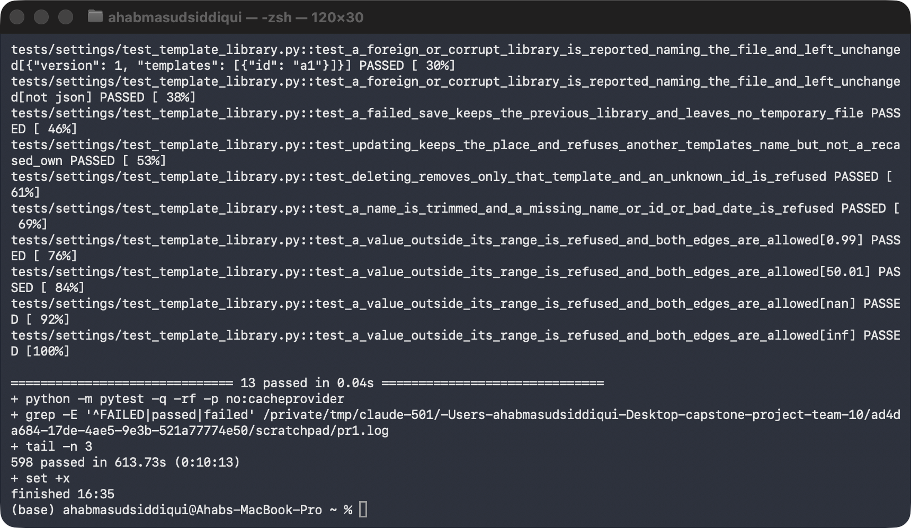

# Week 11, Ahab

_Individual log, one section per merged PR. See [docs/logs/README.md](../README.md)._

## Stack #264, at a glance

| PR | On | Closes | Adds | Own diff | New tests | Suite after |
|---|---|---|---|---|---|---|
| [#264](https://github.com/COSC-499-W2026/capstone-project-team-10/pull/264) | main | #263 | `settings/template_library.py`, the shared template rules (nothing calls it yet) | 9 files, 499 lines | 13 (13 in the file) | 598 passed |

### Shared by every PR in this stack

- The code quality checklist, for every PR in the stack: **no hardcoded values, duplicate code, dead code, unnecessary function calls, excessive conditional logic, deep nesting, high cyclomatic complexity, or classes, modules and functions with many unrelated responsibilities, checked with `anti_slop review --base <parent branch> src tests utils` (no findings) and a line-by-line read of each diff**.
- Checks run on every PR: **`python docs/architecture/build.py --check` and `sh .claude/hooks/session-start.sh`, both exit 0**.
- Not applicable to any PR in the stack: **architectural pattern, database, data processing, state management, backend API (unchanged or none); Frontend (no view or `.ui` file changed); test coverage (no tool)**.

### For PR #**264** (1 of 2, on main)

- As part of requirement **FR-CN-05 and FR-CN-06, save templates and manage them in a library**, the user needs to do **save a template, update one, delete another, and reopen the file with the rest unchanged**.
- Therefore, I implemented/generated code so that **medical physicists' template libraries can share one tested set of load, save, add, update, delete, name and range rules, which #265 switches the cylinder and tandem libraries onto**.

#### Data Modeling and Integrity

- This data **the template library file** is modeled as **`TemplateLibrary[T]`, a frozen dataclass of noun, error class, version, decode and encode** because **kinds differ only in their fields**. We considered alternative models such as **a base class, where kinds would override methods**.
- This data **the template library file** uses the input validation to ensure it adheres to **version 1, unique IDs and names in any case, and every value inside its `Range`**.
- This data **the template library file** may be vulnerable to **a crash corrupting every template**. Therefore, it uses a security-based sanitization by **saving through a `.tmp` swapped in by `os.replace`**. We considered alternative security solutions such as **a backup copy, which the swap makes unnecessary**.
- Not applicable: **privacy sanitization, encryption, access controls (no patient data)**.

#### Backend

- The system architecture diagram consists of the following major components: **views, models, domain services, libraries and local storage, with `template_library` added to settings**. This structure has low coupling because **the module imports nothing from `classes` or `windows`**. This structure has high cohesion because **every function keeps one template file**. This design is scalable because **a third kind is one `TemplateLibrary(...)` line**.

  **[System architecture (SVG), changed by this PR](https://github.com/COSC-499-W2026/capstone-project-team-10/blob/a32dd18a10b39fe618f69ff8832838c0aa26012e/docs/architecture/diagrams/system-architecture.svg)**
- The Level 0 DFD consists of the following major components: **the clinician and their local files**. **No flow changes**.

  **[DFD level 0 (SVG), unchanged by this PR](https://github.com/COSC-499-W2026/capstone-project-team-10/blob/a32dd18a10b39fe618f69ff8832838c0aa26012e/docs/architecture/existing-framework/dfd-0.svg)**
- The Level 1 DFD consists of the following major processes: **Plan and settings store among them**. **Happy path, Save as Template writes the store. Failure path, a corrupt file is refused by name. Neither changes, since nothing calls the module yet**.

  **[DFD level 1 (SVG), unchanged by this PR](https://github.com/COSC-499-W2026/capstone-project-team-10/blob/a32dd18a10b39fe618f69ff8832838c0aa26012e/docs/architecture/existing-framework/dfd-1.svg)**
- The following traceability matrix shows the list of requirements completed in this milestone and their associated tests: **FR-CN-05 and FR-CN-06 → the 13 cases in `test_template_library.py`**
- Not applicable: **see Shared**.

#### Review and design

- When I reviewed **`decode_number` and its two siblings as moved**, I noticed **they raised `CylinderTemplateError`, so tandem raised a cylinder error**. Therefore, I did **raise a new `TemplateLibraryError` base**.
- The PR does not contain any temporary workaround because **the module is complete and tested, and unused only until #265 switches the callers**.
- The PR only contains small functions that are **at most 17 lines (`load`)**.
- By doing **a diff against `cylinder_templates.py`**, I found that my feature contribution contained **duplicate code, the seven moved functions still in the older modules**. Therefore, I did **remove them in #265 to keep both PRs under the size limits**. Now, I can confirm it contains no other listed item, as **Shared** describes.
- This work is written in **new `src/settings/template_library.py`** because **settings holds the template libraries and must import nothing from `classes` or `windows`**.
- This work belongs in **the Plan and settings store** in the DFD because **it reads and writes local template files**.

#### Testing receipts

- The functionality works correctly because the happy path tests involving **`test_a_saved_template_loads_back_identical_and_no_file_means_no_templates` and `test_deleting_removes_only_that_template_and_an_unknown_id_is_refused` (13 new; 13 in the file)** passed.
- I wrote tests to cover abnormal situations involving **a foreign version, a bad entry, malformed JSON, a failed `os.replace` and a repeated name or ID** and they passed.
- I checked that these negative cases involving **seven deliberate breaks of the module (case-sensitive names, saving in place, a repeated ID and four more)** failed as expected.
- When I reviewed the **mutation results**, I noticed **a boolean read as a number fails no test here, after I trimmed the file for the size limit**. Therefore, I did **leave it to the cylinder and tandem tests, which catch it once #265 lands**.
- Among these tests, **all 13** are unit tests and integration tests are not required because **the module imports no Qt and no `classes`**.
- These tests are included in the directory **`tests/settings/`**.
- This new test PR did not break anything else in the system because **`python -m pytest` (598 passed, 585 on main, 0 failed) (screenshot 1)**.

  
