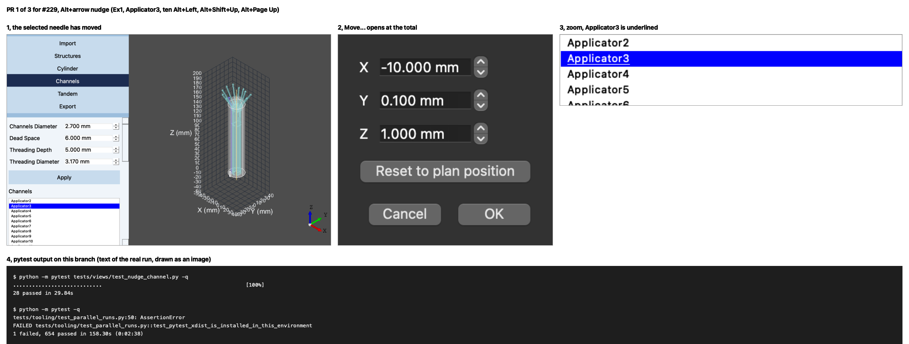
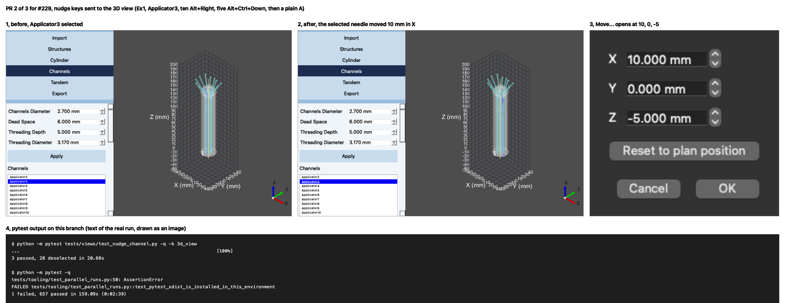
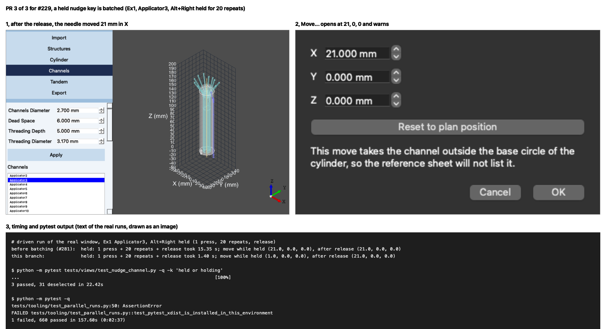

# Week 11, Ahab

_Individual log, one section per merged PR. See [docs/logs/README.md](../README.md)._

## Stack #280 to #282, at a glance

| PR | On | Closes | Adds | Own diff | New tests | Suite after |
|---|---|---|---|---|---|---|
| [#280](https://github.com/COSC-499-W2026/capstone-project-team-10/pull/280) | main | #229 | Alt+arrow and Alt+Page keys nudge the selected applicator from the channel list | 7 files, 345 lines | 28 (28 in the file) | 654 passed, 1 env failure |
| [#281](https://github.com/COSC-499-W2026/capstone-project-team-10/pull/281) | #280 | #229 | the nudge keys in the 3D view, and its broken key handler deleted (§7.9) | 8 files, 109 lines | 3 (31 in the file) | 657 passed, 1 env failure |
| [#282](https://github.com/COSC-499-W2026/capstone-project-team-10/pull/282) | #281 | #229 | a held nudge key moves once on release (1.40 s instead of 15.35 s) | 6 files, 147 lines | 3 (34 in the file) | 660 passed, 1 env failure |

### Shared by every PR in this stack

- The code quality checklist, for every PR in the stack: **no hardcoded values, duplicate code, dead code, unnecessary function calls, excessive conditional logic, deep nesting, high cyclomatic complexity, or classes, modules and functions with many unrelated responsibilities, checked with `anti_slop review --base <parent branch> src tests utils` (no findings) and a line-by-line read of each diff**.
- Checks run on every PR: **`python docs/architecture/build.py --check` and `sh .claude/hooks/session-start.sh`, both exit 0**.
- Not applicable to any PR in the stack: **Data Modeling and Integrity and Backend (no model, data or file format changed); data caching (no backend), restricted pages (no logins), usability evaluation (none run), test coverage (no tool)**.

### For PR #**280** (1 of 3, on main)

- As part of requirement **FR-CN-02, move a needle**, the user needs to do **select an applicator in the Channels list, press Alt (Option) with an arrow or Page key to nudge it by 1 mm, or 0.1 mm with Shift, and watch the 3D view follow**.
- Therefore, I implemented/generated code so that **medical physicists can line a needle up by eye from the keyboard, with each nudge added to the popup's move and kept to its ±300 mm**.

#### Frontend

- The frontend is designed using **PySide6, with a `NudgeKeys` event filter on the channel list** with design components for **the list, the 3D view and the Move popup**. Therefore, changing the design of **the key table in `nudge_keys.py`** will automatically change the look and feel of all instances of that component throughout the system. Changes to the content will not affect the design because **the filter only turns keys into steps and `ChannelsView.nudge_selected` applies them**.
- The frontend adopts accessibility principle **WCAG 2.1.1 Keyboard, every function works from a keyboard**. The aspects that demonstrate this principle in the system include **a move needs no mouse: Alt+arrows nudge, the popup shows the total (screenshots 1 to 3)**.
- The following traceability matrix shows the list of requirements completed in this milestone and their associated tests: **FR-CN-02 → `test_alt_arrow_in_the_list_moves_the_selected_channel_and_marks_its_row`, `test_a_nudge_adds_to_the_popups_move_and_the_popup_shows_the_total`**
- Not applicable: **see Shared**.

#### Review and design

- When I reviewed the **`nudge_step` keypad mask** for this functionality, I noticed **a mutation that removed it failed no test, because the modifiers are tested with `&`, so the mask was dead code**. Therefore, I did **delete it and keep the macOS keypad case in the test table**.
- The PR does not contain any temporary workaround because **the keys go through the same `move_channel` as the popup**.
- The PR only contains small functions that are **at most 8 lines (`nudge_step`, `nudge_selected`)**.
- Code quality checklist: **see Shared**.
- This work is written in **new `src/windows/views/nudge_keys.py` and `channels_view.py`** because **`channels_view.py` is near 500 lines, and the key table is pure and testable without Qt widgets**.
- This work belongs in **Channels** in the DFD because **it moves a needle the way the popup does**.

#### Testing receipts

- The functionality works correctly because the happy path tests involving **`test_each_nudge_key_gives_its_axis_and_step` and `test_alt_arrow_in_the_list_moves_the_selected_channel_and_marks_its_row` (28 new; 28 in the file)** passed.
- I wrote tests to cover abnormal situations involving **a nudge past ±300 mm, a press at 300 mm (no rebuild), and a nudge out of the cylinder (tooltip warning)** and they passed.
- I checked that these negative cases involving **four deliberate breaks (no limit check, no tandem check, no rounding, no filter installed)** failed as expected.
- Among these tests, **the 22 `nudge_step` and `nudged` cases** are unit tests and **the 6 window tests** are integration tests.
- These tests are included in the directory **`tests/views/test_nudge_channel.py`**.
- This new test PR did not break anything else in the system because **`python -m pytest` (654 passed, 1 failed `test_pytest_xdist_is_installed_in_this_environment`, as pytest-xdist is not in my conda env; 627 tests on main) and a driven run of the real window on macOS: Ex1, Applicator3, ten Alt+Left, Alt+Shift+Up and Alt+Page Up sent in-process with `QTest` gave a move of -10, 0.1, 1 mm (screenshots 1 to 4)**.

  

### For PR #**281** (2 of 3, on #280)

- As part of requirement **FR-CN-02, move a needle**, the user needs to do **pick a needle, click into the 3D view, and nudge it with Alt (Option) and the arrow or Page keys while watching it move**.
- Therefore, I implemented/generated code so that **medical physicists can nudge from the 3D view as from the list, and a key the 3D view does not use reaches the window instead of raising `AttributeError`**.

#### Frontend

- The frontend is designed using **PySide6, with #280's `NudgeKeys` filter now also on the 3D view** with design components for **the 3D view and the channel list**. Therefore, changing the design of **the key table in `nudge_keys.py`** will automatically change the look and feel of all instances of that component throughout the system. Changes to the content will not affect the design because **one filter serves both widgets, so the keys cannot differ between them**.
- The frontend adopts accessibility principle **WCAG 2.1.1 Keyboard, every function works from a keyboard**. The aspects that demonstrate this principle in the system include **the 3D view takes the nudge keys (screenshots 1 to 3)**.
- The following traceability matrix shows the list of requirements completed in this milestone and their associated tests: **FR-CN-02 → `test_alt_arrow_in_the_3d_view_moves_the_selected_channel`**
- Not applicable: **see Shared**.

#### Review and design

- When I reviewed the **`OrbitCameraViewer3d.keyPressEvent` handler** for this functionality, I noticed **it read `self._key_map`, which is never set, so every key raised `AttributeError` (§7.9)**. Therefore, I did **delete the handler, so Qt's default passes the key on, and mark §7.9 fixed**.
- The PR does not contain any temporary workaround because **it reuses #280's filter, with one added line**.
- The PR only contains small functions that are **0 new lines; one line is added to `ChannelsView.__init__` and 8 lines are deleted**.
- Code quality checklist: **see Shared**.
- This work is written in **`channels_view.py` and `viewport.py`** because **the view that owns the selection installs the filter, and the viewport only loses its broken handler**.
- This work belongs in **Channels** in the DFD because **it moves a needle the way the popup does**.

#### Testing receipts

- The functionality works correctly because the happy path tests involving **`test_alt_arrow_in_the_3d_view_moves_the_selected_channel` (3 new; 31 in the file)** passed.
- I wrote tests to cover abnormal situations involving **a plain A and an Alt+Left with nothing selected, both passed on by the 3D view** and they passed.
- I checked that these negative cases involving **two deliberate breaks (no filter on the 3D view, the old handler put back)** failed as expected.
- Among these tests, **none** are unit tests and **all 3** are integration tests.
- These tests are included in the directory **`tests/views/test_nudge_channel.py`**.
- This new test PR did not break anything else in the system because **`python -m pytest` (657 passed, 654 after #280, 1 failed `test_pytest_xdist_is_installed_in_this_environment`, as pytest-xdist is not in my conda env) and a driven run of the real window: Applicator3 picked in the list, the 3D view focused as a click does, ten Alt+Right, five Alt+Ctrl+Down and a plain A sent to it gave 10, 0, -5 mm and no error (screenshots 1 to 4)**.

  

### For PR #**282** (3 of 3, on #281)

- As part of requirement **FR-CN-02, move a needle**, the user needs to do **hold Alt (Option) and an arrow key to slide a needle several millimetres, then let go**.
- Therefore, I implemented/generated code so that **medical physicists can hold a nudge key without the window freezing, since the repeats become one move on release**.

#### Frontend

- The frontend is designed using **PySide6, with #280's `NudgeKeys` filter holding back key repeats** with design components for **the channel list and the 3D view, which share the filter**. Therefore, changing the design of **how `NudgeKeys` batches repeats** will automatically change the look and feel of all instances of that component throughout the system. Changes to the content will not affect the design because **the batching sits in the filter, and `ChannelsView.nudge_selected` still applies each move**.
- The frontend adopts accessibility principle **WCAG 2.1.1 Keyboard, every function works from a keyboard**. The aspects that demonstrate this principle in the system include **a held key moves the needle 21 mm in 1.40 s instead of 15.35 s (screenshot 3)**.
- The following traceability matrix shows the list of requirements completed in this milestone and their associated tests: **FR-CN-02 → `test_holding_a_key_moves_once_now_and_once_on_release`**
- Not applicable: **see Shared**.

#### Review and design

- When I reviewed the **`NudgeKeys` held state** for this functionality, I noticed **repeats left waiting when the focus moves would be eaten later and land on whatever channel was then selected**. Therefore, I did **nudge them on `FocusOut` too, with `test_held_repeats_are_applied_when_the_focus_leaves`**.
- The PR does not contain any temporary workaround because **the repeats still go through `move_channel`, once**.
- The PR only contains small functions that are **at most 12 lines (`eventFilter`)**.
- Code quality checklist: **see Shared**.
- This work is written in **`src/windows/views/nudge_keys.py`** because **the filter already sees every key the list and the 3D view get**.
- This work belongs in **Channels** in the DFD because **it moves a needle the way the popup does**.

#### Testing receipts

- The functionality works correctly because the happy path tests involving **`test_holding_a_key_moves_once_now_and_once_on_release` (3 new; 34 in the file)** passed.
- I wrote tests to cover abnormal situations involving **the focus leaving while a key is held** and they passed.
- I checked that these negative cases involving **three deliberate breaks (no focus-out flush, repeats taken with nothing held, the release dropping the repeats)** failed as expected.
- Among these tests, **none** are unit tests and **all 3** are integration tests.
- These tests are included in the directory **`tests/views/test_nudge_channel.py`**.
- This new test PR did not break anything else in the system because **`python -m pytest` (660 passed, 657 after #281, 1 failed `test_pytest_xdist_is_installed_in_this_environment`, as pytest-xdist is not in my conda env) and a driven run of the real window: Alt+Right held for 20 repeats gave 21 mm, with the popup at the total (screenshots 1 to 3)**.

  
