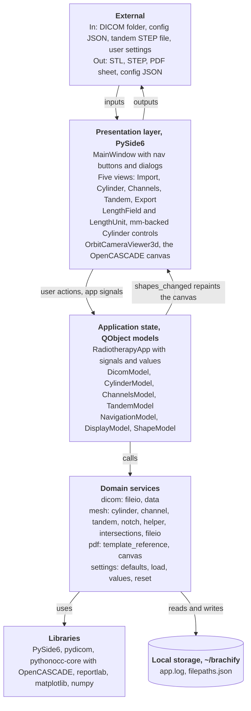
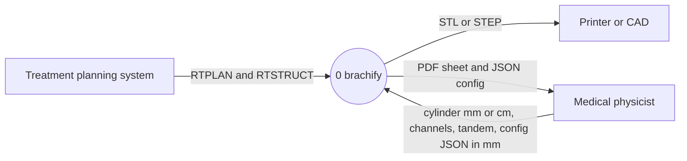
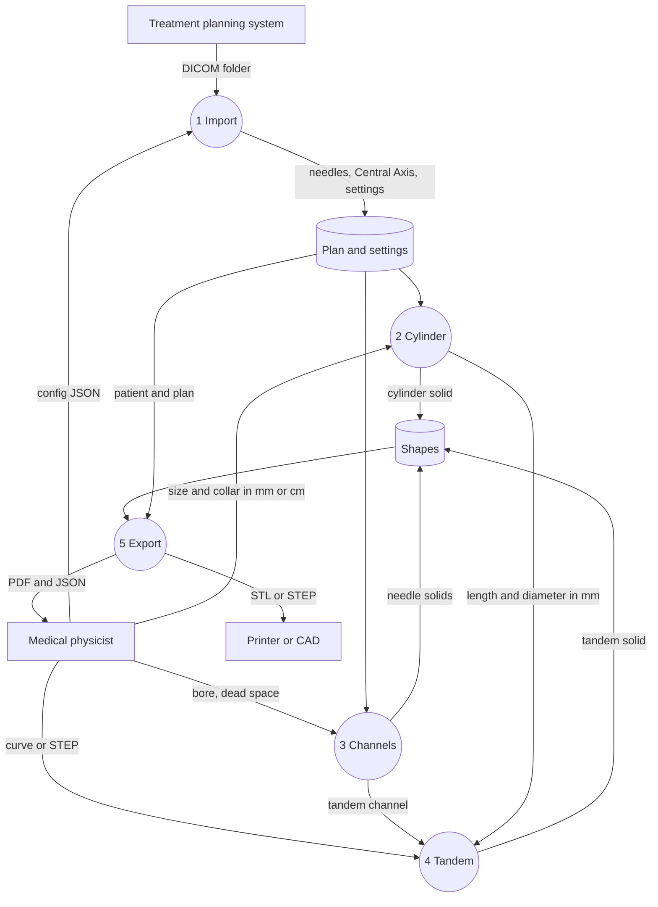

# Week 5, Ahab

_Individual log. One section per PR merged this week, each a copy of that PR's Part A. See
[docs/logs/README.md](../README.md)._

### For PR #**24**

- As part of requirement **FR-CN-02, cylinder property editing, with this PR adding display units**, the user needs to do **select mm or cm, edit diameter, length and collar, then Apply**.
- Therefore, I implemented/generated code so that **clinicians can use either unit while geometry and config remain in mm**.

#### Data Modeling and Integrity

- This data **Cylinder dimensions** is modeled as **mm floats retained by `LengthField`** because **display rounding must not change device dimensions**. We considered alternative models such as **reading spin boxes on every switch, rejected because 175.25 mm becomes 175 mm**.
- This data **Cylinder length** uses the input validation to ensure it adheres to **60–300 mm or 6–30 cm through scaled widget limits**.
- This data may be vulnerable to security issues — **N/A**, this PR adds no external input format.
- This data may be vulnerable to privacy issues — **N/A**, dimensions contain no patient identifiers.
- This data stores sensitive information and uses encryption — **N/A**, this PR adds no sensitive storage.
- The data has access controls — **N/A**, brachify has no user roles.

#### Backend

- The system uses **the existing view/model architecture** because **config reset must update the current Cylinder view**. Benefits for using this pattern include **unchanged mm models**. Possible risks include **display values mistaken for mm**.
  - To mitigate **unit confusion**, we implemented **`set_dimensions_mm` in the config reset path**.
  - We considered alternative solutions such as **saving the unit, rejected because the agreed choice is display only**.
- The system architecture diagram consists of the following major components: **views, state, domain services, libraries and local storage**. This structure has low coupling because **conversion stays in `LengthField`**. This structure has high cohesion because **each field owns one length control**. This design is scalable because **additional controls can reuse the same conversion seam**.

- The system uses a database — **N/A**, brachify has no database.
- The system uses **synchronous processing** because **Apply consumes the current controls**. This method is done by **Qt slots**. Benefits for using this approach include **immediate model updates**. Possible risks include **signal-driven rounding**.
  - To mitigate **rounding**, we implemented **`QSignalBlocker` for programmatic renders**.
  - We considered alternative solutions such as **reading the rounded widget, rejected by the precision test**.
- The system adopts a **stateful** approach to state management because **pending edits must survive switches**. This method is done by **retaining exact mm values per field**. Benefits for using this approach include **no rounding drift**. Possible risks include **stale cached edits**.
  - To mitigate **stale edits**, we implemented **`valueChanged` recording in mm**.
  - We considered alternative solutions such as **changing live settings on selection, rejected because selection must not Apply**.
- The Level 0 DFD consists of the following major components: **physicist, TPS, brachify and CAD/printer**. **Cylinder inputs may be mm or cm; config remains mm**.

- The Level 1 DFD consists of the following major processes: **Import, Cylinder, Channels, Tandem and Export**. **Cylinder converts cm before model/config updates**. **Out-of-range length input is clamped by the scaled widget before Apply**.

- The backend API must serve clients — **N/A**, brachify has no network API.
- The following traceability matrix shows the list of requirements completed in this milestone and their associated tests: **FR-CN-02 display-unit support → `tests/views/test_cylinder_view.py`, test PR #25**.
- By using a tool to check test coverage — **N/A**, coverage was not measured.

#### Frontend

- The frontend uses **mm values cached in four `LengthField` instances** received from the backend because **display precision differs between units**. Benefits for using this pattern include **preserving exact configuration values**. Possible risks include **programmatic mm writes to cm controls**.
  - To mitigate **wrong writes**, we implemented **`set_dimensions_mm` for model/config updates**.
- The frontend ensures only authorized users can access restricted pages — **N/A**, brachify has no login or restricted pages.
- The frontend is designed using **PySide6 and generated `.ui` layouts** with design components for **Cylinder controls**. Therefore, changing the design of **`cylinder_view.ui`** will automatically change the look and feel of all instances of that component throughout the system. Changes to the content will not affect the design because **conversion is in `length_field.py`**.
- The usability evaluation identified major problems — **N/A**, no formal usability evaluation was performed.
- The frontend adopts accessibility principles — **N/A**, no accessibility evaluation was performed.
- The following traceability matrix shows the list of requirements completed in this milestone and their associated tests: **FR-CN-02 display-unit support → all-four-fields, bounds and Apply integration cases in the test PR #25**.
- By using a tool to check test coverage — **N/A**, coverage was not measured.

#### Review and design

- When I reviewed the **config reset path** for this functionality, I noticed **direct mm writes become cm input when cm is selected**. Therefore, I did **route updates through `set_dimensions_mm`**.
- The PR does not contain any temporary workaround because **one reusable field adapter owns unit conversion and exact mm storage**.
- The changed field/view functions are **2–37 lines long; the inherited `resetAllValues` is 103 lines with one call changed, counted with Python AST; generated layout functions excluded**.
- I did **review the full diff and run anti-slop with no findings** to ensure that my feature contribution does not contain any of the following:
  - hardcoded values
  - duplicate code
  - dead code
  - unnecessary function calls
  - excessive conditional logic
  - deep nesting
  - high cyclomatic complexity
  - classes/modules/functions with many unrelated responsibilities
- This work is written in **`windows/length_field.py`, `cylinder_view.py`, its generated layout and `settings/reset.py`** because **conversion belongs at the widget boundary**.
- This work belongs in **Cylinder** in the DFD because **it converts clinician input into mm dimensions**.

#### Testing receipts

- The functionality works correctly because the happy path tests involving **cm display and Apply in `test_cylinder_view.py` (8 cases passed on the test PR #25)** passed.
- I wrote tests to cover abnormal situations involving **config reset before/after a cylinder and repeated unit switches** and they passed.
- I checked that these negative cases involving **wrong cm factor, wrong Apply conversion and rounded mm cache deliberately introduced during mutation checks** failed as expected.
- When I reviewed the **`cylinder_window` fixture**, I noticed **shared app signals could retain earlier windows**. Therefore, I did **disconnect navigation and height receivers during teardown**.
- Among these tests, **none** are unit tests and **all eight real widget/model cases** are integration tests.
- These tests are included in the directory **`tests/views/` on the test PR #25**.
- This new test PR did not break anything else in the system because **28 suite cases pass and Ahab supplied a cm GUI screenshot and Ex1 terminal output, recorded in [GUI evidence and terminal excerpt](https://raw.githubusercontent.com/COSC-499-W2026/capstone-project-team-10/6fc7159/docs/logs/ahab/evidence/cylinder-units-gui.md); the image is not archived, Ex2/tandem and Export after the edit remain visually unverified, and the existing `_key_map` bug appeared**.

---
