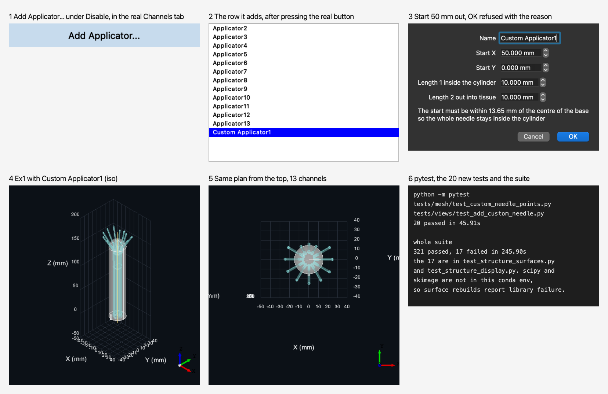
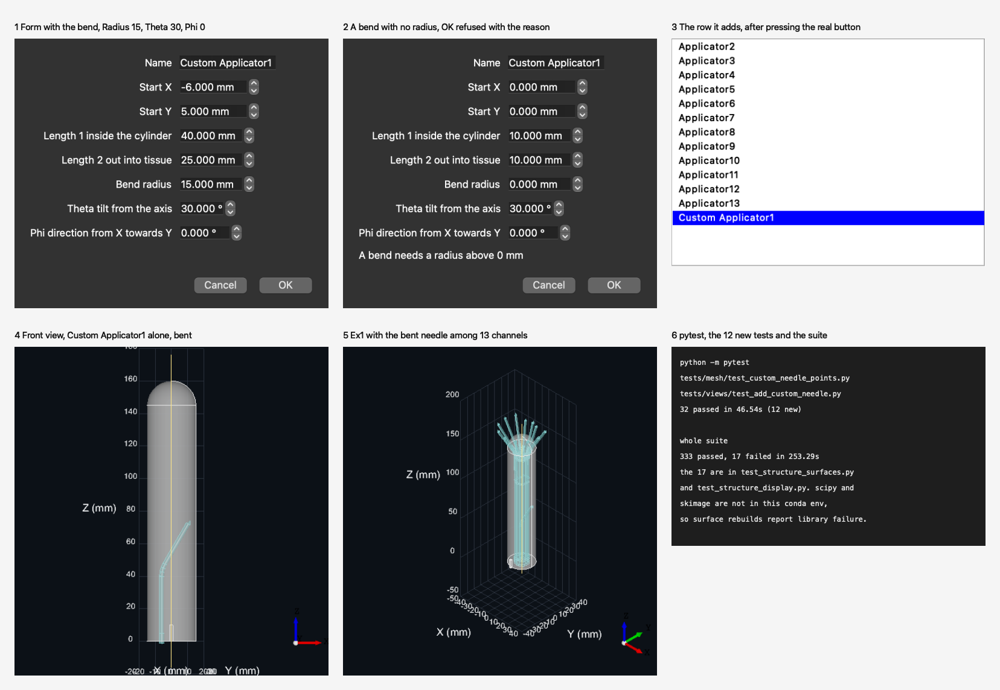
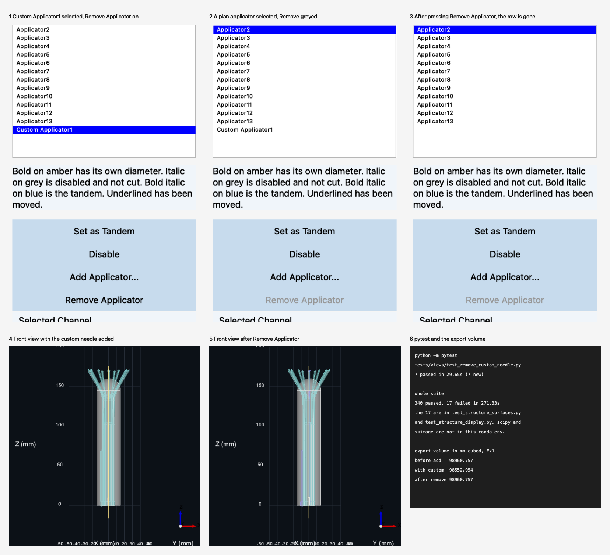
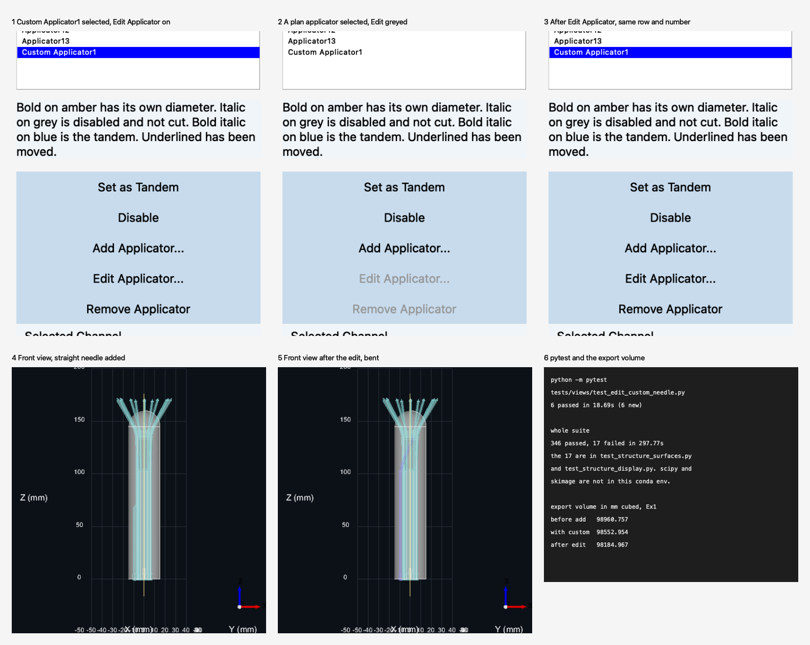
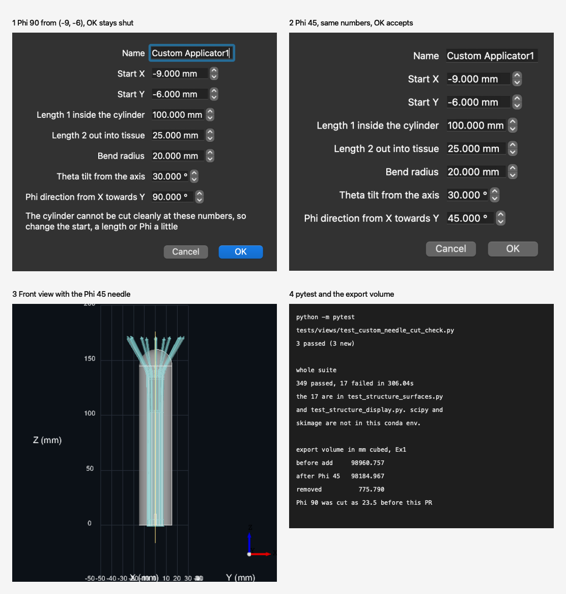

# Week 8, Ahab

_Individual log. One section per PR merged this week, each a copy of that PR's Part A. See
[docs/logs/README.md](../README.md)._

## Stack #184 to #199, at a glance

| PR | On | Closes | Adds | Own diff | New tests | Suite after |
|---|---|---|---|---|---|---|
| #184 | main | #112 | the straight custom applicator, its form and button | 9 files, 499 lines | 20 | 321 passed, 17 failed |
| #194 | #184 | #112 | the bend, with Bend radius, Theta and Phi | 8 files, 233 lines | 12 | 333 passed, 17 failed |
| #195 | #194 | #112 | Remove Applicator for custom applicators | 8 files, 395 lines | 7 | 340 passed, 17 failed |
| #198 | #195 | #112 | Edit Applicator for custom applicators | 9 files, 330 lines | 6 | 346 passed, 17 failed |
| #199 | #198 | #112 | a check that the export can cut a custom applicator | 8 files, 174 lines | 3 | 349 passed, 17 failed |

The 17 failures are in `test_structure_surfaces.py` and `test_structure_display.py`, and are the same in every PR, since `scipy` and `skimage` are not in this conda env.

### Shared by every PR in this stack

- The code quality checklist, for every PR in the stack: **no hardcoded values, duplicate code, dead code, unnecessary function calls, excessive conditional logic, deep nesting, high cyclomatic complexity, or classes, modules and functions with many unrelated responsibilities, checked with `anti_slop review --base <parent branch> src tests utils` and a line-by-line read of each diff**.
- Checks run on every PR: **`python docs/architecture/build.py --check` and `sh .claude/hooks/session-start.sh`, both exit 0**.
- Not applicable to any PR in the stack: **security, privacy, encryption, access controls (typed numbers, nothing stored); database, data processing, state management, backend API (unchanged or none); data caching, restricted pages, design components, usability evaluation; test coverage (no tool)**.

### For PR #**184**

- As part of requirement **FR-CN-01, create custom needles, and FR-CN-07, they reach the 3D export and the PDF**, the user needs to do **import Ex1, press Add Applicator..., type a name, a start on the base and two lengths, press OK, then export the STL and the PDF**.
- Therefore, I implemented/generated code so that **medical physicists can add a straight custom applicator that is listed, drawn, cut and put on the sheet like a plan needle**.

#### Data Modeling and Integrity

- This data **`CustomNeedleSpec`** is modeled as **a frozen dataclass of floats** because **the dialog, model and builder share one value that cannot change on the way**. We considered alternative models such as **a dict, which anti-slop bans for inward values**.
- This data **`CustomNeedleSpec`** uses the input validation to ensure it adheres to **finite numbers, lengths above 0 mm, Length 1 at most the cylinder length, a start within the radius less the needle radius, and a name not blank or repeated**.
- Not applicable: **security, privacy, encryption, access controls (typed numbers, nothing stored)**.

#### Backend

- The system architecture diagram consists of the following major components: **External, Presentation, Application state, Domain services, Libraries and Local storage**. This structure has low coupling because **the dialog reaches the rules only through `ChannelsModel.custom_needle_error`**. This structure has high cohesion because **`custom_needle_points` alone turns numbers into points**. This design is scalable because **the bend adds fields to the spec and one step to the builder**.

  **[System architecture (SVG), unchanged by this PR](https://github.com/COSC-499-W2026/capstone-project-team-10/blob/74b0d97b3381c4d7ecc1b4e2d9eedef3d0c3734b/docs/architecture/diagrams/system-architecture.svg)**
- The Level 0 DFD consists of the following major components: **medical physicist, treatment planning system, brachify and printer or CAD**. **A typed needle comes out in the STL and the PDF**.

  **[DFD level 0 (SVG), unchanged by this PR](https://github.com/COSC-499-W2026/capstone-project-team-10/blob/74b0d97b3381c4d7ecc1b4e2d9eedef3d0c3734b/docs/architecture/diagrams/existing-framework/dfd-0.svg)**
- The Level 1 DFD consists of the following major processes: **Import, Cylinder, Channels, Tandem and Export**. **Channels takes the numbers, ChannelsModel builds the points and the channel, and Export cuts it**. **A start 50 mm out raises `CustomNeedleError` and the dialog stays open showing the text (screenshot 1, panel 3)**.

  **[DFD level 1 (SVG), unchanged by this PR](https://github.com/COSC-499-W2026/capstone-project-team-10/blob/74b0d97b3381c4d7ecc1b4e2d9eedef3d0c3734b/docs/architecture/diagrams/existing-framework/dfd-1.svg)**
- The following traceability matrix shows the list of requirements completed in this milestone and their associated tests: **FR-CN-01 → `test_the_points_run_from_the_tissue_end_down_to_the_base`, `test_add_applicator_offers_the_first_free_name_and_adds_a_row_and_cancel_adds_nothing`; FR-CN-07 → `test_the_export_cut_removes_the_new_needle_from_the_cylinder`, `test_the_reference_sheet_lists_the_new_applicator_with_its_own_number`**
- Not applicable: **architectural pattern, database, data processing, state management, backend API (unchanged or none), test coverage (no tool)**.

#### Frontend

- The frontend adopts accessibility principle **WCAG 3.3.1, Error Identification**. The aspects that demonstrate this principle in the system include **a refused start is explained in words under the fields, with no colour needed (screenshot 1, panel 3)**.
- Not applicable: **data caching, restricted pages, design components, usability evaluation, traceability matrix (in Backend), test coverage (none)**.

#### Review and design

- When I reviewed the **new button's route through the `.ui`**, I noticed **it made the PR 10 files and over 500 lines with the regenerated `channels_view_ui.py`**. Therefore, I did **build the button in `ChannelsView.__init__` and leave the `.ui` alone**.
- The PR does not contain any temporary workaround because **the only gap, no bend yet, is the next PR's scope and every refusal is real**.
- The PR only contains small functions that are **at most 24 lines (`AddApplicatorDialog.__init__`)** long.
- I did **`anti_slop review --base main src tests utils` (three `shape` name warnings that AGENTS.md rule 6 says to ignore) and a line-by-line read of the diff** to ensure that my feature contribution does not contain any of the following:
  - hardcoded values
  - duplicate code
  - dead code
  - unnecessary function calls
  - excessive conditional logic
  - deep nesting
  - high cyclomatic complexity
  - classes/modules/functions with many unrelated responsibilities
- This work is written in **`helper.py`, `channels_model.py` and `channels_view.py`** because **a new module needs the architecture diagram redrawn, and these hold the geometry helpers, channel state and Channels tab**.
- This work belongs in **3 Channels** in the DFD because **it is another way to create a channel**.

#### Testing receipts

- The functionality works correctly because the happy path tests involving **`test_an_added_applicator_is_visible_and_its_solid_opens_through_the_base`, `test_the_export_cut_removes_the_new_needle_from_the_cylinder` and `test_the_reference_sheet_lists_the_new_applicator_with_its_own_number` (20 new)** passed.
- I wrote tests to cover abnormal situations involving **a blank or imported name, no plan, a length change after adding, and Cancel** and they passed.
- I checked that these negative cases involving **four deliberate breaks (points reversed, height offset dropped, a repeated name allowed, the dialog closing on bad numbers)** failed as expected.
- Among these tests, **the 10 in `test_custom_needle_points.py`** are unit tests and **the 10 in `test_add_custom_needle.py`** are integration tests through the real window.
- These tests are included in the directory **`tests/mesh/` and `tests/views/`**.
- This new test PR did not break anything else in the system because **`python -m pytest` (321 passed, 17 failed, all in the structure surface tests with library failure, since `scipy` and `skimage` are not in the conda env), `build.py --check` and `session-start.sh` (exit 0), and brachify run on macOS with Ex1, driven by a script that pressed the real button, then an STL and a PDF exported (screenshot 1, whose panel 6 is the pytest result text drawn from the real output)**.

  

- Not applicable: **generated-test review (no problem found)**.

### For PR #**194** (2 of 5, on #184)

- As part of requirement **FR-CN-01, create custom needles with a bend**, the user needs to do **import Ex1, press Add Applicator..., type a start, two lengths, a bend radius, Theta and Phi, press OK, then export the STL and the PDF**.
- Therefore, I implemented/generated code so that **medical physicists can add a custom applicator that runs straight up, turns by Theta towards Phi along an arc, and runs on into tissue**.

#### Data Modeling and Integrity

- This data **`CustomNeedleSpec`** is modeled as **#184's frozen dataclass with `radius`, `theta` and `phi` added, each defaulting to 0 so a straight needle is unchanged** because **one value still travels from the form to the builder**. We considered alternative models such as **a separate bend class, which would give the dialog and model a second value to carry**.
- This data **`CustomNeedleSpec`** uses the input validation to ensure it adheres to **finite numbers, Theta from 0 to 89 degrees, and a radius above 0 mm whenever Theta is above 0**.
- Not applicable: **see Shared**.

#### Backend

- The system architecture diagram consists of the following major components: **as in #184**. This structure has low coupling because **the form still reaches the rules only through `ChannelsModel.custom_needle_error`**. This structure has high cohesion because **`bent_needle_points` alone makes the arc**. This design is scalable because **a new bend field is one more spec field and one more step in that function**.

  **[System architecture (SVG), unchanged by this PR](https://github.com/COSC-499-W2026/capstone-project-team-10/blob/74b0d97b3381c4d7ecc1b4e2d9eedef3d0c3734b/docs/architecture/diagrams/system-architecture.svg)**
- The Level 0 DFD consists of the following major components: **as in #184**. **A bent needle comes out in the STL and the PDF**.

  **[DFD level 0 (SVG), unchanged by this PR](https://github.com/COSC-499-W2026/capstone-project-team-10/blob/74b0d97b3381c4d7ecc1b4e2d9eedef3d0c3734b/docs/architecture/diagrams/existing-framework/dfd-0.svg)**
- The Level 1 DFD consists of the following major processes: **as in #184**. **A bend with no radius raises `CustomNeedleError` and the form stays open showing the text (screenshot 1, panel 2)**.

  **[DFD level 1 (SVG), unchanged by this PR](https://github.com/COSC-499-W2026/capstone-project-team-10/blob/74b0d97b3381c4d7ecc1b4e2d9eedef3d0c3734b/docs/architecture/diagrams/existing-framework/dfd-1.svg)**
- The following traceability matrix shows the list of requirements completed in this milestone and their associated tests: **FR-CN-01 → `test_a_bend_turns_the_needle_by_theta_towards_phi_after_a_radius_arc`, `test_a_bend_is_sampled_along_the_arc_from_the_joint_to_the_arc_end`, `test_a_bent_applicator_solid_reaches_sideways_to_where_the_bend_sends_it`**
- Not applicable: **see Shared**.

#### Frontend

- The frontend adopts accessibility principle **WCAG 3.3.1, Error Identification**. The aspects that demonstrate this principle in the system include **a bend with no radius is explained in words under the fields, with no colour needed (screenshot 1, panel 2)**.
- Not applicable: **see Shared, and traceability matrix (in Backend)**.

#### Review and design

- When I reviewed **my first bend, sampled every 10 degrees and tested at 90 degrees**, I noticed **`rounded_channel` opens its modal error box when the last pipe is exactly flat, which stalled the offscreen test and would show a clinician an error box**. Therefore, I did **stop Theta at 89 degrees and record the trap in §7.6, rather than change inherited channel code in this PR**.
- The PR contains one limit that works around inherited code, because **Theta stops at 89 since `rounded_channel` cannot build a flat last pipe (§7.6)**.
- The PR only contains small functions that are **at most 28 lines (`AddApplicatorDialog.__init__`)** long. The two it adds or splits are **19 lines (`custom_needle_points`) and 11 lines (`bent_needle_points`)**.
- I did **`anti_slop review --base feat/custom-needle-straight src tests utils` (no findings) and a line-by-line read of the diff** to ensure that my feature contribution does not contain any of the following: **see Shared**.
- This work is written in **`helper.py` and `channels_view.py`** because **#184 put the builder and the form there, and a new module needs the architecture diagram redrawn**.
- This work belongs in **3 Channels** in the DFD because **it is another way to create a channel**.

#### Testing receipts

- The functionality works correctly because the happy path tests involving **`test_a_bend_turns_the_needle_by_theta_towards_phi_after_a_radius_arc` and `test_a_bent_applicator_solid_reaches_sideways_to_where_the_bend_sends_it` (12 new; 21 in `test_custom_needle_points.py` and 11 in `test_add_custom_needle.py`)** passed.
- I wrote tests to cover abnormal situations involving **a Theta of 90 or below 0, NaN, a bend with no radius, an infinite Phi, and Theta 0 with a radius left in the form** and they passed.
- I checked that these negative cases involving **two deliberate breaks (Phi measured from +Y, the arc cut to one chord)** failed as expected.
- Among these tests, **the 11 new in `test_custom_needle_points.py`** are unit tests and **the 1 new in `test_add_custom_needle.py`** is an integration test through the real window.
- These tests are included in the directory **`tests/mesh/` and `tests/views/`**.
- This new test PR did not break anything else in the system because **`python -m pytest` (333 passed, 321 after #184, 17 failed, all in the structure surface tests with library failure, since `scipy` and `skimage` are not in the conda env), and brachify run on macOS with Ex1, driven by a script that pressed the real button, then an STL (2.1 MB) and a PDF (45 KB) exported (screenshot 1, whose panel 6 is the pytest result text drawn from the real output)**.

  

- Not applicable: **generated-test review (no problem found)**.

### For PR #**195** (3 of 5, on #194)

- As part of requirement **FR-CN-01, create custom needles, and edit or remove them**, the user needs to do **select a custom applicator on the Channels tab, press Remove Applicator, then export the STL and the PDF**.
- Therefore, I implemented/generated code so that **medical physicists can delete a custom applicator they added, and the export no longer cuts it**.

#### Data Modeling and Integrity

- This data **`ChannelsModel.custom_specs`** is modeled as **a dict from label to `CustomNeedleSpec`, filled when an applicator is added and cleared with a new plan** because **a plan channel has no spec, so the dict is also the record of which channels are custom, and the Edit PR needs the numbers back**. We considered alternative models such as **a flag on `NeedleChannel`, which would add a field to inherited geometry code for a UI rule**.
- This data **`custom_specs`** uses the input validation to ensure it adheres to **only a custom applicator being removable, and never the one that is the tandem**.
- Not applicable: **see Shared**.

#### Backend

- The system architecture diagram consists of the following major components: **as in #184**. This structure has low coupling because **the view only calls `remove_custom_needle` and reads `is_custom_needle`**. This structure has high cohesion because **removal clears a label from every list that holds it in one method**. This design is scalable because **a new list that keys on a label is one more line in that method**.

  **[System architecture (SVG), unchanged by this PR](https://github.com/COSC-499-W2026/capstone-project-team-10/blob/74b0d97b3381c4d7ecc1b4e2d9eedef3d0c3734b/docs/architecture/diagrams/system-architecture.svg)**
- The Level 0 DFD consists of the following major components: **as in #184**. **A removed needle is no longer in the STL or the PDF**.

  **[DFD level 0 (SVG), unchanged by this PR](https://github.com/COSC-499-W2026/capstone-project-team-10/blob/74b0d97b3381c4d7ecc1b4e2d9eedef3d0c3734b/docs/architecture/diagrams/existing-framework/dfd-0.svg)**
- The Level 1 DFD consists of the following major processes: **as in #184**. **Channels deletes the channel, so Export cuts one hole fewer, and the export volume returns to 98960.757 mm cubed (screenshot 1, panel 6)**.

  **[DFD level 1 (SVG), unchanged by this PR](https://github.com/COSC-499-W2026/capstone-project-team-10/blob/74b0d97b3381c4d7ecc1b4e2d9eedef3d0c3734b/docs/architecture/diagrams/existing-framework/dfd-1.svg)**
- The following traceability matrix shows the list of requirements completed in this milestone and their associated tests: **FR-CN-01 → `test_removing_a_custom_applicator_puts_the_export_cut_back_as_it_was`, `test_the_remove_button_takes_the_selected_applicator_out_of_the_model_and_the_list`, `test_a_plan_applicator_cannot_be_removed_and_nothing_changes`**
- Not applicable: **see Shared**.

#### Frontend

- The frontend adopts accessibility principle **WCAG 4.1.2, Name, Role, Value**. The aspects that demonstrate this principle in the system include **Remove Applicator is really disabled with `setEnabled`, and now greyed too, for a plan applicator and the tandem (screenshot 1, panels 2 and 3). I did not run a screen reader**.
- Not applicable: **see Shared, and traceability matrix (in Backend)**.

#### Review and design

- When I reviewed **my first screenshot of the button**, I noticed **Remove looked on while it was off, because the style copied from Disable has no disabled rule**. Therefore, I did **add a disabled rule in `make_applicator_button`, with a test, which also fixes Add Applicator... without a plan**.
- The PR contains one gap, because **Remove has no confirmation and no undo, so a deleted needle is re-added by hand**.
- The PR only contains small functions that are **at most 28 lines (`AddApplicatorDialog.__init__`, moved unchanged)** long. The ones it adds are **11 lines (`remove_custom_needle`) and 7 lines (`make_applicator_button`)**.
- I did **`anti_slop review --base feat/custom-needle-bend src tests utils` (no findings) and a line-by-line read of the diff** to ensure that my feature contribution does not contain any of the following: **see Shared**.
- This work is written in **`channels_model.py`, `channels_view.py` and a new `add_applicator_dialog.py`** because **`channels_view.py` was at 499 lines, and the new file is not a `*_view.py` and adds no layer, so the diagram check passes without a redraw**.
- This work belongs in **3 Channels** in the DFD because **it deletes a channel**.

#### Testing receipts

- The functionality works correctly because the happy path tests involving **`test_removing_a_custom_applicator_puts_the_export_cut_back_as_it_was` and `test_the_remove_button_takes_the_selected_applicator_out_of_the_model_and_the_list` (7 new; 7 in `test_remove_custom_needle.py`)** passed.
- I wrote tests to cover abnormal situations involving **a plan applicator, the tandem, a disabled and selected applicator with its own diameter, and a new import** and they passed.
- I checked that these negative cases involving **two deliberate breaks (own diameter kept after removal, Remove left on for the tandem)** failed as expected, and **the disabled look assertion failed before its code**.
- Among these tests, **none are pure unit tests** and **all 7** are integration tests through the real window.
- These tests are included in the directory **`tests/views/`**.
- This new test PR did not break anything else in the system because **`python -m pytest` (340 passed, 333 after #194, 17 failed, all in the structure surface tests with library failure, since `scipy` and `skimage` are not in the conda env), and brachify run on macOS with Ex1, driven by a script that pressed the real Remove button and measured the export (screenshot 1, whose panel 6 is the pytest result and the volumes drawn from the real output)**.

  

- Not applicable: **generated-test review (no problem found)**.

### For PR #**198** (4 of 5, on #195)

- As part of requirement **FR-CN-01, create custom needles, and edit or remove them**, the user needs to do **select a custom applicator on the Channels tab, press Edit Applicator..., change its numbers, then export the STL and the PDF**.
- Therefore, I implemented/generated code so that **medical physicists can change a custom applicator they added without deleting it, keeping its number, place, diameter, disabled state and move**.

#### Data Modeling and Integrity

- This data **`ChannelsModel.custom_specs`** is modeled as **the same dict from label to `CustomNeedleSpec` that #195 added, now read by the Edit form and replaced on each edit** because **the form must show the numbers the needle was built from, and a needle cannot give them back**. We considered alternative models such as **reading the numbers back from the needle's points, which loses Radius, Theta and Phi**.
- This data **`edit_custom_needle`** uses the input validation to ensure it adheres to **only a custom applicator being editable, its own name not counting as a repeat, and the same number rules as Add, checked before anything changes**.
- Not applicable: **see Shared**.

#### Backend

- The system architecture diagram consists of the following major components: **as in #184**. This structure has low coupling because **the view calls `edit_custom_needle` and hands the form a check function, so the form never reads the model**. This structure has high cohesion because **Add and Edit share `check_custom_needle` and `make_custom_needle`, so one rule set builds both**. This design is scalable because **a new number on the form is one field and one line in the spec**.

  **[System architecture (SVG), unchanged by this PR](https://github.com/COSC-499-W2026/capstone-project-team-10/blob/74b0d97b3381c4d7ecc1b4e2d9eedef3d0c3734b/docs/architecture/diagrams/system-architecture.svg)**
- The Level 0 DFD consists of the following major components: **as in #184**. **An edited needle comes out changed in the STL and the PDF**.

  **[DFD level 0 (SVG), unchanged by this PR](https://github.com/COSC-499-W2026/capstone-project-team-10/blob/74b0d97b3381c4d7ecc1b4e2d9eedef3d0c3734b/docs/architecture/diagrams/existing-framework/dfd-0.svg)**
- The Level 1 DFD consists of the following major processes: **as in #184**. **Channels rebuilds the channel, so Export cuts a different hole, and the export volume moves from 98552.954 to 98184.967 mm cubed (screenshot 1, panel 6)**.

  **[DFD level 1 (SVG), unchanged by this PR](https://github.com/COSC-499-W2026/capstone-project-team-10/blob/74b0d97b3381c4d7ecc1b4e2d9eedef3d0c3734b/docs/architecture/diagrams/existing-framework/dfd-1.svg)**
- The following traceability matrix shows the list of requirements completed in this milestone and their associated tests: **FR-CN-01 → `test_editing_rebuilds_the_needle_but_keeps_its_name_number_place_diameter_and_disabled_state`, `test_the_edit_button_offers_the_current_numbers_applies_the_answer_and_cancel_changes_nothing`, `test_an_edit_with_bad_numbers_is_refused_and_the_needle_is_left_as_it_was`**
- Not applicable: **see Shared**.

#### Frontend

- The frontend adopts accessibility principle **WCAG 4.1.2, Name, Role, Value**. The aspects that demonstrate this principle in the system include **Edit Applicator... is really disabled with `setEnabled` and greyed for a plan applicator (screenshot 1, panel 2), and the name on the form is disabled so it cannot be typed over. I did not run a screen reader**.
- Not applicable: **see Shared, and traceability matrix (in Backend)**.

#### Review and design

- When I reviewed **my first driven run of the real Edit button**, I noticed **the export volume barely moved, 23.5 mm cubed removed where about 800 was expected**. Therefore, I did **probe the cut: the solid is valid, but `BRepAlgoAPI_Cut` returns a warning for that one start and direction (Phi 90 from (-9, -6)) and the other seven directions cut cleanly. I wrote it in §7.6 and used a Phi of 45 for the screenshot, so the screenshot does not show the failing case**.
- The PR contains one gap, because **a bent needle can still fail the cut at some numbers with no message, which the next PR in the stack is for**.
- The PR only contains small functions that are **at most 30 lines (`AddApplicatorDialog.__init__`, 2 more than before)** long. The ones it adds are **13 lines (`edit_custom_needle`), 6 lines (`action_edit_applicator`) and 5 lines (`make_custom_needle`)**.
- I did **`anti_slop review --base feat/custom-needle-remove src tests utils` (no findings) and a line-by-line read of the diff** to ensure that my feature contribution does not contain any of the following: **see Shared**.
- This work is written in **`channels_model.py`, `channels_view.py` and `add_applicator_dialog.py`** because **the model rules, the button and the form are already there, so no new file or layer is added and the diagram check passes without a redraw**.
- This work belongs in **3 Channels** in the DFD because **it rebuilds a channel**.

#### Testing receipts

- The functionality works correctly because the happy path tests involving **`test_editing_rebuilds_the_needle_but_keeps_its_name_number_place_diameter_and_disabled_state` and `test_the_edit_button_offers_the_current_numbers_applies_the_answer_and_cancel_changes_nothing` (6 new; 6 in `test_edit_custom_needle.py`)** passed.
- I wrote tests to cover abnormal situations involving **a plan applicator, bad numbers, Cancel, and a bent spec on the form** and they passed.
- I checked that these negative cases involving **two deliberate breaks (the move dropped on edit, the edit checked without its own name allowed)** failed as expected, and **all 6 tests failed before their code**.
- Among these tests, **none are pure unit tests** and **all 6** are integration tests through the real window.
- These tests are included in the directory **`tests/views/`**.
- This new test PR did not break anything else in the system because **`python -m pytest` (346 passed, 340 after #195, 17 failed, all in the structure surface tests with library failure, since `scipy` and `skimage` are not in the conda env), and brachify run on macOS with Ex1, driven by a script that pressed the real Edit button and measured the export (screenshot 1, whose panel 6 is the pytest result and the volumes drawn from the real output)**.

  

- Not applicable: **generated-test review (no problem found)**.

### For PR #**199** (5 of 5, on #198)

- As part of requirement **FR-CN-01, create custom needles, and FR-CN-07, they reach the 3D export**, the user needs to do **type the numbers of a custom applicator on the Channels tab and get a printed channel exactly where they placed it**.
- Therefore, I implemented/generated code so that **medical physicists are told in the form when the numbers they typed would print a cylinder with no channel, instead of finding out on the printed device**.

#### Data Modeling and Integrity

- This data **`cut_is_clean(solid, tool)`** is modeled as **a function returning a bool from `BRepAlgoAPI_Cut`'s own error and warning flags** because **OpenCASCADE already says whether a cut is trustworthy, so the check adds no second measure of volume**. We considered alternative models such as **comparing the volume removed with the needle's volume, which needs a second boolean that can fail the same way**.
- This data **`check_custom_needle`** uses the input validation to ensure it adheres to **the earlier rules and now also a channel that cuts cleanly out of the bare cylinder, for an add, an edit and the form's OK**.
- Not applicable: **see Shared**.

#### Backend

- The system architecture diagram consists of the following major components: **as in #184**. This structure has low coupling because **the check is one call from `ChannelsModel` to a function in `mesh/helper.py`, the layer that already holds the geometry rules**. This structure has high cohesion because **every rule that refuses numbers is still in `check_custom_needle`**. This design is scalable because **a new rule is one more refusal in that method, and the form shows it with no change**.

  **[System architecture (SVG), unchanged by this PR](https://github.com/COSC-499-W2026/capstone-project-team-10/blob/74b0d97b3381c4d7ecc1b4e2d9eedef3d0c3734b/docs/architecture/diagrams/system-architecture.svg)**
- The Level 0 DFD consists of the following major components: **as in #184**. **A custom needle that would not be cut never reaches the STL or the PDF**.

  **[DFD level 0 (SVG), unchanged by this PR](https://github.com/COSC-499-W2026/capstone-project-team-10/blob/74b0d97b3381c4d7ecc1b4e2d9eedef3d0c3734b/docs/architecture/diagrams/existing-framework/dfd-0.svg)**
- The Level 1 DFD consists of the following major processes: **as in #184**. **Channels tries the cut before it keeps a channel, so Export only receives channels it can cut. The Phi 45 needle removes 775.790 mm cubed in the export (screenshot 1, panel 4)**.

  **[DFD level 1 (SVG), unchanged by this PR](https://github.com/COSC-499-W2026/capstone-project-team-10/blob/74b0d97b3381c4d7ecc1b4e2d9eedef3d0c3734b/docs/architecture/diagrams/existing-framework/dfd-1.svg)**
- The following traceability matrix shows the list of requirements completed in this milestone and their associated tests: **FR-CN-07 → `test_numbers_the_export_cannot_cut_are_refused_in_plain_text_and_change_nothing`, `test_the_same_bend_towards_another_direction_is_accepted_and_the_export_loses_its_volume`**
- Not applicable: **see Shared**.

#### Frontend

- The frontend adopts accessibility principle **WCAG 3.3.3, Error Suggestion**. The aspects that demonstrate this principle in the system include **the form stays open and says what to change, the start, a length or Phi, in words with no colon or em dash (screenshot 1, panel 1). I did not run a screen reader**.
- Not applicable: **see Shared, and traceability matrix (in Backend)**.

#### Review and design

- When I reviewed **what the Edit PR's real run showed**, I noticed **a bent needle removed 23.5 mm cubed from the export where about 800 was expected**. Therefore, I did **make the model refuse such numbers, and the screenshot shows the same numbers refused and then accepted with Phi 45**.
- The PR contains gaps, because **the check cuts the bare cylinder and not the whole export, so a cut that only fails after the other channels are cut is not caught, and the failing numbers were found by probe with pythonocc 7.7.2 and so may change with the version. OK and Add each run the check, so a needle is built twice, and a probe of six needles before the check took 0.1 to 1.5 s each**.
- The PR only contains small functions that are **at most 18 lines (`check_custom_needle`, 3 more than before)** long. The one it adds is **7 lines (`cut_is_clean`)**.
- I did **`anti_slop review --base feat/custom-needle-edit src tests utils` (no findings) and a line-by-line read of the diff** to ensure that my feature contribution does not contain any of the following: **see Shared**.
- This work is written in **`mesh/helper.py` and `channels_model.py`** because **the geometry check belongs with the mesh helpers and the refusal with the model's other refusals, so no new file or layer is added and the diagram check passes without a redraw**.
- This work belongs in **3 Channels** in the DFD because **it decides whether a channel is kept**.

#### Testing receipts

- The functionality works correctly because the happy path tests involving **`test_the_same_bend_towards_another_direction_is_accepted_and_the_export_loses_its_volume` (3 new; 3 in `test_custom_needle_cut_check.py`)** passed.
- I wrote tests to cover abnormal situations involving **an add and an edit with numbers that cannot be cut, and the form's OK** and they passed.
- I checked that these negative cases involving **two deliberate breaks (`cut_is_clean` always true, which failed 2 tests, and always false, which failed 2)** failed as expected, and **all 3 tests failed before their code, one of them also because the shared window kept a needle from an earlier test, which I fixed by removing it in the test**.
- Among these tests, **none are pure unit tests** and **all 3** are integration tests through the real window.
- These tests are included in the directory **`tests/views/`**.
- This new test PR did not break anything else in the system because **`python -m pytest` (349 passed, 346 after #198, 17 failed, all in the structure surface tests with library failure, since `scipy` and `skimage` are not in the conda env), and brachify run on macOS with Ex1, driven by a script that filled the real Add form and measured the export (screenshot 1, whose panel 4 is the pytest result and the volumes drawn from the real output)**.

  

- Not applicable: **generated-test review (no problem found)**.
