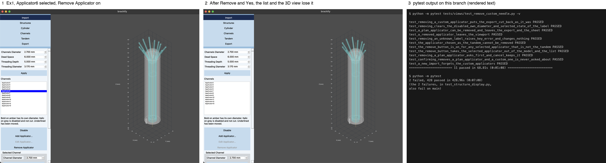
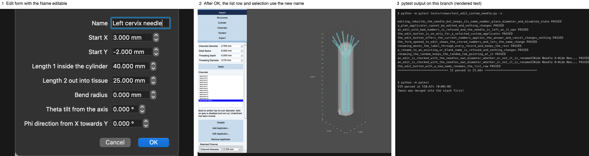
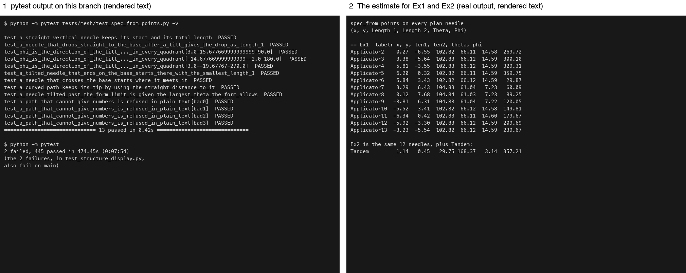
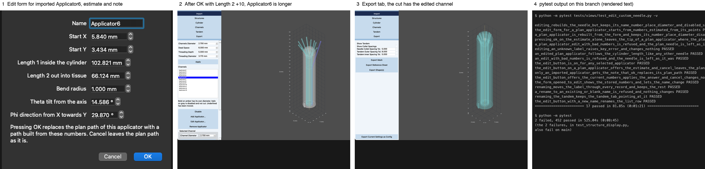

# Week 9, Ahab

_Individual log. One section per PR merged this week, each a copy of that PR's Part A. See
[docs/logs/README.md](../README.md)._

## Stack #238 to #242, at a glance

Four stacked PRs for issue #156, edit and remove any applicator, imported or custom. Each PR is
based on the one above it and is retargeted to `main` once its parent merges. A row's counts are
**that PR's own diff only**. Everything in earlier rows is inherited, not repeated.

| PR | On | Closes | Adds | Own diff | New tests | Suite after |
|---|---|---|---|---|---|---|
| [#238](https://github.com/COSC-499-W2026/capstone-project-team-10/pull/238) | main | #156 | Remove Applicator for any applicator, a question for an imported one, and a removed one leaves the 3D view | 8 files, 242 lines | 5 (11 in the file) | 513 passed |
| [#239](https://github.com/COSC-499-W2026/capstone-project-team-10/pull/239) | #238 | #156 | an editable Name in the Edit form, moved through every record, the tandem included | 7 files, 219 lines | 6 (12 in the file) | 519 passed |
| [#241](https://github.com/COSC-499-W2026/capstone-project-team-10/pull/241) | #239 | #156 | `spec_from_points`, the estimate of a plan needle's form numbers (nothing calls it yet) | 6 files, 209 lines | 13 (13 in the file) | 532 passed |
| [#242](https://github.com/COSC-499-W2026/capstone-project-team-10/pull/242) | #241 | #156 | Edit Applicator... for any applicator, imported or custom, with the estimate and a note | 9 files, 376 lines | 8 (20 in the file) | 540 passed |

After `main` was merged into #238, no test fails. `main` has 509 tests, and each row's suite total counts that PR and the ones below it.

### Shared by every PR in this stack

- The code quality checklist, for every PR in the stack: **no hardcoded values, duplicate code, dead code, unnecessary function calls, excessive conditional logic, deep nesting, high cyclomatic complexity, or classes, modules and functions with many unrelated responsibilities, checked with `anti_slop review --base <parent branch> src tests utils` and a line-by-line read of each diff**.
- Checks run on every PR: **`python docs/architecture/build.py --check` and `sh .claude/hooks/session-start.sh`, both exit 0**.
- Not applicable to any PR in the stack: **security, privacy, encryption, access controls (typed numbers, nothing stored); architectural pattern, database, data processing, state management, backend API (unchanged or none); data caching, restricted pages, design components, usability evaluation; test coverage (no tool)**.

### For PR #**238** (1 of 4, on main)

- As part of requirement **FR-CN-03, remove needles, and FR-CN-07, a removed needle is left out of the 3D export and the PDF**, the user needs to do **import Ex1, select Applicator6 on the Channels tab, press Remove Applicator, answer Yes, then export the STL and the PDF**.
- Therefore, I implemented/generated code so that **medical physicists can delete any applicator, imported or custom, with a question first for an imported one, and see it gone from the list, the 3D view, the export cut and the PDF**.

#### Backend

- The system architecture diagram consists of the following major components: **unchanged (`ChannelsModel` removes, `ChannelsView` asks and calls it, `DisplayModel` drops the shape)**. This structure has low coupling because **the view only calls `remove_channel` and the `confirm_remove` seam**. This structure has high cohesion because **`remove_channel` clears a label from every record that holds it in one method**. This design is scalable because **a new label-keyed record is one more line in that method (the viewport was missed, see Review and design)**.

  **[System architecture (SVG), unchanged by this PR](https://github.com/COSC-499-W2026/capstone-project-team-10/blob/6fa56b753644a6013574760d5a07f3f1c42581d3/docs/architecture/diagrams/system-architecture.svg)**
- The Level 0 DFD consists of the following major components: **unchanged**. **A removed needle is no longer in the STL or the PDF, which both read `get_visible_channels`**.

  **[DFD level 0 (SVG), unchanged by this PR](https://github.com/COSC-499-W2026/capstone-project-team-10/blob/6fa56b753644a6013574760d5a07f3f1c42581d3/docs/architecture/existing-framework/dfd-0.svg)**
- The Level 1 DFD consists of the following major processes: **unchanged**. **Channels deletes the channel and its shape, so Export cuts one hole fewer and the 3D view draws one needle fewer (screenshot 1)**.

  **[DFD level 1 (SVG), unchanged by this PR](https://github.com/COSC-499-W2026/capstone-project-team-10/blob/6fa56b753644a6013574760d5a07f3f1c42581d3/docs/architecture/existing-framework/dfd-1.svg)**
- The following traceability matrix shows the list of requirements completed in this milestone and their associated tests: **FR-CN-03 → `test_a_plan_applicator_can_be_removed_and_leaves_the_export_and_the_sheet`, `test_removing_a_plan_applicator_asks_first_and_cancel_keeps_it`; FR-CN-07 → `test_a_removed_applicator_leaves_the_viewport`, `test_removing_a_custom_applicator_puts_the_export_cut_back_as_it_was`**
- Not applicable: **see Shared**.

#### Frontend

- The frontend adopts accessibility principle **WCAG 3.3.4, Error Prevention**. The aspects that demonstrate this principle in the system include **a plan applicator, which only importing again brings back, asks before it is removed, and Remove Applicator is greyed with nothing selected and for the tandem (screenshot 1). I did not run a screen reader**.
- Not applicable: **see Shared, and traceability matrix (in Backend)**.

#### Review and design

- When I reviewed **my screenshot of Ex1 after pressing Remove**, I noticed **the removed needle was still drawn, in the selected colour, because `DisplayModel.add_shapes` never drops a shape, so every removal, custom ones too, left a ghost in the 3D view that the export and the list did not have**. Therefore, I did **call `DisplayModel.remove_shape` in `remove_channel`, with `test_a_removed_applicator_leaves_the_viewport`, which failed first, and record it as §7.25**.
- The PR does not contain any temporary workaround because **it replaces `remove_custom_needle` outright and keeps no alias**.
- The PR only contains small functions that are **14 lines (`remove_channel`), 5 lines (`action_remove_applicator`) and 3 lines (`ask_remove_plan_needle`)** long.
- I did **`anti_slop review --base main src tests utils` (0 blocking) and a line-by-line read of the diff** to ensure that my feature contribution does not contain any of the following: **see Shared**.
- This work is written in **`channels_model.py` and `channels_view.py`** because **the rule is the model's and the question is the view's, through a `confirm_remove` seam like `ask_needle`, so a test answers it without a dialog**.
- This work belongs in **3 Channels** in the DFD because **it deletes a channel**.

#### Testing receipts

- The functionality works correctly because the happy path tests involving **`test_a_plan_applicator_can_be_removed_and_leaves_the_export_and_the_sheet`, `test_a_removed_applicator_leaves_the_viewport`, `test_confirming_removes_a_plan_applicator_and_a_custom_one_is_never_asked_about` and `test_the_remove_button_is_on_for_any_selected_applicator_that_is_not_the_tandem` (5 new; 11 in `test_remove_custom_needle.py`)** passed.
- I wrote tests to cover abnormal situations involving **an unknown label (`KeyError`), the tandem, a disabled, selected applicator with its own diameter, and answering No** and they passed.
- I checked that these negative cases involving **skipping the confirm (`test_removing_a_plan_applicator_asks_first_and_cancel_keeps_it` failed) and leaving the shape in the display model (`test_a_removed_applicator_leaves_the_viewport` failed with the label still in `displaymodel.shapes`)** failed as expected.
- Among these tests, **none are pure unit tests** and **all 11** are integration tests through the real window.
- These tests are included in the directory **`tests/views/`**.
- This new test PR did not break anything else in the system because **`python -m pytest` (513 passed, 509 on main by test count, 0 failed, after merging `main` into this branch), and brachify run on macOS with Ex1, driven by a script that pressed the real Remove button (screenshot 1)**.

  

- Not applicable: **generated-test review (no generated test)**.

### For PR #**239** (2 of 4, on #238)

- As part of requirement **FR-CN-02, edit the properties of any needle, the name included**, the user needs to do **import Ex1, press Add Applicator..., select the new applicator, press Edit Applicator..., type a new name, press OK, and see the new name in the Channels list**.
- Therefore, I implemented/generated code so that **medical physicists can rename a custom applicator, the tandem included, without losing its disabled state, own diameter, move or place in the list**.

#### Backend

- The system architecture diagram consists of the following major components: **as in #238**. This structure has low coupling because **the view only calls `edit_custom_needle`, which calls `rename_channel`**. This structure has high cohesion because **`rename_channel` moves a label through every record that holds it in one method**. This design is scalable because **a new label-keyed record is one more line in that method**.

  **[System architecture (SVG), unchanged by this PR](https://github.com/COSC-499-W2026/capstone-project-team-10/blob/6fa56b753644a6013574760d5a07f3f1c42581d3/docs/architecture/diagrams/system-architecture.svg)**
- The Level 0 DFD consists of the following major components: **as in #238**. **A renamed needle keeps its place in the STL and the PDF, since only its label changed**.

  **[DFD level 0 (SVG), unchanged by this PR](https://github.com/COSC-499-W2026/capstone-project-team-10/blob/6fa56b753644a6013574760d5a07f3f1c42581d3/docs/architecture/existing-framework/dfd-0.svg)**
- The Level 1 DFD consists of the following major processes: **as in #238**. **Channels renames the channel, and the Tandem tab, which refreshes on `values_changed`, keeps showing the renamed tandem as chosen (screenshot 2)**.

  **[DFD level 1 (SVG), unchanged by this PR](https://github.com/COSC-499-W2026/capstone-project-team-10/blob/6fa56b753644a6013574760d5a07f3f1c42581d3/docs/architecture/existing-framework/dfd-1.svg)**
- The following traceability matrix shows the list of requirements completed in this milestone and their associated tests: **FR-CN-02 → `test_renaming_moves_the_label_through_every_record_and_keeps_the_rest`, `test_a_rename_to_an_existing_or_blank_name_is_refused_and_nothing_changes`, `test_renaming_the_tandem_keeps_the_tandem_tab_pointing_at_it`, `test_the_edit_button_with_a_new_name_renames_the_list_row`**
- Not applicable: **see Shared**.

#### Frontend

- The frontend adopts accessibility principle **WCAG 3.3.1, Error Identification**. The aspects that demonstrate this principle in the system include **a name another applicator has is refused with the text `An applicator named X already exists`, which the form's existing `try_accept` shows in its error label (the text is tested, the label display is reasoned from that existing code). I did not run a screen reader**.
- Not applicable: **see Shared, and traceability matrix (in Backend)**.

#### Review and design

- When I reviewed **`rename_channel`**, I noticed **the old name's shape would stay in the display model, as in #238's §7.25, so the renamed needle would be drawn twice**. Therefore, I did **drop it with `remove_shape` inside `rename_channel`, and assert it in `test_renaming_moves_the_label_through_every_record_and_keeps_the_rest`**.
- The review by **Writable04** identified **validation using the default diameter during a rename, because the trial needle looked its diameter up under the new name before the override moved, so a 6 mm applicator could pass a start that only a default needle fits**. Therefore, I did **pass the edited applicator's own diameter through `check_custom_needle` to the start limit and the trial cut, with `test_an_edit_is_checked_with_the_needles_own_diameter_whether_or_not_it_is_renamed`, which failed first in both its cases, the second without a rename showing the check used the global diameter even then**.
- The PR does not contain any temporary workaround because **it changes `edit_custom_needle` to use the typed name, and adds no flag or second path**.
- The PR only contains small functions that are **11 lines (`rename_channel`), 14 lines (`edit_custom_needle`) and 19 lines, 4 of them docstring (`check_custom_needle`)** long.
- I did **`anti_slop review --base feat/remove-any-applicator src tests utils` (no findings) and a line-by-line read of the diff** to ensure that my feature contribution does not contain any of the following: **see Shared**.
- This work is written in **`channels_model.py` and `add_applicator_dialog.py`** because **the label records are the model's and the lock was one line in the form**.
- This work belongs in **3 Channels** in the DFD because **it changes a channel's name**.

#### Testing receipts

- The functionality works correctly because the happy path tests involving **`test_renaming_moves_the_label_through_every_record_and_keeps_the_rest`, `test_the_edit_button_with_a_new_name_renames_the_list_row` and `test_the_form_opened_to_edit_shows_the_stored_numbers_and_lets_the_name_change` (6 new; 12 in `test_edit_custom_needle.py`)** passed.
- I wrote tests to cover abnormal situations involving **a name an existing applicator has, a blank name, a name with spaces around it, the tandem, and a start 0.05 mm inside the wall limit of a 6 mm applicator, renamed or not** and they passed.
- I checked that these negative cases involving **leaving `data.tandem_channel` on the old name (`test_renaming_the_tandem_keeps_the_tandem_tab_pointing_at_it` failed) and validating with the global diameter (both cases of `test_an_edit_is_checked_with_the_needles_own_diameter_whether_or_not_it_is_renamed` failed)** failed as expected.
- Among these tests, **none are pure unit tests** and **all 12** are integration tests through the real window.
- These tests are included in the directory **`tests/views/`**.
- This new test PR did not break anything else in the system because **`python -m pytest` (519 passed, 513 after #238, 0 failed, after merging `main` into the stack), and brachify run on macOS with Ex1, driven by a script that opened the real form and pressed the real Edit button (screenshot 1)**.

  

- Not applicable: **generated-test review (no generated test)**.

### For PR #**241** (3 of 4, on #239)

- As part of requirement **FR-CN-14, define a needle by points or by an entry point, an angle from the axis, an azimuth and a length**, the user needs to do **have the Edit form show the numbers that describe an imported needle, which the next PR wires to the form and this PR provides**.
- Therefore, I implemented/generated code so that **medical physicists editing a plan needle start from estimated numbers instead of typing every one**.

#### Data Modeling and Integrity

- This data **a needle's points, given to `spec_from_points`** uses the input validation to ensure it adheres to **at least two points, every value finite, and a tip above the base, each refused with a `CustomNeedleError` that has no colon or dash**.
- Not applicable: **data model (reuses `CustomNeedleSpec`), see Shared for the rest**.

#### Backend

- The system architecture diagram consists of the following major components: **as in #238, with the geometry helpers in `mesh/helper.py` gaining one function**. This structure has low coupling because **`spec_from_points` takes points and a label and returns a spec, and imports nothing from the models or views**. This structure has high cohesion because **it sits beside `custom_needle_points`, its inverse**. This design is scalable because **a better estimate, for example a fitted radius, replaces one function**.

  **[System architecture (SVG), unchanged by this PR](https://github.com/COSC-499-W2026/capstone-project-team-10/blob/6fa56b753644a6013574760d5a07f3f1c42581d3/docs/architecture/diagrams/system-architecture.svg)**
- The Level 0 DFD consists of the following major components: **as in #238**. **Nothing reaches the STL or the PDF in this PR**.

  **[DFD level 0 (SVG), unchanged by this PR](https://github.com/COSC-499-W2026/capstone-project-team-10/blob/6fa56b753644a6013574760d5a07f3f1c42581d3/docs/architecture/existing-framework/dfd-0.svg)**
- The Level 1 DFD consists of the following major processes: **as in #238**. **Channels will call this function when Edit is pressed, which the next PR does**.

  **[DFD level 1 (SVG), unchanged by this PR](https://github.com/COSC-499-W2026/capstone-project-team-10/blob/6fa56b753644a6013574760d5a07f3f1c42581d3/docs/architecture/existing-framework/dfd-1.svg)**
- The following traceability matrix shows the list of requirements completed in this milestone and their associated tests: **FR-CN-14 → `test_a_straight_vertical_needle_keeps_its_start_and_its_total_length`, `test_a_needle_that_drops_straight_to_the_base_after_a_tilt_gives_the_drop_as_length_1`, `test_a_needle_that_crosses_the_base_starts_where_it_meets_it`**
- Not applicable: **see Shared**.

#### Review and design

- When I reviewed **Ex1's real plan needles before writing `path_down_to_base`**, I noticed **they stop at z 102.8, above the base, and the export drops them straight down from there, so Length 1 is that drop and not zero**. Therefore, I did **end every path on the base first, the way `down_to_end` and the PDF do, and the result is a ring of needles with Phi stepping by about 30 degrees (screenshot 1, panel 2)**.
- The PR does not contain any temporary workaround because **the two guesses, the 1 mm bend radius and the 0.001 mm minimum length, are named constants with a comment saying when to replace them, and a curved path becoming one corner is stated in the docstring and §5.4**.
- The PR only contains small functions that are **14 lines (`path_down_to_base`) and 24 lines, 8 of them docstring (`spec_from_points`)** long.
- I did **`anti_slop review --base feat/rename-applicator src tests utils` (no findings) and a line-by-line read of the diff** to ensure that my feature contribution does not contain any of the following: **see Shared**.
- This work is written in **`mesh/helper.py` and `tests/mesh/`** because **the function is pure geometry beside `custom_needle_points`, so it needs no window or models**.
- This work belongs in **3 Channels** in the DFD because **it prepares a channel's numbers for editing**.

#### Testing receipts

- The functionality works correctly because the happy path tests involving **`test_a_straight_vertical_needle_keeps_its_start_and_its_total_length`, `test_a_needle_that_drops_straight_to_the_base_after_a_tilt_gives_the_drop_as_length_1` and `test_phi_is_the_direction_of_the_tilt_from_x_towards_y_in_every_quadrant` (13 new; 13 in `test_spec_from_points.py`)** passed.
- I wrote tests to cover abnormal situations involving **a needle ending on the base, one crossing it, a curved path, a tilt past 89 degrees, and no points, one point, NaN and infinity** and they passed.
- I checked that these negative cases involving **dropping `% 360` (the quadrant test failed), using the rise for Length 2 (4 failed) and skipping the base cut (the crossing test failed)** failed as expected.
- Among these tests, **all 13** are unit tests and integration tests are not required because **the function is pure and takes only points and a label**.
- These tests are included in the directory **`tests/mesh/`**.
- This new test PR did not break anything else in the system because **`python -m pytest` (532 passed, 519 after #239, 0 failed, after merging `main` into the stack). I did not run the app, since nothing calls the function yet. The evidence is the function run on every Ex1 and Ex2 needle (screenshot 1, panel 2)**.

  

- Not applicable: **generated-test review (no generated test)**.

### For PR #**242** (4 of 4, on #241)

- As part of requirement **FR-CN-02, edit the properties of any needle, and FR-CN-07, an edited needle is in the 3D export and the PDF**, the user needs to do **import Ex1, select the imported Applicator6, press Edit Applicator..., change Length 2, press OK, then open the Export tab**.
- Therefore, I implemented/generated code so that **medical physicists can reshape or rename any applicator in the plan, not only ones they added, and see the change in the 3D cut**.

#### Data Modeling and Integrity

- This data **`ChannelsModel.custom_specs`** is modeled as **the same dict from label to `CustomNeedleSpec`, now also filled when a plan applicator is edited** because **it is the record that a path was built from numbers, which the form must show back and Remove uses to stop asking**. We considered alternative models such as **a separate dict for edited plan needles, which would give two records to keep in step on rename and remove**.
- This data **`edit_channel`** uses the input validation to ensure it adheres to **the same `check_custom_needle` rules for a plan applicator as for a custom one, checked before anything changes, and an unknown label raising `KeyError`**.
- Not applicable: **see Shared**.

#### Backend

- The system architecture diagram consists of the following major components: **as in #238**. This structure has low coupling because **the view calls `spec_for_edit` and `edit_channel` and the model calls the pure `spec_from_points` from #241**. This structure has high cohesion because **`spec_for_edit` is the one place that decides where the form's numbers come from**. This design is scalable because **a better estimate changes `spec_from_points` alone**.

  **[System architecture (SVG), unchanged by this PR](https://github.com/COSC-499-W2026/capstone-project-team-10/blob/6fa56b753644a6013574760d5a07f3f1c42581d3/docs/architecture/diagrams/system-architecture.svg)**
- The Level 0 DFD consists of the following major components: **as in #238**. **An edited needle is cut into the STL and listed on the PDF through `get_visible_channels` (the STL by screenshot 3, the PDF reasoned from that call)**.

  **[DFD level 0 (SVG), unchanged by this PR](https://github.com/COSC-499-W2026/capstone-project-team-10/blob/6fa56b753644a6013574760d5a07f3f1c42581d3/docs/architecture/existing-framework/dfd-0.svg)**
- The Level 1 DFD consists of the following major processes: **as in #238**. **Channels estimates the numbers from the plan points, rebuilds the needle from the typed ones, and Export cuts the rebuilt channel (screenshots 2 and 3)**.

  **[DFD level 1 (SVG), unchanged by this PR](https://github.com/COSC-499-W2026/capstone-project-team-10/blob/6fa56b753644a6013574760d5a07f3f1c42581d3/docs/architecture/existing-framework/dfd-1.svg)**
- The following traceability matrix shows the list of requirements completed in this milestone and their associated tests: **FR-CN-02 → `test_a_plan_applicator_is_rebuilt_from_the_form_and_keeps_its_number_place_diameter_disabled_state_and_move`, `test_pressing_ok_on_the_estimate_alone_leaves_the_tip_of_a_plan_applicator_where_the_plan_put_it`; FR-CN-07 → `test_an_edited_plan_applicator_follows_the_cylinder_length_like_any_other_needle`**
- Not applicable: **see Shared**.

#### Frontend

- The frontend adopts accessibility principle **WCAG 3.3.2, Labels or Instructions**. The aspects that demonstrate this principle in the system include **the form for an imported applicator says in words that OK replaces the plan path and Cancel leaves it (screenshot 1), and Edit Applicator... is greyed with nothing selected. I did not run a screen reader**.
- Not applicable: **see Shared, and traceability matrix (in Backend)**.

#### Review and design

- When I reviewed **`spec_for_edit`**, I noticed **a moved applicator's `points` already include its move, so estimating from them would put the move into the numbers and `edit_channel` would apply it again**. Therefore, I did **estimate from `points_raw` plus `height_offset`, with the move kept by `edit_channel`, and assert the offset in `test_an_edited_plan_applicator_follows_the_cylinder_length_like_any_other_needle` and the kept move in `test_a_plan_applicator_is_rebuilt_from_the_form_and_keeps_its_number_place_diameter_disabled_state_and_move`**.
- The review by **Writable04** identified **`spec_for_edit()` raising `CustomNeedleError` out of the click handler for a path that never rises above the base, so the clinician got no explanation**. Therefore, I did **catch it in `action_edit_applicator`, show `<label> cannot be edited. <reason>.` through a `show_warning` seam, and open no form, with `test_an_applicator_whose_numbers_cannot_be_estimated_is_explained_and_the_form_never_opens`, which failed first with the error escaping the click**.
- The PR does not contain any temporary workaround because **an edited plan applicator becoming a custom one is the issue's design, and restoring it is the issue's out of scope follow up, so there is no restore stub**.
- The PR only contains small functions that are **9 lines (`spec_for_edit`), 16 lines (`edit_channel`), 11 lines (`action_edit_applicator`) and 3 lines (`edit_note`)** long, the longest with 4 lines of docstring.
- I did **`anti_slop review --base feat/applicator-spec-from-points src tests utils` (no findings) and a line-by-line read of the diff** to ensure that my feature contribution does not contain any of the following: **see Shared**.
- This work is written in **`channels_model.py`, `channels_view.py` and `add_applicator_dialog.py`** because **the estimate source is the model's, the note is the view's, and the dialog only shows what it is given**.
- This work belongs in **3 Channels** in the DFD because **it rebuilds a channel**.

#### Testing receipts

- The functionality works correctly because the happy path tests involving **`test_a_plan_applicator_is_rebuilt_from_the_form_and_keeps_its_number_place_diameter_disabled_state_and_move`, `test_pressing_ok_on_the_estimate_alone_leaves_the_tip_of_a_plan_applicator_where_the_plan_put_it` and `test_the_edit_button_is_on_for_any_selected_applicator` (8 new; 20 in `test_edit_custom_needle.py`)** passed.
- I wrote tests to cover abnormal situations involving **a plan applicator edit with a start 50 mm out, an unknown label, a 5 mm height change, Cancel, the note for a plan versus a custom applicator, and a plan needle whose path never rises above the base (a warning and no form)** and they passed.
- I checked that these negative cases involving **ignoring the height offset in the estimate (`test_an_edited_plan_applicator_follows_the_cylinder_length_like_any_other_needle` failed) and keeping Edit custom only (`test_the_edit_button_is_on_for_any_selected_applicator` failed) and letting the estimate error escape (`test_an_applicator_whose_numbers_cannot_be_estimated_is_explained_and_the_form_never_opens` failed with `CustomNeedleError` raised from the click)** failed as expected.
- Among these tests, **none are pure unit tests** and **all 20** are integration tests through the real window.
- These tests are included in the directory **`tests/views/`**.
- This new test PR did not break anything else in the system because **`python -m pytest` (540 passed, 532 after #241, 0 failed, after merging `main` into the stack; one cylinder template test failed once when four suites ran at the same time and passed alone and in a rerun), and brachify run on macOS with Ex1 and Ex2, driven by a script that pressed the real Edit button (screenshots 1 to 3), where the Ex2 tandem was still refused for removal and still editable**.

  

- Not applicable: **generated-test review (no generated test)**.
