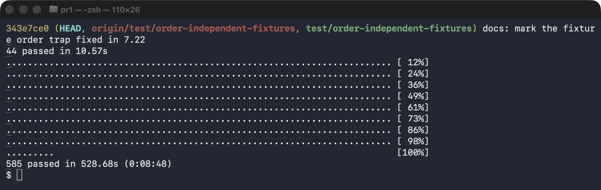
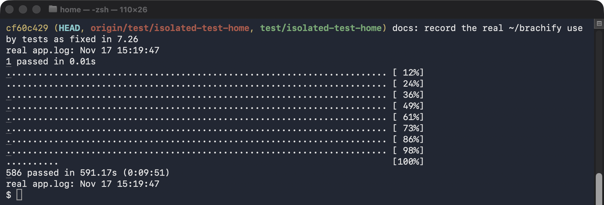
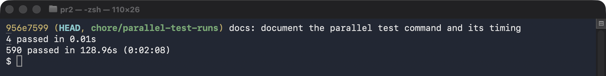
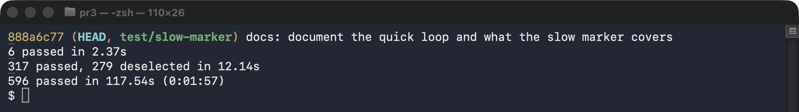
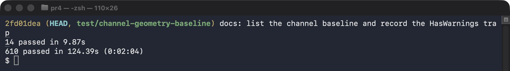

# Week 10, Ariq

_Individual log. One section per PR merged this week, each a copy of that PR's Part A. See
[docs/logs/README.md](../README.md)._

## Stack #256 to #259, at a glance

Six stacked PRs that make the test suite fast enough to keep growing: every test file passes on its own and in its own home folder, the files run in parallel, a quick loop leaves out the tests that build a window, and the channel solids are built once and reused, with the geometry pinned first. On the same machine the serial suite went from 10 min 45 s on #259 to 2 min 55 s. Each PR is based on the one above it and closes its own issue.
A row's counts are **that PR's own diff only**, as GitHub shows it against its parent.

| PR | On | Closes | What this PR adds | Own diff (files, lines) | New tests | Suite after |
|---|---|---|---|---|---|---|
| [#256](https://github.com/COSC-499-W2026/capstone-project-team-10/pull/256) | `main` | #251 | Every test file passes alone: five viewport tests get a window, §7.22 fixed | 9, +104/−8 | 0 | 585 |
| [#262](https://github.com/COSC-499-W2026/capstone-project-team-10/pull/262) | #256 | #261 | Each test run gets its own home, so the suite no longer uses or deletes the real `~/brachify`; §7.26 | 6, +92/−2 | 1 | 586 |
| [#257](https://github.com/COSC-499-W2026/capstone-project-team-10/pull/257) | #262 | #252 | `pytest-xdist` on every platform and the parallel command | 8, +118/−7 | 4 | 590 |
| [#258](https://github.com/COSC-499-W2026/capstone-project-team-10/pull/258) | #257 | #253 | The `slow` marker and the 12 s quick loop | 9, +150/−4 | 6 | 596 |
| [#259](https://github.com/COSC-499-W2026/capstone-project-team-10/pull/259) | #258 | #254 | Tests only: every sample channel's solid pinned; §7.27 | 5, +158/−1 | 14 | 610 |

The suite had 585 tests on `main` before the stack (`22ac6a8`).

### Shared by every PR in this stack

Stated once here instead of in each section.

- **Code quality checklist.** For each PR, I did **`anti_slop review --base <parent branch>` (no findings) and a read of that PR's own diff** to ensure that my feature contribution does not contain any of the following:
  - hardcoded values
  - duplicate code
  - dead code
  - unnecessary function calls
  - excessive conditional logic
  - deep nesting
  - high cyclomatic complexity
  - classes/modules/functions with many unrelated responsibilities
- **Regression checks.** Every PR's regression receipt also includes **`build.py --check` and `session-start.sh`, both exit 0**. Each section gives only its own `python -m pytest` result.
- **Run on macOS only.** **Every run in this stack was on a 10-core Apple Silicon Mac. Windows and Linux are *Not verified***.

### For PR #**256** (1 of 6, on `main`)

- As part of requirement **issue #251, tests that pass in any order**, the user needs to do **run one test file alone, or the suite split across parallel workers, and get the same result as the full serial run**.
- Therefore, I implemented/generated code so that **every test file passes on its own, for the developers who run the suite**.

#### Review and design

- When I reviewed the **generated fix for the five viewport tests** for this functionality, I noticed **that giving the shared `viewport_module` fixture a window would build one for all 44 tests in the three files**. Therefore, I did **add `cylinder_window` to only the five tests that build an `OrbitCameraViewer3d`**.
- The PR does not contain any temporary workaround because **the tests use the existing `cylinder_window`, and the app fixtures set `window` to `None` as `units_app` already did**.
- The PR only contains small functions that are **19 to 30 lines (the changed tests and fixtures, docstrings included)** long.
- Code quality checklist: **see Shared**.
- This work is written in **`tests/conftest.py`, `tests/windows/conftest.py` and the three viewport test files** because **each fix sits in the fixture or test that had the order dependence**.
- Not applicable: **DFD process (no application code changed)**.

#### Testing receipts

- The functionality works correctly because the happy path tests involving **the three viewport files alone (44 passed), `tests/mesh/test_tandem.py` with `test_tandem_template_controls.py` (36 passed), and each of the 48 test files run alone (48 of 48 exit 0)** passed.
- I checked that these negative cases involving **the same runs on `main` (5 failed with `'NoneType' object has no attribute 'collisionmodel'`, and 29 errors with `'RadiotherapyApp' object has no attribute 'window'`)** failed as expected.
- These tests are included in the directory **`tests/`, `tests/windows/` and `tests/views/`**.
- This new test PR did not break anything else in the system because **`python -m pytest`, 585 passed (585 on `main`, 0 new; screenshot 1)**.

  
- Not applicable: **abnormal cases (fixtures only), generated-test review (no problem beyond the one above), unit and integration tests (no new tests)**.

### For PR #**262** (2 of 6, on #256)

- As part of requirement **issue #261, test runs that never touch the developer's files**, the user needs to do **run the suite, serially or in parallel, and keep their own `~/brachify` templates, log and last config untouched**.
- Therefore, I implemented/generated code so that **each test run, and each parallel worker, uses its own temporary home before brachify is imported, for the developers who run the suite**.

#### Review and design

- When I reviewed the **generated `pytest_configure` hook** for this functionality, I noticed **that the session fixtures already redirect HOME, but only after collection, when test modules such as `test_remove_custom_needle.py` have already imported brachify and fixed `USER_PATH`**. Therefore, I did **set HOME and USERPROFILE in `pytest_configure`, which runs before collection, and leave the fixtures as they were**.
- The PR does not contain any temporary workaround because **pytest runs `pytest_configure` once per process before importing any test module, so every worker gets its own folder**.
- The PR only contains small functions that are **10 lines (test) and 16 lines (hook, docstring included)** long.
- Code quality checklist: **see Shared**.
- This work is written in **`tests/conftest.py` and new `tests/tooling/test_test_home.py`** because **only the root conftest runs before every test module is collected**.
- Not applicable: **DFD process (no application code changed)**.

#### Testing receipts

- The functionality works correctly because the happy path tests involving **`test_brachify_user_folder_is_inside_the_temporary_folder` (1 new; 1 in the file; screenshot 1)** passed.
- I checked that these negative cases involving **the same test before the hook, which failed with `USER_PATH` at the real home, `/Users/<name>/brachify`** failed as expected.
- Among these tests, **`test_brachify_user_folder_is_inside_the_temporary_folder`** are unit tests and integration tests are not required because **it reads one module constant**.
- These tests are included in the directory **`tests/tooling/`**.
- This new test PR did not break anything else in the system because **`python -m pytest`, 586 passed (585 after #256), with the real `~/brachify/app.log` unchanged (screenshot 1)**.

  
- Not applicable: **abnormal cases (one fixed path), generated-test review (no problem found)**.

### For PR #**257** (3 of 6, on #262)

- As part of requirement **issue #252, a test suite that stays fast as it grows**, the user needs to do **build the environment on any OS and run the suite over every CPU core**.
- Therefore, I implemented/generated code so that **`pytest-xdist` is in all three dependency lists and `python -m pytest -n auto --dist loadfile` is documented, for developers on Windows, macOS and Linux**.

#### Review and design

- When I reviewed the **generated `spec-file.txt` lines** for this functionality, I did not find any problems with it because **a `win-64` dry-run solve with all 191 packages pinned kept every one and added only `execnet` 2.1.2 and `pytest-xdist` 3.8.0, both `noarch`, and both URLs returned HTTP 200**.
- The PR does not contain any temporary workaround because **the dependency follows the §1.1 procedure for every platform, and a plain `python -m pytest` stays serial**.
- The PR only contains small functions that are **7 to 9 lines** long.
- Code quality checklist: **see Shared**.
- This work is written in **`environment.yml`, `spec-file.txt`, §1 and §8.1 of the project docs, and new `tests/tooling/test_parallel_runs.py`** because **§1.1 names those three dependency lists, and repository checks live in `tests/tooling/`**.
- Not applicable: **DFD process (no application code changed)**.

#### Testing receipts

- The functionality works correctly because the happy path tests involving **`test_pytest_xdist_is_listed_wherever_the_environment_is_defined` (3 cases) and `test_pytest_xdist_is_installed_in_this_environment` (4 new; 4 in the file; screenshot 1)** passed.
- I checked that these negative cases involving **the three lists before the change, and `pytest-xdist` removed from `environment.yml` (1 failed)** failed as expected.
- Among these tests, **all 4** are unit tests and integration tests are not required because **they only read three files and import the plugin**.
- These tests are included in the directory **`tests/tooling/`**.
- This new test PR did not break anything else in the system because **`python -m pytest`, 590 passed (586 after #262), and `python -m pytest -n auto --dist loadfile`, 590 passed in 2 min 9 s (screenshot 1)**.

  
- Not applicable: **abnormal cases (the input is three fixed files), generated-test review (no problem found)**.

### For PR #**258** (4 of 6, on #257)

- As part of requirement **issue #253, a quick loop for test-driven development**, the user needs to do **run only the tests that need no window, in seconds, between red and green**.
- Therefore, I implemented/generated code so that **`python -m pytest -m "not slow"` leaves out every test that builds the main window or takes seconds, for developers writing tests**.

#### Review and design

- When I reviewed the **generated hook, which first marked only `channels_window` and `tandem_window` tests** for this functionality, I noticed **13 slow tests import a plan inside the test through `cylinder_window`, `fresh_window` or `anatomy_model`, so they would stay in the quick loop**. Therefore, I did **mark every window fixture, leaving one slow test unmarked, which I marked by hand**.
  - When I reviewed the **mark on that one PDF test**, I noticed **skipping it moved its 8.7 s to the next test, since the cost is the first call of `interstitial_length`**. Therefore, I did **mark all three tests that call it**.
- The PR does not contain any temporary workaround because **the marker is pytest's own, applied in one hook from fixture names**.
- The PR only contains small functions that are **3 to 18 lines** long.
- Code quality checklist: **see Shared**.
- This work is written in **`tests/conftest.py`, `pytest.ini` and new `tests/tooling/test_slow_marker.py`** because **the hook must see every collected test, so it belongs in the root conftest**.
- Not applicable: **DFD process (no application code changed)**.

#### Testing receipts

- The functionality works correctly because the happy path tests involving **`test_a_test_that_builds_a_window_or_takes_seconds_is_left_out_of_the_quick_loop` (4 cases), `test_a_test_of_pure_logic_stays_in_the_quick_loop` and `test_the_quick_loop_and_the_slow_tests_together_are_the_whole_suite` (6 new; 6 in the file; screenshot 1)** passed.
- I checked that these negative cases involving **`cylinder_window` removed from `WINDOW_FIXTURES`, and the dome test's mark removed (1 failed each)** failed as expected.
- When I reviewed the **`collected` helper**, I noticed **`check=True` raised when `-m slow` selected nothing, because pytest exits 5**. Therefore, I did **accept exit code 5 as an empty selection**.
- Among these tests, **none** are unit tests and **all 6** are integration tests.
- These tests are included in the directory **`tests/tooling/`**.
- This new test PR did not break anything else in the system because **`python -m pytest`, 596 passed (590 after #257), `-m "not slow"`, 317 passed and 279 deselected in 12 s, and `-n auto --dist loadfile`, 596 passed in 1 min 58 s (screenshot 1)**.

  
- Not applicable: **abnormal cases (marker expressions are pytest's own)**.

### For PR #**259** (5 of 6, on #258)

- As part of requirement **issue #254, channels that do not move when their code changes**, the user needs to do **import Ex1 or Ex2 and get the same holes in the exported applicator after any change to how channels are built**.
- Therefore, I implemented/generated code so that **every sample channel's volume, centre of mass and bounding box is pinned to 0.01, for the clinician who prints the applicator**.

#### Review and design

- When I reviewed the **generated expected values** for this functionality, I noticed **Ex2's twelve applicators measure the same as Ex1's**. Therefore, I did **keep only Ex2's Tandem, so the module builds 13 channels in about 10 s**.
  - When I reviewed **`rounded_channel` while measuring**, I noticed **`if(temp.HasWarnings)` without brackets, so every corner sphere is built 0.01 mm smaller**. Therefore, I did **record it as §7.27 and leave it, since fixing it changes every channel**.
- The PR does not contain any temporary workaround because **it changes no code and pins the code as it is**.
- The PR only contains small functions that are **7 to 23 lines** long.
- Code quality checklist: **see Shared**.
- This work is written in **new `tests/mesh/test_channel_geometry.py`** because **it tests `classes/mesh/channel.py`, with the expected values as literals**.
- Not applicable: **DFD process (no application code changed)**.

#### Testing receipts

- The functionality works correctly because the happy path tests involving **`test_a_sample_channel_keeps_its_volume_position_and_extent` (13 channels) and `test_every_listed_channel_is_in_its_plan` (14 new; 14 in the file; screenshot 1)** passed.
- I checked that these negative cases involving **`TIP_LENGTH` 2.4 instead of 2.5, and corner spheres at the full radius (13 failed each)** failed as expected.
- Among these tests, **none** are unit tests and **all 14** are integration tests.
- These tests are included in the directory **`tests/mesh/`**.
- This new test PR did not break anything else in the system because **`python -m pytest`, 610 passed (596 after #258), and `-n auto --dist loadfile`, 610 passed in 2 min 4 s (screenshot 1)**.

  
- Not applicable: **abnormal cases (the inputs are the two sample plans), generated-test review (no problem found)**.
