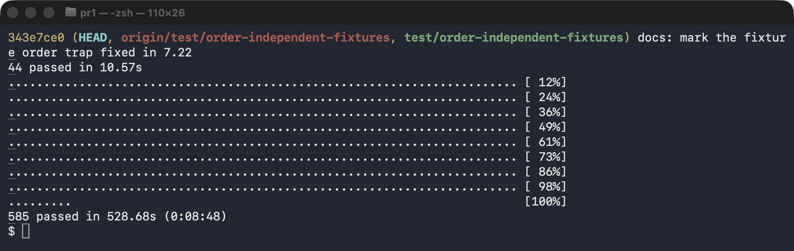
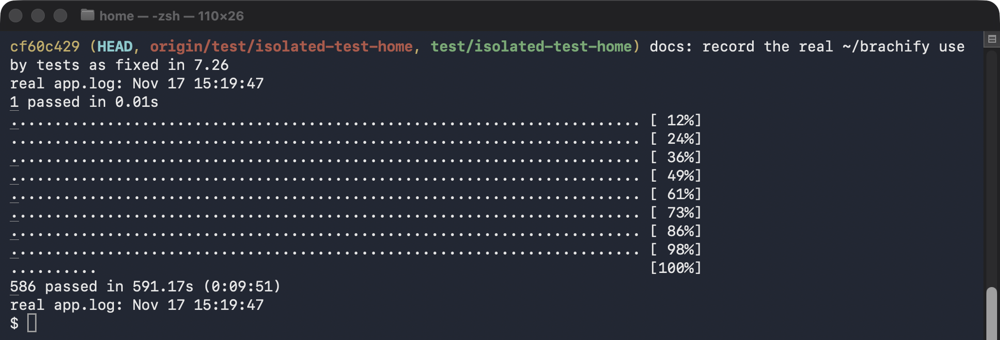
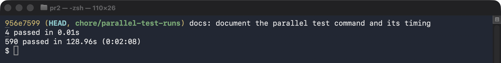
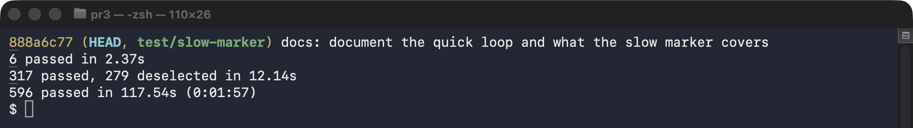
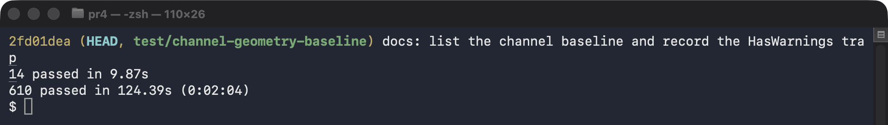
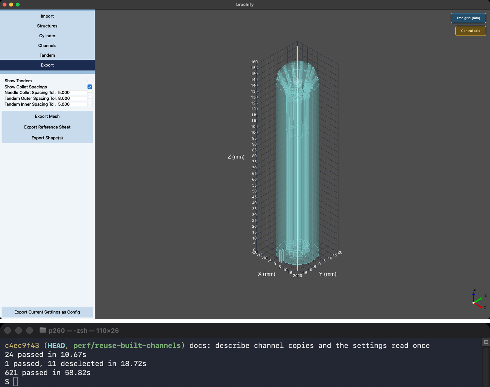
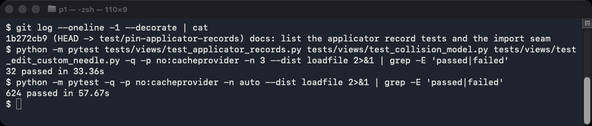
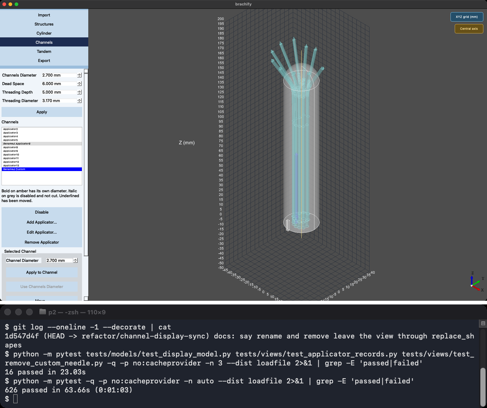
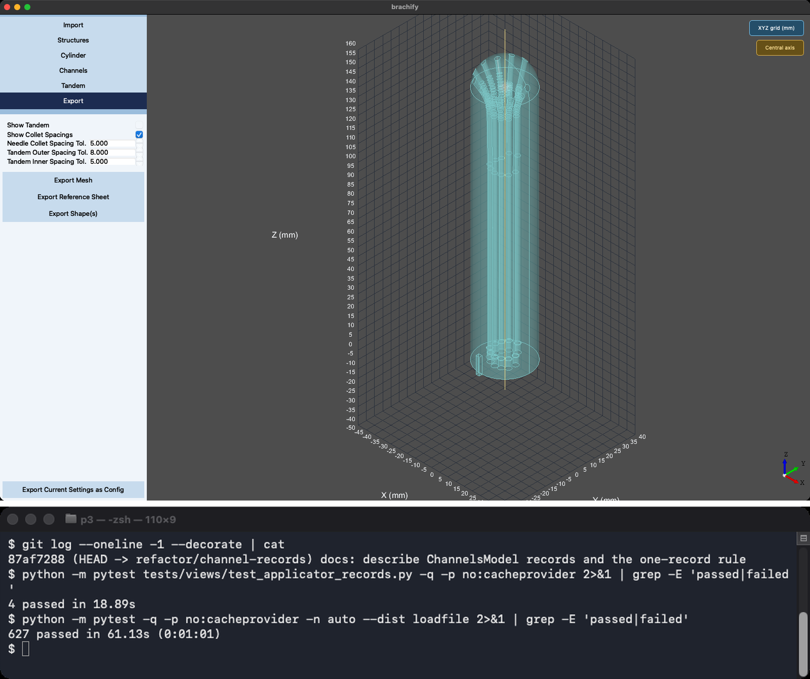

# Week 11, Ariq

_Individual log. One section per PR merged this week, each a copy of that PR's Part A. See
[docs/logs/README.md](../README.md)._

## Stack #256 to #260, at a glance

Six stacked PRs that make the test suite fast enough to keep growing: every test file passes on its own and in its own home folder, the files run in parallel, a quick loop leaves out the tests that build a window, and the channel solids are built once and reused, with the geometry pinned first. Run alone, the serial suite went from 8 min 48 s on #256 to 2 min 26 s on #260. Each PR is based on the one above it and closes its own issue.
A row's counts are **that PR's own diff only**, as GitHub shows it against its parent.

| PR | On | Closes | What this PR adds | Own diff (files, lines) | New tests | Suite after |
|---|---|---|---|---|---|---|
| [#256](https://github.com/COSC-499-W2026/capstone-project-team-10/pull/256) | `main` | #251 | Every test file passes alone: five viewport tests get a window, §7.22 fixed | 9, +104/−8 | 0 | 585 |
| [#262](https://github.com/COSC-499-W2026/capstone-project-team-10/pull/262) | #256 | #261 | Each test run gets its own home, so the suite no longer uses or deletes the real `~/brachify`; §7.26 | 6, +92/−2 | 1 | 586 |
| [#257](https://github.com/COSC-499-W2026/capstone-project-team-10/pull/257) | #262 | #252 | `pytest-xdist` on every platform and the parallel command | 8, +118/−7 | 4 | 590 |
| [#258](https://github.com/COSC-499-W2026/capstone-project-team-10/pull/258) | #257 | #253 | The `slow` marker and the 12 s quick loop | 9, +150/−4 | 6 | 596 |
| [#259](https://github.com/COSC-499-W2026/capstone-project-team-10/pull/259) | #258 | #254 | Tests only: every sample channel's solid pinned; §7.27 | 5, +158/−1 | 14 | 610 |
| [#260](https://github.com/COSC-499-W2026/capstone-project-team-10/pull/260) | #259 | #255 | `rounded_channel` copies a solid built from identical inputs; §7.28 | 8, +403/−25 | 11 | 621 |

The suite had 585 tests on `main` before the stack (`22ac6a8`).

### Shared by every PR in this stack

Stated once here instead of in each section.

- **Code quality checklist.** For each PR, I did **`anti_slop review --base <parent branch>` (no findings) and a read of that PR's own diff** to ensure that my feature contribution does not contain any of the following:
  - hardcoded values
  - duplicate code
  - dead code
  - unnecessary function calls
  - excessive conditional logic
  - deep nesting
  - high cyclomatic complexity
  - classes/modules/functions with many unrelated responsibilities
- **Regression checks.** Every PR's regression receipt also includes **`build.py --check` and `session-start.sh`, both exit 0**. Each section gives only its own `python -m pytest` result.
- **Run on macOS only.** **Every run in this stack was on a 10-core Apple Silicon Mac. Windows and Linux are *Not verified***.

### For PR #**256** (1 of 6, on `main`)

- As part of requirement **issue #251, tests that pass in any order**, the user needs to do **run one test file alone, or the suite split across parallel workers, and get the same result as the full serial run**.
- Therefore, I implemented/generated code so that **every test file passes on its own, for the developers who run the suite**.

#### Review and design

- When I reviewed the **generated fix for the five viewport tests** for this functionality, I noticed **that giving the shared `viewport_module` fixture a window would build one for all 44 tests in the three files**. Therefore, I did **add `cylinder_window` to only the five tests that build an `OrbitCameraViewer3d`**.
- The PR does not contain any temporary workaround because **the tests use the existing `cylinder_window`, and the app fixtures set `window` to `None` as `units_app` already did**.
- The PR only contains small functions that are **19 to 30 lines (the changed tests and fixtures, docstrings included)** long.
- Code quality checklist: **see Shared**.
- This work is written in **`tests/conftest.py`, `tests/windows/conftest.py` and the three viewport test files** because **each fix sits in the fixture or test that had the order dependence**.
- Not applicable: **DFD process (no application code changed)**.

#### Testing receipts

- The functionality works correctly because the happy path tests involving **the three viewport files alone (44 passed), `tests/mesh/test_tandem.py` with `test_tandem_template_controls.py` (36 passed), and each of the 48 test files run alone (48 of 48 exit 0)** passed.
- I checked that these negative cases involving **the same runs on `main` (5 failed with `'NoneType' object has no attribute 'collisionmodel'`, and 29 errors with `'RadiotherapyApp' object has no attribute 'window'`)** failed as expected.
- These tests are included in the directory **`tests/`, `tests/windows/` and `tests/views/`**.
- This new test PR did not break anything else in the system because **`python -m pytest`, 585 passed (585 on `main`, 0 new; screenshot 1)**.

  
- Not applicable: **abnormal cases (fixtures only), generated-test review (no problem beyond the one above), unit and integration tests (no new tests)**.

### For PR #**262** (2 of 6, on #256)

- As part of requirement **issue #261, test runs that never touch the developer's files**, the user needs to do **run the suite, serially or in parallel, and keep their own `~/brachify` templates, log and last config untouched**.
- Therefore, I implemented/generated code so that **each test run, and each parallel worker, uses its own temporary home before brachify is imported, for the developers who run the suite**.

#### Review and design

- When I reviewed the **generated `pytest_configure` hook** for this functionality, I noticed **that the session fixtures already redirect HOME, but only after collection, when test modules such as `test_remove_custom_needle.py` have already imported brachify and fixed `USER_PATH`**. Therefore, I did **set HOME and USERPROFILE in `pytest_configure`, which runs before collection, and leave the fixtures as they were**.
- The PR does not contain any temporary workaround because **pytest runs `pytest_configure` once per process before importing any test module, so every worker gets its own folder**.
- The PR only contains small functions that are **10 lines (test) and 16 lines (hook, docstring included)** long.
- Code quality checklist: **see Shared**.
- This work is written in **`tests/conftest.py` and new `tests/tooling/test_test_home.py`** because **only the root conftest runs before every test module is collected**.
- Not applicable: **DFD process (no application code changed)**.

#### Testing receipts

- The functionality works correctly because the happy path tests involving **`test_brachify_user_folder_is_inside_the_temporary_folder` (1 new; 1 in the file; screenshot 1)** passed.
- I checked that these negative cases involving **the same test before the hook, which failed with `USER_PATH` at the real home, `/Users/<name>/brachify`** failed as expected.
- Among these tests, **`test_brachify_user_folder_is_inside_the_temporary_folder`** are unit tests and integration tests are not required because **it reads one module constant**.
- These tests are included in the directory **`tests/tooling/`**.
- This new test PR did not break anything else in the system because **`python -m pytest`, 586 passed (585 after #256), with the real `~/brachify/app.log` unchanged (screenshot 1)**.

  
- Not applicable: **abnormal cases (one fixed path), generated-test review (no problem found)**.

### For PR #**257** (3 of 6, on #262)

- As part of requirement **issue #252, a test suite that stays fast as it grows**, the user needs to do **build the environment on any OS and run the suite over every CPU core**.
- Therefore, I implemented/generated code so that **`pytest-xdist` is in all three dependency lists and `python -m pytest -n auto --dist loadfile` is documented, for developers on Windows, macOS and Linux**.

#### Review and design

- When I reviewed the **generated `spec-file.txt` lines** for this functionality, I did not find any problems with it because **a `win-64` dry-run solve with all 191 packages pinned kept every one and added only `execnet` 2.1.2 and `pytest-xdist` 3.8.0, both `noarch`, and both URLs returned HTTP 200**.
- The PR does not contain any temporary workaround because **the dependency follows the §1.1 procedure for every platform, and a plain `python -m pytest` stays serial**.
- The PR only contains small functions that are **7 to 9 lines** long.
- Code quality checklist: **see Shared**.
- This work is written in **`environment.yml`, `spec-file.txt`, §1 and §8.1 of the project docs, and new `tests/tooling/test_parallel_runs.py`** because **§1.1 names those three dependency lists, and repository checks live in `tests/tooling/`**.
- Not applicable: **DFD process (no application code changed)**.

#### Testing receipts

- The functionality works correctly because the happy path tests involving **`test_pytest_xdist_is_listed_wherever_the_environment_is_defined` (3 cases) and `test_pytest_xdist_is_installed_in_this_environment` (4 new; 4 in the file; screenshot 1)** passed.
- I checked that these negative cases involving **the three lists before the change, and `pytest-xdist` removed from `environment.yml` (1 failed)** failed as expected.
- Among these tests, **all 4** are unit tests and integration tests are not required because **they only read three files and import the plugin**.
- These tests are included in the directory **`tests/tooling/`**.
- This new test PR did not break anything else in the system because **`python -m pytest`, 590 passed (586 after #262), and `python -m pytest -n auto --dist loadfile`, 590 passed in 2 min 9 s (screenshot 1)**.

  
- Not applicable: **abnormal cases (the input is three fixed files), generated-test review (no problem found)**.

### For PR #**258** (4 of 6, on #257)

- As part of requirement **issue #253, a quick loop for test-driven development**, the user needs to do **run only the tests that need no window, in seconds, between red and green**.
- Therefore, I implemented/generated code so that **`python -m pytest -m "not slow"` leaves out every test that builds the main window or takes seconds, for developers writing tests**.

#### Review and design

- When I reviewed the **generated hook, which first marked only `channels_window` and `tandem_window` tests** for this functionality, I noticed **13 slow tests import a plan inside the test through `cylinder_window`, `fresh_window` or `anatomy_model`, so they would stay in the quick loop**. Therefore, I did **mark every window fixture, leaving one slow test unmarked, which I marked by hand**.
  - When I reviewed the **mark on that one PDF test**, I noticed **skipping it moved its 8.7 s to the next test, since the cost is the first call of `interstitial_length`**. Therefore, I did **mark all three tests that call it**.
- The PR does not contain any temporary workaround because **the marker is pytest's own, applied in one hook from fixture names**.
- The PR only contains small functions that are **3 to 18 lines** long.
- Code quality checklist: **see Shared**.
- This work is written in **`tests/conftest.py`, `pytest.ini` and new `tests/tooling/test_slow_marker.py`** because **the hook must see every collected test, so it belongs in the root conftest**.
- Not applicable: **DFD process (no application code changed)**.

#### Testing receipts

- The functionality works correctly because the happy path tests involving **`test_a_test_that_builds_a_window_or_takes_seconds_is_left_out_of_the_quick_loop` (4 cases), `test_a_test_of_pure_logic_stays_in_the_quick_loop` and `test_the_quick_loop_and_the_slow_tests_together_are_the_whole_suite` (6 new; 6 in the file; screenshot 1)** passed.
- I checked that these negative cases involving **`cylinder_window` removed from `WINDOW_FIXTURES`, and the dome test's mark removed (1 failed each)** failed as expected.
- When I reviewed the **`collected` helper**, I noticed **`check=True` raised when `-m slow` selected nothing, because pytest exits 5**. Therefore, I did **accept exit code 5 as an empty selection**.
- Among these tests, **none** are unit tests and **all 6** are integration tests.
- These tests are included in the directory **`tests/tooling/`**.
- This new test PR did not break anything else in the system because **`python -m pytest`, 596 passed (590 after #257), `-m "not slow"`, 317 passed and 279 deselected in 12 s, and `-n auto --dist loadfile`, 596 passed in 1 min 58 s (screenshot 1)**.

  
- Not applicable: **abnormal cases (marker expressions are pytest's own)**.

### For PR #**259** (5 of 6, on #258)

- As part of requirement **issue #254, channels that do not move when their code changes**, the user needs to do **import Ex1 or Ex2 and get the same holes in the exported applicator after any change to how channels are built**.
- Therefore, I implemented/generated code so that **every sample channel's volume, centre of mass and bounding box is pinned to 0.01, for the clinician who prints the applicator**.

#### Review and design

- When I reviewed the **generated expected values** for this functionality, I noticed **Ex2's twelve applicators measure the same as Ex1's**. Therefore, I did **keep only Ex2's Tandem, so the module builds 13 channels in about 10 s**.
  - When I reviewed **`rounded_channel` while measuring**, I noticed **`if(temp.HasWarnings)` without brackets, so every corner sphere is built 0.01 mm smaller**. Therefore, I did **record it as §7.27 and leave it, since fixing it changes every channel**.
- The PR does not contain any temporary workaround because **it changes no code and pins the code as it is**.
- The PR only contains small functions that are **7 to 23 lines** long.
- Code quality checklist: **see Shared**.
- This work is written in **new `tests/mesh/test_channel_geometry.py`** because **it tests `classes/mesh/channel.py`, with the expected values as literals**.
- Not applicable: **DFD process (no application code changed)**.

#### Testing receipts

- The functionality works correctly because the happy path tests involving **`test_a_sample_channel_keeps_its_volume_position_and_extent` (13 channels) and `test_every_listed_channel_is_in_its_plan` (14 new; 14 in the file; screenshot 1)** passed.
- I checked that these negative cases involving **`TIP_LENGTH` 2.4 instead of 2.5, and corner spheres at the full radius (13 failed each)** failed as expected.
- Among these tests, **none** are unit tests and **all 14** are integration tests.
- These tests are included in the directory **`tests/mesh/`**.
- This new test PR did not break anything else in the system because **`python -m pytest`, 610 passed (596 after #258), and `-n auto --dist loadfile`, 610 passed in 2 min 4 s (screenshot 1)**.

  
- Not applicable: **abnormal cases (the inputs are the two sample plans), generated-test review (no problem found)**.

### For PR #**260** (6 of 6, on #259)

- As part of requirement **issue #255, faster channel building with the same geometry**, the user needs to do **import a plan, change the cylinder length or channel settings and back, add and remove an applicator, reimport, and export**.
- Therefore, I implemented/generated code so that **a channel built once is copied for identical inputs, so returning to a length, setting or plan already built takes about 1 s instead of about 10 s, with the same exported solid, for clinicians and for the test suite**.

#### Backend

- The system uses **memoisation inside the geometry module, keyed by every input of the build** because **the solid is a pure function of those inputs, and the app and the tests rebuild the same plan many times**. Benefits for using this pattern include **a reimport in 0.06 s instead of 9.4 s, and a serial suite in 2 min 26 s instead of 8 min 48 s on #256, each run alone**. Possible risks include **a stale hole when an input is missing from the key, two channels sharing one solid, a missing warning dialog, and memory growth**.
  - To mitigate **a stale hole**, we implemented **`ChannelSettings`, read once and passed to both the key and the build**.
  - To mitigate **two channels sharing one solid**, we implemented **a `BRepBuilderAPI_Copy` of the kept solid on every call**.
  - To mitigate **a missing dialog and memory growth**, we implemented **keeping only builds that opened no dialog, in a store of the 256 solids used last**.
  - We considered alternative solutions such as **one parallel `BRepAlgoAPI_Fuse` per needle, which took 6.1 s against 4.6 s for six Ex1 needles**.
- The system architecture diagram consists of the following major components: **views, models, domain services, libraries and local storage, unchanged**. This structure has low coupling because **the store is private to `channel.py`, and `NeedleChannel.shape()` calls `rounded_channel` as before**. This structure has high cohesion because **`ChannelSolids` only stores and evicts, and `ChannelSettings` only reads settings**. This design is scalable because **a new setting is one more field in `ChannelSettings`**.

  **[System architecture, unchanged](https://github.com/COSC-499-W2026/capstone-project-team-10/blob/252ffaa356e7db891f2add7c5772a8251ced9c97/docs/architecture/diagrams/system-architecture.svg)**
- The system adopts a **stateful** approach to state management because **the store lasts the app's session, across imports**. This method is done by **a module-level `ChannelSolids`**. Benefits for using this approach include **a reimported plan reuses its channels**. Possible risks include **state shared between tests**.
  - To mitigate **state shared between tests**, we implemented **a key that includes the live settings, so a test that changes one builds new solids**.
- The following traceability matrix shows the list of requirements completed in this milestone and their associated tests: **#255: `tests/mesh/test_channel_reuse.py` (10 cases) and the twin test in `tests/views/test_add_custom_needle.py`, with #259's `tests/mesh/test_channel_geometry.py` unchanged**
- Not applicable: **database, data processing (unchanged), Level 0 DFD, Level 1 DFD (no data flow changed), backend API (none), test coverage (no coverage tool)**.

#### Review and design

- When I reviewed the **generated wrapper** for this functionality, I noticed **the build opens its dialogs in six places, so the wrapper could not tell a clean build from a reported one**. Therefore, I did **route the six calls through a local `report` and keep only builds with none**.
- The review by **Ayyhab** identified **that two channels built from identical inputs shared one solid, so `set_selected_shapes` selected the first of two identical applicators when the second was clicked**. Therefore, I did **return a copy of the kept solid on every call, with a test of that case**.
  - The review by **Ayyhab** identified **that `channel_key` listed the settings separately from the build, so a setting added to one could be missed in the other**. Therefore, I did **read them once into `ChannelSettings` and pass it to the key, the build and `down_to_end`**.
  - The review by **Ayyhab** identified **the branch still carrying #257's and #258's old commits**. Therefore, I did **confirm the stack had already been rebuilt on #259, 5 commits of its own, before the fixes**.
- The PR does not contain any temporary workaround because **the build's steps are unchanged, as #259's baseline shows**.
- The PR only contains small functions that are **3 to 18 lines (new) and 3 to 20 lines (tests); `_build_rounded_channel` is the existing 261-line body, renamed** long.
- Code quality checklist: **see Shared**.
- This work is written in **`src/classes/mesh/channel.py`** because **the store sits beside the build it skips, so no caller changes**.
- This work belongs in **3 Channels** in the DFD because **it builds the channel solids the Channels and Export tabs show**.

#### Testing receipts

- The functionality works correctly because the happy path tests involving **`test_the_same_inputs_are_given_the_kept_solid_instead_of_a_new_build`, `test_each_call_gets_its_own_copy_with_the_same_geometry` and `test_selecting_the_second_of_two_identical_applicators_selects_that_one` (11 new; 10 in `test_channel_reuse.py`; screenshot 1)** passed.
- I wrote tests to cover abnormal situations involving **a flat last pipe that opens the error dialog on every build** and they passed.
- I checked that these negative cases involving **the kept solid returned uncopied (2 failed), the settings left out of the key (3 failed), and before the review a reported build kept or no size limit (1 failed each)** failed as expected.
- Among these tests, **the store test** are unit tests and **the 10 that build real channels or a window** are integration tests.
- These tests are included in the directory **`tests/mesh/` and `tests/views/`**.
- This new test PR did not break anything else in the system because **`python -m pytest`, 621 passed (610 after #259), `-n auto --dist loadfile`, 621 passed in 59 s, and the real app on Ex1 and Ex2 exporting the same solid volume and the same STL bytes as `main` at all 9 steps (screenshot 1)**.

  
- Not applicable: **generated-test review (no problem beyond the review's)**.

## Stack #269 to #271, at a glance

Three stacked PRs that change how `ChannelsModel` keeps an applicator, with no behaviour change, prompted by #195's removal, which forgot the 3D view (§7.25). The tests that pin what a rename carries come first, then the 3D view drops a gone channel in one place, then each applicator's state becomes one `ChannelRecord`. The same scripted run on Ex1 gave identical results on #260 and on each refactor PR. Each PR is based on the one above it and closes its own issue.
A row's counts are **that PR's own diff only**, as GitHub shows it against its parent.

| PR | On | Closes | What this PR adds | Own diff (files, lines) | New tests | Suite after |
|---|---|---|---|---|---|---|
| [#269](https://github.com/COSC-499-W2026/capstone-project-team-10/pull/269) | #260 | #266 | Tests only: what a rename carries is pinned, and two test files reach `ChannelsModel` through its import and methods | 7, +176/−21 | 3 | 624 |
| [#270](https://github.com/COSC-499-W2026/capstone-project-team-10/pull/270) | #269 | #267 | `DisplayModel.replace_shapes`, so a removed or renamed channel leaves the 3D view in one place; §7.25 | 8, +113/−11 | 2 | 626 |
| [#271](https://github.com/COSC-499-W2026/capstone-project-team-10/pull/271) | #270 | #268 | One `ChannelRecord` per applicator in place of five label-keyed collections, with read-only views | 7, +153/−64 | 1 | 627 |

The suite had 621 tests on #260.

### Shared by every PR in this stack

Stated once here instead of in each section.

- **Code quality checklist.** For each PR, I did **`anti_slop review --base <parent branch>` (no blocking finding; the one warning, `no-shape-in-symbol-names` on `shapes`, is the rule AGENTS.md sets aside) and a read of that PR's own diff** to ensure that my feature contribution does not contain any of the following:
  - hardcoded values
  - duplicate code
  - dead code
  - unnecessary function calls
  - excessive conditional logic
  - deep nesting
  - high cyclomatic complexity
  - classes/modules/functions with many unrelated responsibilities
- **Regression checks.** Every PR's regression receipt also includes **`build.py --check` and `session-start.sh`, both exit 0**. Each section gives only its own `python -m pytest` result.
- **Run on macOS only.** **Every run in this stack was on a 10-core Apple Silicon Mac. Windows and Linux are *Not verified***.

### For test PR #**269** (1 of 3, on #260) written to assess functionality in **#195, #238 and #239, removing and renaming an applicator**

#### Testing receipts

- The functionality works correctly because the happy path tests involving **`test_a_renamed_tandem_stays_the_tandem_and_out_of_the_cut`, `test_after_a_rename_every_change_reaches_the_applicator_by_its_new_name` and `test_a_renamed_applicator_is_drawn_under_its_new_name_only` (3 new; 3 in the file; screenshot 1)** passed.
- I wrote tests to cover abnormal situations involving **renaming the applicator chosen as the tandem** and they passed.
- I checked that these negative cases involving **`rename_channel` dropping the disabled state, leaving `custom_specs` under the old name, or leaving the old shape drawn (each made a different new test fail)** failed as expected.
- When I reviewed the **setups of `test_collision_model.py` and of the flat-needle test in `test_edit_custom_needle.py`**, I noticed **they assigned `ChannelsModel.channels` and `disabled_channels` directly, so they tested how the model stores applicators, not what it does**. Therefore, I did **import their needles through `load_data` and disable through `toggle_channel_enabled`, keeping every assertion (29 passed; with disabled needles counted as visible, 2 collision tests failed)**.
- Among these tests, **no new test** are unit tests and **the 3 new tests, which drive the real `ChannelsModel` in a window with Ex1 imported,** are integration tests.
- These tests are included in the directory **`tests/views/`**.
- This new test PR did not break anything else in the system because **`python -m pytest`, 624 passed (621 after #260), and `-n auto --dist loadfile`, 624 passed (screenshot 1)**.
  

### For PR #**270** (2 of 3, on #269)

- As part of requirement **issue #267, a removed or renamed applicator leaves the 3D view without each change remembering to**, the user needs to do **remove or rename an applicator on the Channels tab and see the 3D view match the list and the export**.
- Therefore, I implemented/generated code so that **`DisplayModel.replace_shapes` makes the channels `ChannelsModel` passes the only channel shapes drawn, so remove and rename no longer call `remove_shape`, for clinicians checking the model and developers changing applicators**.

#### Backend

- The system uses **one owner for each piece of state (Information Expert): `DisplayModel` decides which shapes leave its own dictionary** because **#195 forgot to drop a removed channel's shape, so the viewport drew a needle the export no longer cut (§7.25)**. Benefits for using this pattern include **`update_display` passes the full set of channels on every `update()`, so the two hand-written `remove_shape` calls are gone and a new way to delete or rename a channel cannot forget one**. Possible risks include **dropping a shape of another type, and drawing a disabled channel because it is listed**.
  - To mitigate **dropping another type's shape**, we implemented **a filter on `ShapeTypes.CHANNEL`, which only `ChannelsModel` uses, tested with a cylinder shape that stays**.
  - To mitigate **drawing a listed disabled channel**, we implemented **`replace_shapes` ending in the existing `add_shapes`, which leaves out a shape that is not enabled**.
  - We considered alternative solutions such as **keeping a `remove_shape` call in each method, which is the step #195 missed**.
- The system architecture diagram consists of the following major components: **views, models, domain services, libraries and local storage, unchanged**. This structure has low coupling because **`ChannelsModel` passes `ShapeModel`s and never reads `DisplayModel.shapes`**. This structure has high cohesion because **only `DisplayModel` adds and drops entries in its dictionary**. This design is scalable because **another model can pass its own shape type the same way**.

  **[System architecture, unchanged](https://github.com/COSC-499-W2026/capstone-project-team-10/blob/b03cd64687f2dd863ea76733c13a4cf7d5f8f876/docs/architecture/diagrams/system-architecture.svg)**
- The system adopts a **stateful** approach to state management because **the 3D view shows what `DisplayModel.shapes` holds between updates**. This method is done by **`update_display` replacing every channel entry on each `update()`**. Benefits for using this approach include **the view is rebuilt from the model's channels instead of patched**. Possible risks include **a change to the channels that does not end in `update()`**.
  - To mitigate **a change without `update()`**, we implemented **nothing new: `remove_channel` and `edit_channel` already end in `update()`, `rename_channel` is called only by `edit_channel`, and both paths are pinned by #238's `test_a_removed_applicator_leaves_the_viewport` and #269's rename test**.
- The following traceability matrix shows the list of requirements completed in this milestone and their associated tests: **#267: `tests/models/test_display_model.py` (2 cases), with #238's `test_a_removed_applicator_leaves_the_viewport` and #269's `test_a_renamed_applicator_is_drawn_under_its_new_name_only` unchanged**
- Not applicable: **database (none), data processing (unchanged), Level 0 DFD, Level 1 DFD (no data flow changed), backend API (none), test coverage (no coverage tool)**.

#### Review and design

- When I reviewed the **generated `replace_shapes` and its call in `update_display`** for this functionality, I noticed **that it also drops the old plan's channels when `load_data` runs without the display reset an import does first, as the tests' `restored_plan` fixtures do**. Therefore, I did **confirm `import_dicom_from_folder` resets the display before `load_data`, so the app is unchanged, and record that in §5.5**.
- The PR does not contain any temporary workaround because **the drop replaces both hand-written `remove_shape` calls instead of adding a third path**.
- The PR only contains small functions that are **7 lines (`replace_shapes`) and 5 to 16 lines (tests); `update_display` stays 16** long.
- Code quality checklist: **see Shared**.
- This work is written in **`src/windows/models/display_model.py` and `src/windows/models/channels_model.py`** because **the display model owns its shapes, and `update_display` is where channel shapes are made**.
- This work belongs in **3 Channels** in the DFD because **it decides which channel solids the Channels tab's 3D view shows**.

#### Testing receipts

- The functionality works correctly because the happy path tests involving **`test_replacing_channel_shapes_drops_a_channel_that_is_gone_and_leaves_other_types_alone` (2 new; 2 in `tests/models/test_display_model.py`; screenshot 1)** passed.
- I wrote tests to cover abnormal situations involving **a disabled channel in the list passed to `replace_shapes`** and they passed.
- I checked that these negative cases involving **`replace_shapes` missing (both new tests failed with `AttributeError`) and `update_display` put back on `add_shapes` (#238's remove test and #269's rename test failed)** failed as expected.
- Among these tests, **both `test_display_model.py` tests** are unit tests and **#238's and #269's viewport tests, which drive the real window,** are integration tests.
- These tests are included in the directory **`tests/models/`**.
- This new test PR did not break anything else in the system because **`python -m pytest`, 626 passed (624 after #269), and the real app on Ex1, where the list, the shapes drawn and the export volume (100,739.741 mm³) matched #260 after the same 6 steps (screenshot 1)**.
  
- Not applicable: **generated-test review (no problem found)**.

### For PR #**271** (3 of 3, on #270)

- As part of requirement **issue #268, one place for everything kept about an applicator**, the user needs to do **give an applicator its own diameter, disable it, rename it, add, rename and remove others, and export**.
- Therefore, I implemented/generated code so that **`ChannelsModel` keeps one `ChannelRecord` per applicator, so a rename moves it whole and a removal drops it whole, with every behaviour unchanged, for developers adding an applicator setting and the clinicians who need it to follow a rename**.

#### Data Modeling and Integrity

- This data **an applicator's state** is modeled as **a `ChannelRecord` dataclass of its needle, custom spec or `None`, own diameter or `None` and disabled flag, one per label in one ordered dict, `records`** because **five label-keyed collections had to be rebuilt in step by every rename and removal, and #195's removal missed one (§7.25)**. We considered alternative models such as **putting the spec, diameter and flag on `NeedleChannel`, which would mix the clinician's choices into the geometry class #260 changed, or one helper that renames every dict, which still needs each new field added to it**.
- Not applicable: **input validation (unchanged), security sanitization, privacy sanitization, encryption, access controls (no patient data or users in this state)**.

#### Backend

- The system uses **a single source of truth per applicator, with read-only views for the existing readers** because **three views, the viewport and the tests read `channels`, `custom_specs`, `own_diameters` and `disabled_channels`, and a refactor must not change behaviour**. Benefits for using this pattern include **`rename_channel` rebuilds one dict instead of four, `remove_channel` deletes one entry instead of four, and a new setting is one field**. Possible risks include **a reader writing to a view and losing the write, and an edge case behaving differently**.
  - To mitigate **a lost write**, we implemented **views built on each read with no setter, so assigning one raises `AttributeError`; #269 moved the only tests that wrote them**.
  - To mitigate **an edge case behaving differently**, we implemented **the same public methods with the same errors, and recorded the two edges that differ in §5.5: `toggle_channel_enabled` on a label no applicator has raises `KeyError` instead of recording a disabled label, and `disabled_channels` is in list order**.
  - We considered alternative solutions such as **removing the views and changing their readers, which edits 3 views and about 15 test files and loses the unchanged tests as evidence**.
- The system architecture diagram consists of the following major components: **views, models, domain services, libraries and local storage, unchanged**. This structure has low coupling because **views keep reading `channels`, and only `ChannelsModel` touches `records`**. This structure has high cohesion because **all of one applicator's state is one object**. This design is scalable because **a new applicator setting, such as a colour, is one `ChannelRecord` field that import, rename and remove carry with no other change**.

  **[System architecture, unchanged](https://github.com/COSC-499-W2026/capstone-project-team-10/blob/b03cd64687f2dd863ea76733c13a4cf7d5f8f876/docs/architecture/diagrams/system-architecture.svg)**
- The system adopts a **stateful** approach to state management because **an applicator's choices last until the next import**. This method is done by **`records`, emptied and rebuilt by `load_data`**. Benefits for using this approach include **one object per applicator to carry or drop**. Possible risks include **a record that outlives its needle**.
  - To mitigate **a record outliving its needle**, we implemented **the needle inside the record, so deleting the record deletes both**.
- The following traceability matrix shows the list of requirements completed in this milestone and their associated tests: **#268: `test_an_edit_keeps_the_applicators_one_record_in_its_place_under_the_new_name`, with every existing test unchanged**
- Not applicable: **database (none), data processing (unchanged), Level 0 DFD, Level 1 DFD (no data flow changed), backend API (none), test coverage (no coverage tool)**.

#### Review and design

- When I reviewed the **generated `ChannelsModel` refactor** for this functionality, I noticed **`update_height_offset` wrote each needle back into `self.channels`, which would now write into a throwaway view**. Therefore, I did **set the offset on each record's needle, which is all the old write did**.
  - I noticed **the old `toggle_channel_enabled` recorded a disabled label for a name no applicator had, which a record cannot hold**. Therefore, I did **let it raise `KeyError` like the other per-applicator methods, and record it in §5.5**.
- The PR does not contain any temporary workaround because **the four views serve current readers and hold no state of their own**.
- The PR only contains small functions that are **2 to 17 lines; `load_data` is its existing 28 lines with two changed** long.
- Code quality checklist: **see Shared**.
- This work is written in **`src/windows/models/channels_model.py`** because **only `ChannelsModel` uses `ChannelRecord`, so it adds no module and no diagram change**.
- This work belongs in **3 Channels** in the DFD because **it holds the choices the Channels tab makes for each applicator**.

#### Testing receipts

- The functionality works correctly because the happy path tests involving **`test_an_edit_keeps_the_applicators_one_record_in_its_place_under_the_new_name` (1 new; 4 in `test_applicator_records.py`), with no existing test changed (screenshot 1)** passed.
- I wrote tests to cover abnormal situations involving **renaming an applicator with its own diameter, which must keep the 4.0 mm** and they passed.
- I checked that these negative cases involving **`records` missing (the new test failed with `AttributeError`), a rename that copies the record (it failed), and the tandem not disabled or Disable doing nothing (4 existing tests failed each)** failed as expected.
- Among these tests, **none** are unit tests and **the new test, which drives the real window,** is an integration test.
- These tests are included in the directory **`tests/views/`**.
- This new test PR did not break anything else in the system because **`python -m pytest`, 627 passed (626 after #270), and the real app on Ex1, where the list, shapes drawn, disabled, own diameters, specs, channel numbers and export volume (100,739.741 mm³) matched #260 after the same 6 steps (screenshot 1)**.
  
- Not applicable: **generated-test review (no problem found)**.

## Stack #275 to #276, at a glance

Two stacked PRs that file the #256 to #271 work under week 11, since the team took week 10 off capstone: the log is renamed and its nine screenshots move to `week-11/`, with their links re-pinned. They are split because all nine images and the log are 10 files. Each PR is based on the one above it and closes its own issue.
A row's counts are **that PR's own diff only**, as GitHub shows it against its parent.

| PR | On | Closes | What this PR adds | Own diff (files, lines) | New tests | Suite after |
|---|---|---|---|---|---|---|
| [#275](https://github.com/COSC-499-W2026/capstone-project-team-10/pull/275) | `main` | #272 | This log renamed to week 11, and the #256 to #260 screenshots moved with their links | 7, +43/−7 | 0 | 627 |
| [#276](https://github.com/COSC-499-W2026/capstone-project-team-10/pull/276) | #275 | #274 | The #269 to #271 screenshots moved with their links | 4, +22/−3 | 0 | 627 |

The suite had 627 tests on `main` before the stack (`f0366cb`).

### Shared by every PR in this stack

Stated once here instead of in each section.

- **Regression checks.** Every PR's regression receipt also includes **`build.py --check` and `session-start.sh`, both exit 0**.
- **Run on macOS only.** **Every run in this stack was on a 10-core Apple Silicon Mac**.

### For PR #**275** (1 of 2, on `main`)

- As part of requirement **issue #272, my week 11 work filed under week 11**, the user needs to do **open `docs/logs/ariq/week-11.md` and audit the #256 to #271 receipts with every screenshot rendering**.
- Therefore, I implemented/generated code so that **the log and the #256 to #260 screenshots are renamed from week 10 to week 11, for the grader auditing week 11**.

#### Review and design

- When I reviewed the **generated renames** for this functionality, I noticed **that moving all nine screenshots with the log changes 10 files, over the course's limit**. Therefore, I did **move the #256 to #260 stack's six here and leave #269 to #271's three to #276**.
- I did **`git diff -M --name-status` against `main` (7 renames, the log kept as a rename at 91%) and a `curl` of each re-pinned link** to ensure that my feature contribution does not contain any of the following: **a broken link or a lost image; the code items do not apply, no code changed**.
- This work is written in **`docs/logs/ariq/week-11.md` and `docs/logs/ariq/screenshots/week-11/`** because **`docs/logs/README.md` files a log and its screenshots under the semester week its PRs merged**.
- Not applicable: **temporary workaround, function length, DFD process (no code changed)**.

#### Testing receipts

- The functionality works correctly because the happy path tests involving **`curl` on the six re-pinned links (6 of 6 HTTP 200), and a grep that finds only #269 to #271's three links still in the old folder** passed.
- This new test PR did not break anything else in the system because **it changes no code, and `python -m pytest -n auto --dist loadfile`, 627 passed (627 on `main`)**.
- Not applicable: **abnormal cases, negative cases, generated-test review, unit and integration tests, test directory (no code, the checks are shell commands)**.

### For PR #**276** (2 of 2, on #275)

- As part of requirement **issue #274, my week 11 screenshots filed under week 11**, the user needs to do **open `docs/logs/ariq/week-11.md` and see the #269 to #271 screenshots render from the week 11 folder**.
- Therefore, I implemented/generated code so that **the last three screenshots move to `week-11/` and their links follow, for the grader auditing week 11**.

#### Review and design

- When I reviewed the **generated renames and re-pinned links** for this functionality, I did not find any problems with it because **`git diff -M --name-status` against #275 shows 3 renames at 100% and the three link lines changed in the log, and each link returns HTTP 200**.
- I did **a grep of the log for links into the old folder (none left) and a `curl` of each re-pinned link** to ensure that my feature contribution does not contain any of the following: **a broken link or a lost image; the code items do not apply, no code changed**.
- This work is written in **`docs/logs/ariq/week-11.md` and `docs/logs/ariq/screenshots/week-11/`** because **as in #275**.
- Not applicable: **temporary workaround, function length, DFD process (no code changed)**.

#### Testing receipts

- The functionality works correctly because the happy path tests involving **`curl` on the three re-pinned links (3 of 3 HTTP 200), and a grep that finds no link into the old folder** passed.
- This new test PR did not break anything else in the system because **it changes no code, and `python -m pytest -n auto --dist loadfile`, 627 passed (627 after #275)**.
- Not applicable: **abnormal cases, negative cases, generated-test review, unit and integration tests, test directory (no code, the checks are shell commands)**.
