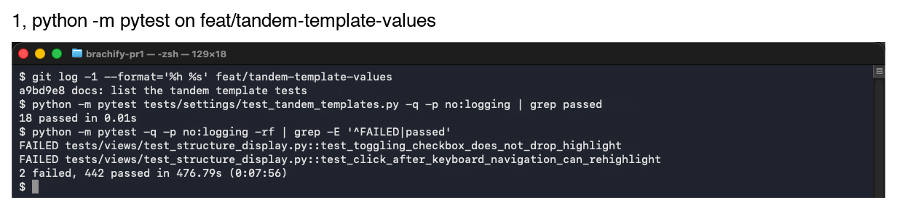

# Week 9, Ariq

_Individual log. One section per PR merged this week, each a copy of that PR's Part A. See
[docs/logs/README.md](../README.md)._

## Stack #212 to #212, at a glance

Nine stacked PRs that let a clinician save the Tandem tab's Generate settings as named tandem templates and load, update and delete them, and make *Generate Tandem*'s boxes show the tandem it built. Each PR is based on the one above it and closes its own issue.
A row's counts are **that PR's own diff only**, as GitHub shows it against its parent.

| PR | On | Closes | What this PR adds | Own diff (files, lines) | New tests | Suite after |
|---|---|---|---|---|---|---|
| [#212](https://github.com/COSC-499-W2026/capstone-project-team-10/pull/212) | `main` | #204 | `TandemDesign`, `make_template` and the eight Generate ranges | 9, +291/−10 | 18 | 444 |

The suite had 426 tests on `main` before the stack (`6fa56b7`). Each suite total includes the two inherited failures named below.

### Shared by every PR in this stack

Stated once here instead of in each section.

- **Code quality checklist.** For each PR, I did **`anti_slop review --base <parent branch>` (no findings) and a read of that PR's own diff** to ensure that my feature contribution does not contain any of the following:
  - hardcoded values
  - duplicate code
  - dead code
  - unnecessary function calls
  - excessive conditional logic
  - deep nesting
  - high cyclomatic complexity
  - classes/modules/functions with many unrelated responsibilities
- **Regression checks.** Every PR's regression receipt also includes **`build.py --check` and `session-start.sh`, both exit 0, and a run of the real window on that PR's own worktree with Ex2 where the tab changed**. Each section gives only its own `python -m pytest` result.
- **Two failures inherited from `main`.** **`test_toggling_checkbox_does_not_drop_highlight` and `test_click_after_keyboard_navigation_can_rehighlight` in `tests/views/test_structure_display.py` also fail on `main` (`6fa56b7`, 2 failed and 37 passed in that file). This stack does not touch the Structures tab**.
- **Not applicable in every PR.** **Encryption and access controls (no stored secrets, no user roles), restricted pages (no logins), usability evaluation (none run), backend API (none), test coverage (no coverage tool)**.

### For PR #**212** (1 of 9, on `main`)

- As part of requirement **FR-CN-05 and issue #204, save tandem designs as templates**, the user needs to do **set up a tandem on the Tandem tab's Generate sub-tab and keep it under a name for later patients**.
- Therefore, I implemented/generated code so that **a clinician's tandem template holds the eight Generate settings, rotation included, with a name, note and dates, and can never hold a value the sub-tab cannot show**.

#### Data Modeling and Integrity

- This data **a tandem template** is modeled as **two frozen dataclasses, `TandemTemplate` holding a `TandemDesign`** because **AGENTS.md asks for named domain values instead of a bare dict**. We considered alternative models such as **adding the tandem to `CylinderDesign`, rejected because the whole-cylinder file is a later change**.
- This data **the eight settings** uses the input validation to ensure it adheres to **the Generate spin box ranges (`RANGES`), a non-blank trimmed name, an ID, and dates with a time zone where modified is not before created**.
- This data **a template** may be vulnerable to **storing patient data in a shared file**. Therefore, it uses a privacy-based sanitization by **having no patient, plan or channel field**. We considered alternative privacy solutions such as **saving the tandem channel's name, rejected because it belongs to one plan**.
- Not applicable: **security sanitization (no external input until #213)**.

#### Backend

- The system uses **a pure settings module with no Qt or OpenCASCADE imports** because **the caller passes the ID and times, so every rule is testable alone**. Benefits for using this pattern include **18 tests in 0.01 s with no window**. Possible risks include **`RANGES` drifting from `tandem_view.ui`**.
  - To mitigate **range drift**, we implemented **the edge tests here, and #215's test comparing `RANGES` with the spin boxes**.
- The system architecture diagram consists of the following major components: **views, models, domain services, libraries and local storage**. This structure has low coupling because **`tandem_templates.py` imports only `Range` from `cylinder_templates.py`**. This structure has high cohesion because **it only models and checks templates**. This design is scalable because **a whole-cylinder template can hold a `TandemDesign`**.

  **[System architecture, settings line names `tandem_templates`](https://github.com/COSC-499-W2026/capstone-project-team-10/blob/17d4a80/docs/architecture/diagrams/system-architecture.svg)**
- The following traceability matrix shows the list of requirements completed in this milestone and their associated tests: **FR-CN-05, #204: `tests/settings/test_tandem_templates.py`, 18 cases**
- Not applicable: **database (none yet), data processing, state management (no app state changed), Level 0 DFD, Level 1 DFD (nothing calls the module yet)**.

#### Review and design

- When I reviewed the **generated `RANGES`** for this functionality, I noticed **five Generate boxes have no maximum or minimum in the `.ui`, so their limits are Qt's defaults (99.99 and 0)**. Therefore, I did **use those defaults, and say so in a comment and in §5.2**.
- The PR does not contain any temporary workaround because **the ranges are the tab's own limits**.
- The PR only contains small functions that are **7 to 14 lines (module) and 6 to 15 lines (tests)** long.
- Code quality checklist: **see Shared**.
- This work is written in **new `src/settings/tandem_templates.py`** because **template libraries live in `settings/`, like `cylinder_templates.py`**.
- This work belongs in **Tandem** in the DFD because **a template is the Tandem tab's settings**.

#### Testing receipts

- The functionality works correctly because the happy path tests involving **`test_a_template_keeps_every_value_it_was_made_with`, `test_a_value_on_the_edge_of_its_range_is_accepted` (18 new; 18 in the file; screenshot 1)** passed.
- I wrote tests to cover abnormal situations involving **NaN, infinity and each value just outside its range, a naive or backwards date** and they passed.
- I checked that these negative cases involving **seven deliberate breaks (no range check, no trim, no ID, time zone or modified check, a 0° rotation minimum, open range edges)** failed as expected.
- Among these tests, **all 18** are unit tests and integration tests are not required because **the module imports nothing from the app**.
- These tests are included in the directory **`tests/settings/`**.
- This new test PR did not break anything else in the system because **`python -m pytest`, 442 passed and the 2 failures inherited from `main` (426 tests on `main`, screenshot 1)**.

  
- Not applicable: **generated-test review (no problem found)**.
