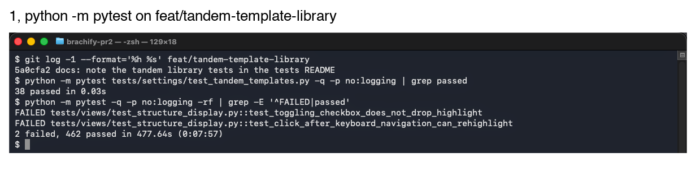
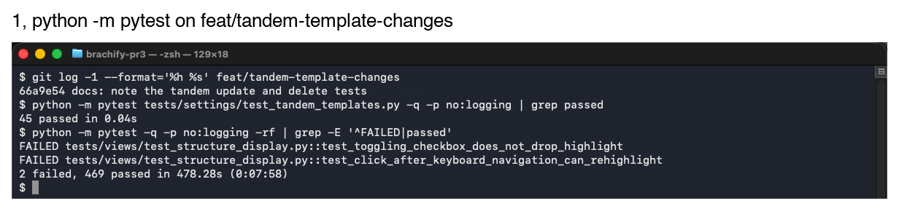

# Week 9, Ariq

_Individual log. One section per PR merged this week, each a copy of that PR's Part A. See
[docs/logs/README.md](../README.md)._

## Stack #212 to #214, at a glance

Nine stacked PRs that let a clinician save the Tandem tab's Generate settings as named tandem templates and load, update and delete them, and make *Generate Tandem*'s boxes show the tandem it built. Each PR is based on the one above it and closes its own issue.
A row's counts are **that PR's own diff only**, as GitHub shows it against its parent.

| PR | On | Closes | What this PR adds | Own diff (files, lines) | New tests | Suite after |
|---|---|---|---|---|---|---|
| [#212](https://github.com/COSC-499-W2026/capstone-project-team-10/pull/212) | `main` | #204 | `TandemDesign`, `make_template` and the eight Generate ranges | 9, +291/−10 | 18 | 444 |
| [#213](https://github.com/COSC-499-W2026/capstone-project-team-10/pull/213) | #212 | #205 | JSON library: `load_templates`, `add_template`, a shared safe save | 7, +358/−18 | 20 | 464 |
| [#214](https://github.com/COSC-499-W2026/capstone-project-team-10/pull/214) | #213 | #206 | `update_template`, `delete_template`; diagram names the file | 9, +212/−9 | 7 | 471 |

The suite had 426 tests on `main` before the stack (`6fa56b7`). Each suite total includes the two inherited failures named below.

### Shared by every PR in this stack

Stated once here instead of in each section.

- **Code quality checklist.** For each PR, I did **`anti_slop review --base <parent branch>` (no findings) and a read of that PR's own diff** to ensure that my feature contribution does not contain any of the following:
  - hardcoded values
  - duplicate code
  - dead code
  - unnecessary function calls
  - excessive conditional logic
  - deep nesting
  - high cyclomatic complexity
  - classes/modules/functions with many unrelated responsibilities
- **Regression checks.** Every PR's regression receipt also includes **`build.py --check` and `session-start.sh`, both exit 0, and a run of the real window on that PR's own worktree with Ex2 where the tab changed**. Each section gives only its own `python -m pytest` result.
- **Two failures inherited from `main`.** **`test_toggling_checkbox_does_not_drop_highlight` and `test_click_after_keyboard_navigation_can_rehighlight` in `tests/views/test_structure_display.py` also fail on `main` (`6fa56b7`, 2 failed and 37 passed in that file). This stack does not touch the Structures tab**.
- **Not applicable in every PR.** **Encryption and access controls (no stored secrets, no user roles), restricted pages (no logins), usability evaluation (none run), backend API (none), test coverage (no coverage tool)**.

### For PR #**212** (1 of 9, on `main`)

- As part of requirement **FR-CN-05 and issue #204, save tandem designs as templates**, the user needs to do **set up a tandem on the Tandem tab's Generate sub-tab and keep it under a name for later patients**.
- Therefore, I implemented/generated code so that **a clinician's tandem template holds the eight Generate settings, rotation included, with a name, note and dates, and can never hold a value the sub-tab cannot show**.

#### Data Modeling and Integrity

- This data **a tandem template** is modeled as **two frozen dataclasses, `TandemTemplate` holding a `TandemDesign`** because **AGENTS.md asks for named domain values instead of a bare dict**. We considered alternative models such as **adding the tandem to `CylinderDesign`, rejected because the whole-cylinder file is a later change**.
- This data **the eight settings** uses the input validation to ensure it adheres to **the Generate spin box ranges (`RANGES`), a non-blank trimmed name, an ID, and dates with a time zone where modified is not before created**.
- This data **a template** may be vulnerable to **storing patient data in a shared file**. Therefore, it uses a privacy-based sanitization by **having no patient, plan or channel field**. We considered alternative privacy solutions such as **saving the tandem channel's name, rejected because it belongs to one plan**.
- Not applicable: **security sanitization (no external input until #213)**.

#### Backend

- The system uses **a pure settings module with no Qt or OpenCASCADE imports** because **the caller passes the ID and times, so every rule is testable alone**. Benefits for using this pattern include **18 tests in 0.01 s with no window**. Possible risks include **`RANGES` drifting from `tandem_view.ui`**.
  - To mitigate **range drift**, we implemented **the edge tests here, and #215's test comparing `RANGES` with the spin boxes**.
- The system architecture diagram consists of the following major components: **views, models, domain services, libraries and local storage**. This structure has low coupling because **`tandem_templates.py` imports only `Range` from `cylinder_templates.py`**. This structure has high cohesion because **it only models and checks templates**. This design is scalable because **a whole-cylinder template can hold a `TandemDesign`**.

  **[System architecture, settings line names `tandem_templates`](https://github.com/COSC-499-W2026/capstone-project-team-10/blob/17d4a80/docs/architecture/diagrams/system-architecture.svg)**
- The following traceability matrix shows the list of requirements completed in this milestone and their associated tests: **FR-CN-05, #204: `tests/settings/test_tandem_templates.py`, 18 cases**
- Not applicable: **database (none yet), data processing, state management (no app state changed), Level 0 DFD, Level 1 DFD (nothing calls the module yet)**.

#### Review and design

- When I reviewed the **generated `RANGES`** for this functionality, I noticed **five Generate boxes have no maximum or minimum in the `.ui`, so their limits are Qt's defaults (99.99 and 0)**. Therefore, I did **use those defaults, and say so in a comment and in §5.2**.
- The PR does not contain any temporary workaround because **the ranges are the tab's own limits**.
- The PR only contains small functions that are **7 to 14 lines (module) and 6 to 15 lines (tests)** long.
- Code quality checklist: **see Shared**.
- This work is written in **new `src/settings/tandem_templates.py`** because **template libraries live in `settings/`, like `cylinder_templates.py`**.
- This work belongs in **Tandem** in the DFD because **a template is the Tandem tab's settings**.

#### Testing receipts

- The functionality works correctly because the happy path tests involving **`test_a_template_keeps_every_value_it_was_made_with`, `test_a_value_on_the_edge_of_its_range_is_accepted` (18 new; 18 in the file; screenshot 1)** passed.
- I wrote tests to cover abnormal situations involving **NaN, infinity and each value just outside its range, a naive or backwards date** and they passed.
- I checked that these negative cases involving **seven deliberate breaks (no range check, no trim, no ID, time zone or modified check, a 0° rotation minimum, open range edges)** failed as expected.
- Among these tests, **all 18** are unit tests and integration tests are not required because **the module imports nothing from the app**.
- These tests are included in the directory **`tests/settings/`**.
- This new test PR did not break anything else in the system because **`python -m pytest`, 442 passed and the 2 failures inherited from `main` (426 tests on `main`, screenshot 1)**.

  
- Not applicable: **generated-test review (no problem found)**.

### For PR #**213** (2 of 9, on #212)

- As part of requirement **FR-CN-05, FR-CN-06 and issue #205, keep tandem templates in a library**, the user needs to do **save a tandem template, close brachify, and find it again, even if the file was edited by hand**.
- Therefore, I implemented/generated code so that **tandem templates are saved to and read from `~/brachify/tandem_templates.json`, with a bad file refused rather than overwritten**.

#### Data Modeling and Integrity

- This data **the tandem template library** is modeled as **a versioned JSON object, `{"version": 1, "templates": [...]}`, decoded into #212's `TandemTemplate` in `load_templates` only** because **AGENTS.md asks to decode at the boundary**. We considered alternative models such as **one file with the cylinder templates, rejected until the whole-cylinder template is designed**.
- This data **each saved template** uses the input validation to ensure it adheres to **JSON numbers that are not booleans, ISO 8601 dates, unique IDs and names ignoring case, then #212's range checks**.
- This data **the library file** may be vulnerable to **a hand edit or a crash corrupting every saved template**. Therefore, it uses a security-based sanitization by **refusing the whole file on any bad entry, never writing over a file it could not read, and saving through `write_atomically`**. We considered alternative security solutions such as **skipping bad entries, rejected because the next save would delete them**.
- Not applicable: **privacy sanitization (no patient data, as in #212)**.

#### Backend

- The system uses **a pure settings module that takes the file path from its caller** because **the Tandem tab will pass `~/brachify` and the tests pass `tmp_path`**. Benefits for using this pattern include **the 20 new tests never touch the developer's home folder**. Possible risks include **a third copy of the cylinder library's save**.
  - To mitigate **duplicated save code**, we implemented **`write_atomically` in `cylinder_templates.py`, now called by both libraries, with the cylinder's 44 tests still passing**.
- The system architecture diagram consists of the following major components: **as in #212**. This structure has low coupling because **the module imports the cylinder library's decoders instead of copying them**. This structure has high cohesion because **it only checks, reads and writes tandem templates**. This design is scalable because **a version 2 file can be read beside version 1**.

  **[System architecture, unchanged since #212; #214 names the file](https://github.com/COSC-499-W2026/capstone-project-team-10/blob/17d4a80/docs/architecture/diagrams/system-architecture.svg)**
- The system uses **a local JSON file as its** database because **templates are a few small records on one clinic machine, like `cylinder_templates.json`**. This method is done by **`load_templates` and `add_template`**. Benefits for using this approach include **no server and a file a physicist can read**. Possible risks include **a hand edit breaking it**.
  - To mitigate **a broken hand edit**, we implemented **all-or-nothing decoding with the reason in the error, such as `Tandem Height must be from 10 to 500 mm`**.
- The following traceability matrix shows the list of requirements completed in this milestone and their associated tests: **FR-CN-05, FR-CN-06, #205: 20 new cases in `tests/settings/test_tandem_templates.py`**
- Not applicable: **data processing, state management (no app state changed), Level 0 DFD, Level 1 DFD (nothing calls the module yet)**.

#### Review and design

- When I reviewed the **generated save** for this functionality, I noticed **it repeated `cylinder_templates.write_templates` line for line**. Therefore, I did **move the `.tmp` and `os.replace` steps into a shared `write_atomically`**.
- The PR does not contain any temporary workaround because **the save is the cylinder library's tested pattern, now shared**.
- The PR only contains small functions that are **3 to 17 lines (module) and 3 to 25 lines (tests)** long.
- Code quality checklist: **see Shared**.
- This work is written in **`src/settings/tandem_templates.py`, with the shared save in `cylinder_templates.py`** because **the file belongs with the template it stores**.
- This work belongs in **Tandem** in the DFD because **the library stores the Tandem tab's settings**.

#### Testing receipts

- The functionality works correctly because the happy path tests involving **`test_a_saved_template_loads_back_with_identical_values`, `test_no_library_file_means_no_templates_yet` (20 new; 38 in the file with #212's 18; screenshot 1)** passed.
- I wrote tests to cover abnormal situations involving **a corrupt, malformed, unreadable or unwritable library, 10 to the 400, and a failed `os.replace`** and they passed.
- I checked that these negative cases involving **nine deliberate breaks (case-sensitive names, `true` as a number, writing in place, `OverflowError` escaping, a shared ID, any version, a missing file refused, decoded values unchecked, a reused ID added)** failed as expected.
- Among these tests, **all 20 new** are unit tests and integration tests are not required because **the module reads and writes only the path it is given**.
- These tests are included in the directory **`tests/settings/`**.
- This new test PR did not break anything else in the system because **`python -m pytest`, 462 passed and the 2 failures inherited from `main` (444 tests after #212, screenshot 1)**.

  
- Not applicable: **generated-test review (no problem found)**.

### For PR #**214** (3 of 8, on #213)

- As part of requirement **FR-CN-06 and issue #206, manage tandem templates**, the user needs to do **rename a saved tandem template, change its settings or note, or delete it**.
- Therefore, I implemented/generated code so that **a tandem template can be updated in place, keeping its ID, created date and place, or deleted, and the system architecture names `tandem_templates.json`**.

#### Data Modeling and Integrity

- This data **an updated template** uses the input validation to ensure it adheres to **#212's checks again, a name no other template uses in any case, and an ID still in the library**.
- Not applicable: **data model, security and privacy sanitization (as in #213)**.

#### Backend

- The system uses **the same pure module, finding a template by ID with `position`** because **two templates may share nothing but a name in another case**. Benefits for using this pattern include **a rename keeps the same template**. Possible risks include **a template deleted by another copy of brachify**.
  - To mitigate **a template that has gone**, we implemented **"That tandem template no longer exists", changing nothing**.
- The system architecture diagram consists of the following major components: **as in #212, with local storage now naming `tandem_templates.json`**. This structure has low coupling because **only the library writes the file**. This structure has high cohesion because **update and delete sit beside add**. This design is scalable because **the Tandem tab calls these three functions alone**.

  **[System architecture, local storage names `tandem_templates.json`](https://github.com/COSC-499-W2026/capstone-project-team-10/blob/92a590b/docs/architecture/diagrams/system-architecture.svg)**
- The system uses **a local JSON file as its** database because **as in #213**. This method is done by **`update_template` and `delete_template`, each reading, changing and saving the whole file**. Benefits for using this approach include **the file is never half changed**. Possible risks include **an update racing another save**.
  - To mitigate **a lost update**, we implemented **reading the file fresh on every change**.
- The following traceability matrix shows the list of requirements completed in this milestone and their associated tests: **FR-CN-06, #206: 7 new cases in `tests/settings/test_tandem_templates.py`**
- Not applicable: **data processing, state management (no app state changed), Level 0 DFD, Level 1 DFD (nothing calls the module yet)**.

#### Review and design

- When I reviewed the **generated update and delete** for this functionality, I did not find any problems with it because **seven deliberate breaks each failed a test**.
- The PR does not contain any temporary workaround because **it follows the cylinder library's tested update and delete**.
- The PR only contains small functions that are **6 to 11 lines (module) and 3 to 18 lines (tests)** long.
- Code quality checklist: **see Shared**.
- This work is written in **`src/settings/tandem_templates.py`** because **the library owns every change to its file**.
- This work belongs in **Tandem** in the DFD because **as in #212**.

#### Testing receipts

- The functionality works correctly because the happy path tests involving **`test_updating_a_template_keeps_its_id_created_date_and_place`, `test_deleting_removes_only_that_template` (7 new; 45 in the file; screenshot 1)** passed.
- I wrote tests to cover abnormal situations involving **an unknown ID, a corrupt library, a 5 mm height on update** and they passed.
- I checked that these negative cases involving **seven deliberate breaks (created date replaced, updated template moved, own name counted as taken, rename onto another name, a delete dropping the rest, an unknown ID taken as the first, checks skipped on update)** failed as expected.
- Among these tests, **all 7 new** are unit tests and integration tests are not required because **the module reads and writes only the path it is given**.
- These tests are included in the directory **`tests/settings/`**.
- This new test PR did not break anything else in the system because **`python -m pytest`, 469 passed and the 2 failures inherited from `main` (464 tests after #213, screenshot 1)**.

  
- Not applicable: **generated-test review (no problem found)**.
