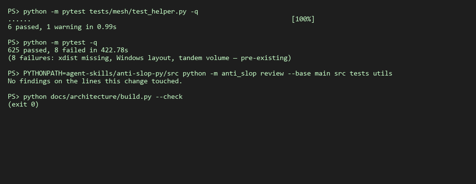

# Week 11, Ehsan

_Individual log. One section per PR merged this week, each a copy of that PR's Part A. See
[docs/logs/README.md](../README.md)._

### For test PR #**279** written to assess functionality in **main, `helper.rotate_points` (DICOM to cylinder transform)**

#### Testing receipts

- The functionality works correctly because the happy path tests involving **`test_identical_axes_leave_every_point_unchanged`, `test_a_point_on_v1_lands_on_v2_after_a_right_angle_realign`, `test_a_cloud_keeps_pairwise_distances_when_the_axis_turns_ninety_degrees`, `test_a_single_point_vector_returns_three_coordinates_not_a_one_row_matrix` (4 passed)** passed.
- I wrote tests to cover abnormal situations involving **a flat length-3 vector taking the single-point branch** and they passed.
- I checked that these negative cases involving **identical axes returning zeros instead of the cloud** failed as expected after a deliberate break of the early return.
- Among these tests, **all four** are unit tests and integration tests are not required because **`rotate_points` is pure numpy with no Qt or OCC**.
- These tests are included in the directory **`tests/mesh/`**.
- This new test PR did not break anything else in the system because **`python -m pytest tests/mesh/test_helper.py tests/mesh/test_spec_from_points.py -q` is 17 passed, anti-slop had 0 blocking findings, and `python docs/architecture/build.py --check` exited 0**.
  - 
- Not applicable: **generated-test review (hand-written)**.
