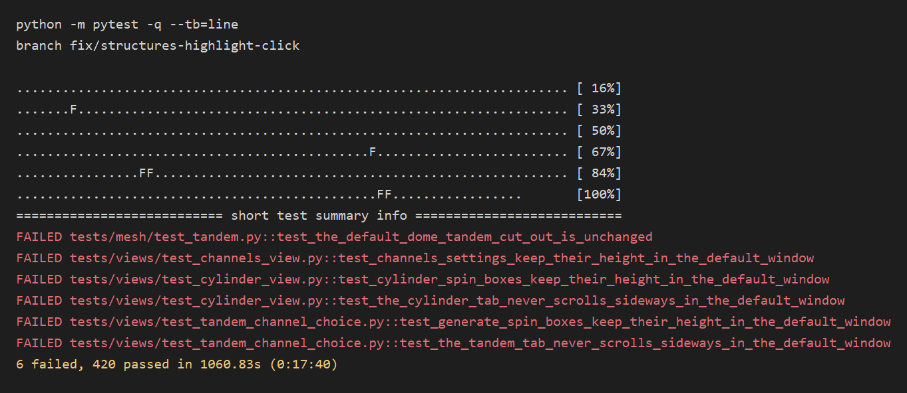

# Week 9, Ehsan

_Individual log. One section per PR merged this week, each a copy of that PR's Part A. See
[docs/logs/README.md](../README.md)._

### For PR #**228**

- As part of requirement **FR-SV-01**, the user needs to do **select a listed organ, hide it with its checkbox or move to it with the keyboard, and still control that highlight**.
- Therefore, I implemented/generated code so that **the medical physicist keeps the highlight when showing or hiding an organ, and one click after a keyboard move clears it**.

#### Frontend

- The frontend is designed using **PySide6** with design components for **the Structures `QListWidget`**. Therefore, changing the design of **`structure_list` row updates** will automatically change the look and feel of all instances of that component throughout the system. Changes to the content will not affect the design because **row text still comes from `structure_list_rows`**.
- Not applicable: **data caching (no backend fetch), restricted pages (no logins), usability evaluation (none run), accessibility (no new copy), traceability matrix (FR-SV not complete), test coverage (no coverage tool)**.

#### Review and design

- When I reviewed the **Structures list click handling** for this functionality, I noticed **`changed` cleared every `QListWidgetItem`, so a checkbox click deleted its own row (`RuntimeError: Internal C++ object already deleted`)**. Therefore, I did **rewrite the rows in place when the ROI numbers are unchanged**.
- When I reviewed the **same-click guard** for this functionality, I noticed **keyboard movement set `_just_selected` and never cleared it, so the next click left `highlighted` at 2**. Therefore, I did **set the guard only when a mouse press changes the current row**.
- The PR does not contain any temporary workaround because **the same row objects stay for a visibility change, and a new plan still rebuilds the list**.
- The PR only contains small functions that are **33 lines** long (`action_update_structure_list`).
- I did **run `PYTHONPATH=agent-skills/anti-slop-py/src python -m anti_slop review --base origin/main src tests utils` (no findings)** to ensure that my feature contribution does not contain any of the following:
  - hardcoded values
  - duplicate code
  - dead code
  - unnecessary function calls
  - excessive conditional logic
  - deep nesting
  - high cyclomatic complexity
  - classes/modules/functions with many unrelated responsibilities
- This work is written in **`structures_view.py`** because **the bug is which list signal the click handles**.
- This work belongs in **the Structures page** in the DFD because **highlight and visibility stay display-only and Export is unchanged**.

#### Testing receipts

- The functionality works correctly because the happy path tests involving **`test_toggling_checkbox_does_not_drop_highlight` and `test_click_after_keyboard_navigation_can_rehighlight` (4 passed with the neighbouring highlight click tests)** passed.
- I checked that these negative cases involving **a forced list rebuild (deleted `QListWidgetItem`) and a guard left set after keyboard movement (`highlighted` stayed 2)** failed as expected.
- Among these tests, **`test_toggling_checkbox_does_not_drop_highlight` and `test_click_after_keyboard_navigation_can_rehighlight`** are integration tests and unit tests are not required because **the failure is in the list widget's click handling**.
- These tests are included in the directory **`tests/views/`**.
- This new test PR did not break anything else in the system because **`python -m pytest` on this branch is 420 passed, 6 failed. The 6 are `test_the_default_dome_tandem_cut_out_is_unchanged` and five default-window layout tests. The two highlight tests passed. The image is that summary.**

  

## Stack #234, #245 and #246, at a glance

Three stacked PRs for Hide all. Each is based on the one below it, closes its own issue, and should be retargeted to main once its parent merges. A row's counts are that PR's own diff only. This PR is first; #245 and #246 follow on stacked branches.

| PR | On | Closes | What this PR adds | Own diff (files, lines) | New tests | Suite after |
|---|---|---|---|---|---|---|
| [#234](https://github.com/COSC-499-W2026/capstone-project-team-10/pull/234) | `main` | #150 | Hide all button | 9 files, +275/-7 | 4 | hide-all tests 4 passed |
| [#245](https://github.com/COSC-499-W2026/capstone-project-team-10/pull/245) | #234 | #232 | Hide all on the DFD and UML | 9 files, +41/-19 | 0 | inherited |
| [#246](https://github.com/COSC-499-W2026/capstone-project-team-10/pull/246) | #245 | #233 | Hide all on the system architecture | 4 files | 0 | inherited |

### Shared by every PR in this stack

- Code quality checklist: **`PYTHONPATH=agent-skills/anti-slop-py/src python -m anti_slop review --base main src tests utils` reported no findings. `python docs/architecture/build.py --check` exited 0. `sh .claude/hooks/session-start.sh` exited 0 with no UNDOCUMENTED or STALE ROW line.**
- Not applicable: **database (none), backend API (none), security sanitization, privacy sanitization, encryption, access controls (no network or logins), restricted pages (no logins), usability evaluation (none run), test coverage (no coverage tool)**.

### For PR #**234** (1 of 3, on main)

- As part of requirement **FR-SV-03**, the user needs to do **open Structures, click Hide all, then check one organ again**.
- Therefore, I implemented/generated code so that **the medical physicist clears every listed structure in one click and can show one organ again**.

#### Backend

- The system uses **`StructuresModel.hide_all`** because **visibility is already the set of requested ROI numbers**. Benefits for using this pattern include **the existing `changed` signal refreshes the list and the preview**. Possible risks include **a surface that finishes after the click showing the organ again**.
  - To mitigate **a late surface coming back**, we rely on **`presentations()` returning only ROIs still in `visible`**. `_accept_surface` still attaches a mesh whenever `result.alignment == self.alignment` and the ROI is in `_outlines`; there is no visibility check there. That cache stays unused until the organ is shown again. Hide all also advances the generation tag and clears the surface pool queue and `pending`, so queued work does not block the next show and unchecked rows do not keep Building surface. `test_hide_all_clears_surface_mode_presentations` and `test_hide_all_clears_pending_surface_work` cover Surface mode and pending work.
  - We considered alternative solutions such as **a new signal, which the list and the viewport would both have to learn**.
- The system architecture diagram consists of the following major components: **presentation, application state, domain services, libraries, local storage**. This structure has low coupling because **Hide all adds no signal and no file**. This structure has high cohesion because **requested visibility stays on `StructuresModel`**. This design is scalable because **a later Show all can fill the same set**. [system architecture](https://github.com/COSC-499-W2026/capstone-project-team-10/blob/main/docs/architecture/diagrams/system-architecture.svg)
- The system uses **synchronous data processing** because **the click runs on the GUI thread**. This method is done by **`hide_all` clearing `visible`, clearing pending work, clearing the highlight, and emitting `changed` only when something was visible**. Benefits for using this approach include **the checkboxes update in the same turn as the click**. Possible risks include **an in-flight reconstruction that cannot be cancelled**.
  - To mitigate **that result redrawing a hidden organ**, we rely on **the generation tag rejecting stale finishes, and `presentations()` filtering on `visible`**.
  - We considered alternative solutions such as **cancelling the worker thread itself, which Qt cannot do for the task already running**.
- The system adopts a **stateful** approach to state management because **`visible` is the list of organs the preview may draw**. This method is done by **`visible.clear()`**. Benefits for using this approach include **a later `set_visible` shows one organ without reloading the plan**. Possible risks include **dropping the surface cache**.
  - To mitigate **rebuilding a mesh the physicist will show again**, we implemented **leaving `_surfaces` and `unavailable` in place**.
  - We considered alternative solutions such as **calling `clear`, which would drop the plan**.
- The Level 0 DFD consists of the following major components: **treatment planning system, medical physicist, printer, brachify**. **Hide all is another physicist input on the existing structures edge. The label is updated in #245.** [DFD level 0](https://github.com/COSC-499-W2026/capstone-project-team-10/blob/main/docs/architecture/diagrams/existing-framework/dfd-0.svg)
- The Level 1 DFD consists of the following major processes: **Import, Cylinder, Channels, Tandem, Export, Structures preview**. **Happy path: Hide all empties requested visibility and the preview draws no anatomy. Failure path: a mismatched frame stays in `unavailable` and its row stays disabled.** [DFD level 1](https://github.com/COSC-499-W2026/capstone-project-team-10/blob/main/docs/architecture/diagrams/existing-framework/dfd-1.svg)
- Not applicable: **traceability matrix (FR-SV not complete)**.

#### Frontend

- The frontend is designed using **PySide6** with design components for **a Hide all `QPushButton` under Change colour**. Therefore, changing the design of **that button** will automatically change the look and feel of all instances of that component throughout the system. Changes to the content will not affect the design because **the rows still come from `structure_list_rows`**. The button starts disabled and stays disabled whenever `visible` is empty.
- Not applicable: **data caching (no backend fetch), accessibility (no new principle adopted)**.

#### Review and design

- When I reviewed the **Structures controls** for this functionality, I noticed **Change colour already sits above the list, so the October button placement would have landed in front of it**. Therefore, I did **put Hide all under Change colour**.
- The PR does not contain any temporary workaround because **`hide_all` clears the existing `visible` set and uses `changed`**.
- The PR only contains small functions that are about **20 lines** long (`hide_all`).
- Code quality checklist: **see Shared**.
- This work is written in **`structures_model.py` and `structures_view.py`** because **visibility is model state and the button is the Structures control**.
- This work belongs in **Structures preview** in the DFD because **anatomy stays display-only and Export is unchanged**.

#### Testing receipts

- The functionality works correctly because the happy path tests involving **`test_hide_all_clears_listed_organs_and_one_can_return`, `test_hide_all_clears_surface_mode_presentations`, `test_hide_all_does_nothing_when_nothing_is_visible`, and `test_hide_all_clears_pending_surface_work` (4 new)** passed.
- I wrote tests to cover abnormal situations involving **a structure from another frame staying disabled (`unavailable` still contains `frame`) and pending surface work clearing on Hide all** and they passed.
- I checked that these negative cases involving **`hide_all` emitting `changed` without `visible.clear()` (bladder and rectum stayed in `presentations()`) and leaving `pending` populated after Hide all** failed as expected.
- Among these tests, **the four Hide all cases** are integration tests and unit tests are not required because **the failure is the button not clearing the model the list shows**.
- These tests are included in the directory **`tests/views/`**.
- This new test PR did not break anything else in the system because **`xvfb-run -a env QT_QPA_PLATFORM=offscreen python -m pytest tests/views/test_structure_display.py -k hide_all -q` is 4 passed.** Evidence: [before](https://raw.githubusercontent.com/COSC-499-W2026/capstone-project-team-10/feat/structures-hide-all/docs/logs/ehsan/screenshots/week-9/pr-234-1-hide-all-before.png), [after Hide all](https://raw.githubusercontent.com/COSC-499-W2026/capstone-project-team-10/feat/structures-hide-all/docs/logs/ehsan/screenshots/week-9/pr-234-2-hide-all-after.png), [pytest hide-all](https://raw.githubusercontent.com/COSC-499-W2026/capstone-project-team-10/feat/structures-hide-all/docs/logs/ehsan/screenshots/week-9/pr-234-3-pytest-hide-all.png).
- Not applicable: **generated-test review (no generated test)**.

### For PR #**245** (2 of 3, on #234)

- As part of requirement **FR-SV-03**, the user needs to do **read the flow pictures and see Hide all as an input to brachify**.
- Therefore, I implemented/generated code so that **the DFD and UML name Hide all on the existing structures path**.

#### Review and design

- When I reviewed the **DFD and UML labels** for this functionality, I noticed **they named visibility, mode, opacity, highlight, and collision warnings, and not Hide all**. Therefore, I did **add Hide all on those three edges and render the pictures**. System architecture stays in #246 so this PR stays under 10 files.
- Code quality checklist: **see Shared**.
- This work is written in **`docs/architecture/`** because **that folder owns the pictures and the rule for when they change**.
- Not applicable: **temporary workaround, function length, DFD process (no code changed)**.

#### Testing receipts

- The functionality works correctly because the happy path checks involving **`python docs/architecture/build.py --check` (exit 0), `dfd-0.mmd` and `dfd-1.mmd` containing `Hide all`, and `uml.mmd` containing `hide_all`** passed.
- This new test PR did not break anything else in the system because **the diff against `feat/structures-hide-all` is documentation only, and `--check` exited 0**.
- Not applicable: **abnormal cases, negative cases, generated-test review, unit and integration tests, test directory (no code, the check is `build.py --check`)**.

