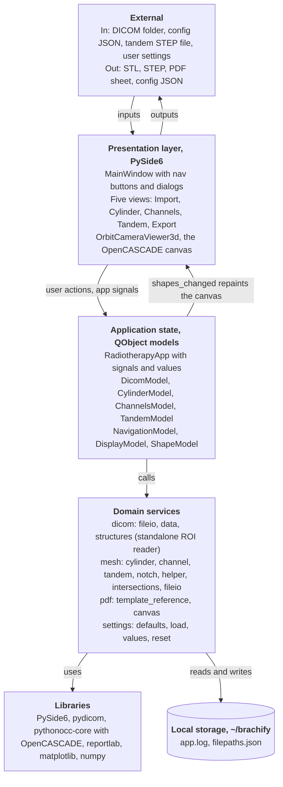
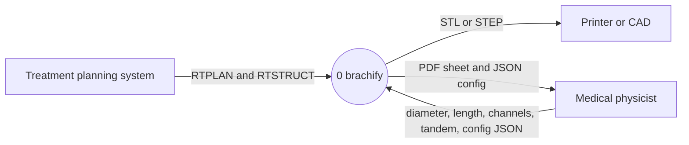
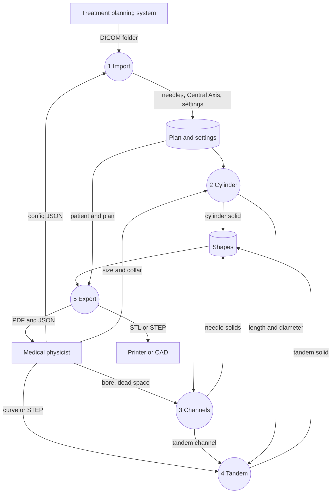

# Week 5, Gilles

_Individual log. One section per PR merged this week, each a copy of that PR's Part A. See
[docs/logs/README.md](../README.md)._

### For PR #**27**

- As part of requirement **milestone 1 FR-SV-01 and FR-SV-03, decoding and classification only**, the user needs to do **load RTSTRUCT anatomy before future visualization; GUI integration remains pending**.
- Therefore, I implemented/generated code so that **developers can call `read_structures()` to obtain validated ROI metadata and all contour points**.

#### Data Modeling and Integrity

- This data **RTSTRUCT ROIs** is modeled as **frozen `Structure` and `Contour` dataclasses** because **fields and patient-coordinate points remain explicit and immutable**. We considered alternative models such as **bare dictionaries, which lose the named boundary contract**.
- This data **RTSTRUCT contours** uses the input validation to ensure it adheres to **ROI identity, finite XYZ triples, declared point counts, RGB bounds and consistent XOR semantics**.
- This data **DICOM input** may be vulnerable to **malformed numeric and reference fields**. Therefore, it uses a security-based sanitization by **rejecting invalid records with `StructureReadError`, without partial results**. We considered alternative security solutions such as **silently skipping records, which could hide missing anatomy**.
- This data **structure names and geometry** may be vulnerable to **patient-identifying content in labels**. Therefore, it uses a privacy-based sanitization by **none; this reader is not a de-identification tool and adds no logging or persistence**. We considered alternative privacy solutions such as **removing labels, which would discard required structure names**.
- This data stores sensitive information and uses encryption — **N/A**, no persistence or encryption is added.
- The data has access controls — **N/A**, this local function adds no authorization layer.

#### Backend

- The system uses **a standalone decoding boundary** because **FR-SV-01 needs anatomy independently of Qt**. Benefits for using this pattern include **headless tests**. Possible risks include **ambiguous ROI joins**.
  - To mitigate **misidentification**, we implemented **ID-based joins and duplicate/reference checks**.
  - We considered alternative solutions such as **positional joins, which fail shuffled records**.
- The system architecture diagram consists of the following major components: **presentation, application state, domain readers and geometry, libraries, local storage**. This structure has low coupling because **the new reader imports only pydicom and standard-library types**. This structure has high cohesion because **its functions decode RTSTRUCT records**. This design is scalable because **future consumers can reuse immutable results without widgets**.

- The system uses a database — **N/A**, this change adds no database.
- The system uses **synchronous data processing** because **the caller supplies an already-loaded dataset**. This method is done by **joining records and decoding each ROI**. Benefits for using this approach include **deterministic return or exception**. Possible risks include **large datasets blocking a future GUI caller**.
  - To mitigate **current UI blocking**, we implemented **no GUI connection in this change**.
  - We considered alternative solutions such as **background execution, deferred to GUI integration**.
- The system adopts a **stateless** approach to state management because **one call decodes one dataset**. This method is done by **returning immutable tuples without mutating input**. Benefits for using this approach include **repeatable reads**. Possible risks include **future callers retaining results from an old plan**.
  - To mitigate **partially decoded replacements**, we implemented **all-or-error returns**.
  - We considered alternative solutions such as **incremental global updates, which expose partial state**.
- The Level 0 DFD consists of the following major components: **clinician, brachify and exported files**. **The existing flow is unchanged; this reader is not yet connected to Import**.

- The Level 1 DFD consists of the following major processes: **Import, Cylinder, Channels, Tandem and Export**. **The existing plan-to-model flow is unchanged**. **Reader failures raise `StructureReadError` to a future caller, with no current GUI handler**.

- The backend API must serve **future local Python callers**. We decided to use **`read_structures(Dataset)`** for all interactions with the backend because **it separates file loading from decoding**. Benefits for using this approach include **real in-memory fixtures**. Possible risks include **mistaking decoded contours for validated solids**.
  - To mitigate **that assumption**, we implemented **explicit module documentation excluding surface reconstruction and geometric validity checks**.
- The following traceability matrix shows the list of requirements completed in this milestone and their associated tests: **FR-SV-01 decoding subset → `test_join_by_identifier_and_keep_all_slices`; FR-SV-03 classification subset → `test_preserve_input_and_unknown_type`; neither full requirement is complete**.

#### Review and design

- When I reviewed the **contour reader** for this functionality, I noticed **mixed XOR and ordinary polygons were accepted**. Therefore, I did **add `test_reject_mixed_xor_contours`, observe its failure, and reject mixed types**.
- The PR does not contain any temporary workaround because **the reader has its own typed boundary and no UI dependency**.
- The PR only contains small functions that are **11–38 lines in production and 9–37 in tests, including docstrings, counted with Python AST** long.
- I did **source review and a clean anti-slop review; defaults and DICOM category constants are intentional, and the standalone API awaits a caller** to ensure that my feature contribution does not contain any of the following:
  - hardcoded values
  - duplicate code
  - dead code
  - unnecessary function calls
  - excessive conditional logic
  - deep nesting
  - high cyclomatic complexity
  - classes/modules/functions with many unrelated responsibilities
- This work is written in **`src/classes/dicom/structures.py`** because **decoding belongs at the DICOM boundary**.
- This work belongs in **the future Import extension** in the DFD because **it prepares anatomy before rendering; current runtime flows are unchanged**.

#### Testing receipts

- The functionality works correctly because the happy path tests involving **ID joins, all slices and contour semantics; full suite 44 passed** passed.
- I wrote tests to cover abnormal situations involving **duplicate names, optional metadata and geometry-free ROIs** and they passed.
- I checked that these negative cases involving **invalid coordinates, orphan references, duplicate IDs, invalid colours and mixed XOR contours** failed as expected.
- When I reviewed the **missing-definition test**, I noticed **its final assertions had been placed in the frame-reference test**. Therefore, I did **move them into `test_reject_wrong_modality_and_missing_definitions` and rerun the suite**.
- Among these tests, **24 cases in `test_structures.py`** are unit tests and integration tests are not required because **this module accepts datasets directly; separate headless checks decoded each bundled RTSTRUCT into 42 ROIs and 152 contours**.
- These tests are included in the directory **`tests/dicom/`**.
- This new test PR did not break anything else in the system because **44 tests pass; the new module has no GUI caller. GUI regression and screenshot remain unverified

---
