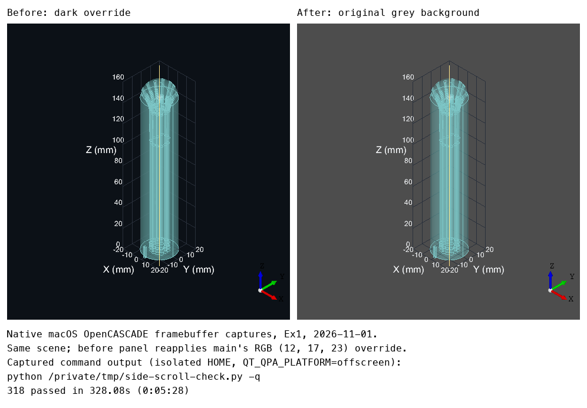

# Week 8, Gilles

_Individual log. One section per PR merged this week, each a copy of that PR’s Part A. See
[docs/logs/README.md](../README.md)._

### For PR #**180**

- As part of requirement **FR-SV-06 (frontend camera controls), issue #160**, the user needs to do **scroll sideways to roll the view clockwise/counterclockwise and vertically to zoom**.
- Therefore, I implemented/generated code so that **the viewport routes clearly horizontal scroll to bounded roll and clearly vertical scroll to zoom, ignoring ambiguous diagonal input**.

#### Frontend

- The following traceability matrix shows the list of requirements completed in this milestone and their associated tests: **FR-SV-06, side-scroll roll only → `test_scroll_routes_dominant_axis_without_combining_actions` and `test_wheel_handler_accumulates_roll_repaints_and_preserves_zoom` (14 new cases vs main; 20 camera cases total)**.
- Not applicable: **data caching, restricted pages, design components (unchanged), usability evaluation, accessibility, test coverage (not measured)**.

#### Review and design

- When I reviewed the **wheel routing and handler** for this functionality, I noticed **diagonal jitter could roll, roll was unbounded, and absolute twist or missing repaint escaped the tests**. Therefore, I did **add a 2:1 axis gate, shared clamped step normalization and real-wheel-handler tests**.
- The review by **Ayyhab and ariqmuldi** identified **jitter, unbounded roll and missing handler coverage**. Therefore, I did **add the axis gate, clamp, mutation-tested handler checks and native camera evidence**.
- The PR does not contain any temporary workaround because **roll uses the existing native camera API**.
- The PR only contains small functions that are **8 lines for `wheel_camera_motion`, 4 for `wheel_steps`, and 10 for `wheelEvent`** long.
- This work is written in **`src/windows/views/viewport.py`** because **that module owns camera input and native viewer calls**.
- This work belongs in **the existing viewport presentation in the DFD** because **only camera orientation changes; geometry, models and export flows are unchanged**.
- Not applicable: **code quality checklist (the explicit 10-degree sensitivity is a documented fixed control setting, so no blanket claim of no hardcoded values)**.

#### Testing receipts

- The functionality works correctly because the happy path tests involving **20 camera cases, including mixed delta sources, opposite directions and native-handler calls (14 new vs main, 9 added during review)** passed.
- I wrote tests to cover abnormal situations involving **zero movement, diagonal dead-zone boundaries, large deltas and both Qt inverted flags** and they passed.
- I checked that these negative cases involving **absolute SetTwist and removed Repaint mutations, each caught by two handler cases; the nine added cases were first watched failing against the reviewed code** failed as expected.
- These tests are included in the directory **`tests/views/`**.
- Among these tests, **12 routing cases** are unit tests and **2 wheel-handler cases** are integration tests.
- This new test PR did not break anything else in the system because **332 passed in 368.54s (0:06:08) (14 new cases vs main); 20 camera cases passed; lint and architecture checks passed; native macOS synthetic wheel events verified reversibility, 144 pole/near-pole steps, post-orbit stability, diagonal no-op and vertical zoom (image 1). Physical trackpad gestures were not tested**.

  
- Not applicable: **generated-test review (covered by the two caught mutations above)**.

### For PR #**197**

- As part of requirement **#159, restore the grey viewport background**, the user needs to do **open Brachify and view the probe against the original grey background**.
- Therefore, I implemented/generated code so that **the viewport retains OpenCASCADE's default grey background**.

#### Frontend

- The frontend is designed using **PySide6 and OpenCASCADE** with design components for **the shared 3D viewport**. Therefore, changing the design of **the viewport background** will automatically change the look and feel of all instances of that component throughout the system. Changes to the content will not affect the design because **background setup is independent of the displayed shapes**.
- Not applicable: **data caching, usability evaluation, accessibility evaluation, coverage measurement (none introduced or performed)**.

#### Review and design

- When I reviewed the **viewport initialization** for this functionality, I did not find any problems with it because **the two-line removal restores the initialization used before the grid change, and the native framebuffer shows grey**.
- The PR does not contain any temporary workaround because **it removes the dark override instead of adding another colour override**.
- The PR only contains small functions that are **5 lines long (`InitDriver`)**.
- I did **a diff review and anti-slop review with no findings** to ensure that my feature contribution does not contain any of the following:
  - hardcoded values
  - duplicate code
  - dead code
  - unnecessary function calls
  - excessive conditional logic
  - deep nesting
  - high cyclomatic complexity
  - classes/modules/functions with many unrelated responsibilities
- This work is written in **`src/windows/views/viewport.py`** because **`InitDriver` initializes the native viewport**.
- This work belongs in **the existing display process** in the DFD because **only its background appearance changes**.

#### Testing receipts

- The functionality works correctly because the happy path tests involving **the native macOS viewport capture with Ex1, compared with the previous dark override (image 1)** passed.
- This new test PR did not break anything else in the system because **318 passed in 328.08s (0:05:28) (0 new tests; all inherited); architecture and session-start checks passed; image 1 includes the captured test output**.

  
- Not applicable: **new unit/integration tests, abnormal and negative cases, generated-test review (a visual default restoration; existing tests were rerun)**.

### For PR #**196**

- As part of requirement **FR-SV-06 (frontend camera inspection), issue #158**, the user needs to do **zoom into the probe and read finer model-coordinate grid intervals**.
- Therefore, I implemented/generated code so that **the grid switches between 10, 5 and 1 mm without moving its bounding walls, and labels sit closer to the box**.

#### Frontend

- The following traceability matrix shows the list of requirements completed in this milestone and their associated tests: **FR-SV-06 grid support → `test_grid_spacing_follows_zoom` (4 new cases) and `test_zoom_grid_keeps_bounds_and_updates_ticks` (3 new cases); camera reset itself is unchanged**.
- Not applicable: **data caching, restricted pages, design components (unchanged), usability evaluation, accessibility, test coverage (not measured)**.

#### Review and design

- When I reviewed the **`grid_spacing` tests and documentation** for this functionality, I noticed **they still described the earlier thresholds after the user selected 0.5 and 0.125 mm/pixel**. Therefore, I did **update boundary cases and documentation to preserve the user's chosen behaviour**.
- The PR does not contain any temporary workaround because **grid rebuilds follow native view scale, with the previous interval cached to avoid redundant geometry creation**.
- The PR only contains small functions that are **7 lines for `grid_spacing`, 10 for `_update_grid_spacing` and 27 for the updated `reference_grid`** long.
- This work is written in **`src/windows/views/viewport.py`** because **that module owns grid geometry, labels and camera events**.
- This work belongs in **the existing viewport presentation in the DFD** because **it changes display-only references, not models, printable geometry or export flows**.
- Not applicable: **code quality checklist (explicit spacing thresholds and label offsets are intentional fixed settings, so no blanket no-hardcoded-values claim), teammate review (none requested)**.

#### Testing receipts

- The functionality works correctly because the happy path tests involving **`test_grid_spacing_follows_zoom` and `test_zoom_grid_keeps_bounds_and_updates_ticks` (7 new cases; 16 grid cases total)** passed.
- I wrote tests to cover abnormal situations involving **negative model bounds, exact spacing thresholds and unchanged outer walls across all three intervals** and they passed.
- I checked that these negative cases involving **disabling the fine-grid threshold, which made the 0.125 mm/pixel case fail before restoring the implementation** failed as expected.
- These tests are included in the directory **`tests/views/`**.
- This new test PR did not break anything else in the system because **the independent-main isolated-home pytest run passed 325 tests; lint and architecture checks passed; [author: attach a screenshot of the 16 grid cases and full-suite result, plus before/after native views showing 10, 5 and 1 mm intervals and the revised label positions]. Native zoom transitions remain visually unverified**.
- Not applicable: **generated-test review (threshold mismatch covered above), unit and integration tests (new cases cover pure rules; native integration remains unverified)**.

