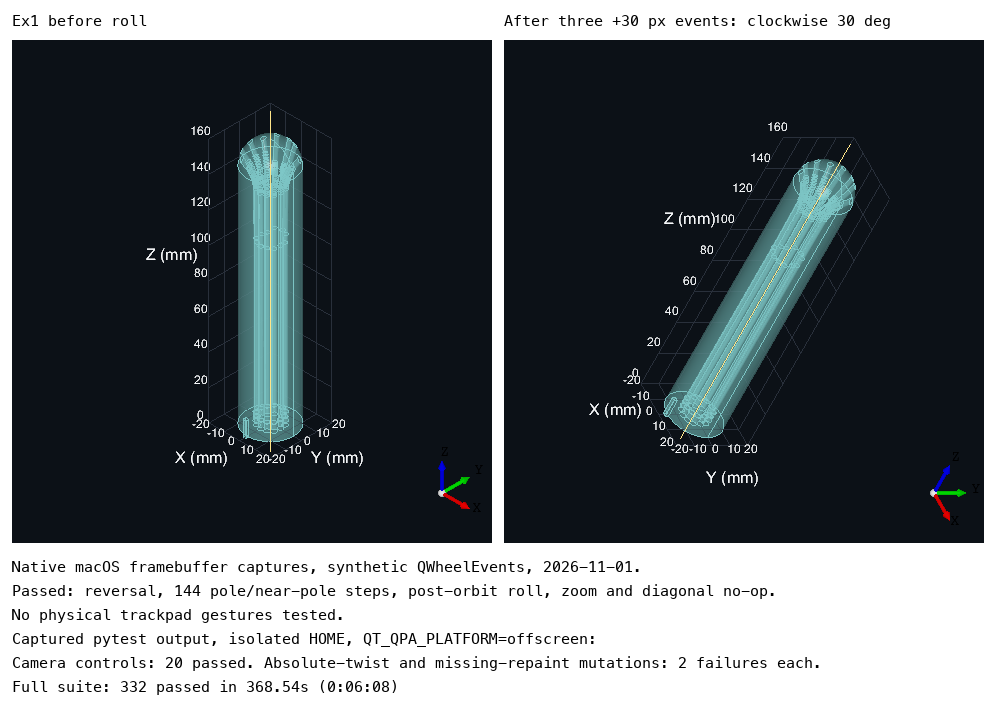

# Week 8, Gilles

_Individual log. One section per PR merged this week, each a copy of that PR’s Part A. See
[docs/logs/README.md](../README.md)._

### For PR #**180**

- As part of requirement **FR-SV-06 (frontend camera controls), issue #160**, the user needs to do **scroll sideways to roll the view clockwise/counterclockwise and vertically to zoom**.
- Therefore, I implemented/generated code so that **the viewport routes clearly horizontal scroll to bounded roll and clearly vertical scroll to zoom, ignoring ambiguous diagonal input**.

#### Frontend

- The following traceability matrix shows the list of requirements completed in this milestone and their associated tests: **FR-SV-06, side-scroll roll only → `test_scroll_routes_dominant_axis_without_combining_actions` and `test_wheel_handler_accumulates_roll_repaints_and_preserves_zoom` (14 new cases vs main; 20 camera cases total)**.
- Not applicable: **data caching, restricted pages, design components (unchanged), usability evaluation, accessibility, test coverage (not measured)**.

#### Review and design

- When I reviewed the **wheel routing and handler** for this functionality, I noticed **diagonal jitter could roll, roll was unbounded, and absolute twist or missing repaint escaped the tests**. Therefore, I did **add a 2:1 axis gate, shared clamped step normalization and real-wheel-handler tests**.
- The review by **Ayyhab and ariqmuldi** identified **jitter, unbounded roll and missing handler coverage**. Therefore, I did **add the axis gate, clamp, mutation-tested handler checks and native camera evidence**.
- The PR does not contain any temporary workaround because **roll uses the existing native camera API**.
- The PR only contains small functions that are **8 lines for `wheel_camera_motion`, 4 for `wheel_steps`, and 10 for `wheelEvent`** long.
- This work is written in **`src/windows/views/viewport.py`** because **that module owns camera input and native viewer calls**.
- This work belongs in **the existing viewport presentation in the DFD** because **only camera orientation changes; geometry, models and export flows are unchanged**.
- Not applicable: **code quality checklist (the explicit 10-degree sensitivity is a documented fixed control setting, so no blanket claim of no hardcoded values)**.

#### Testing receipts

- The functionality works correctly because the happy path tests involving **20 camera cases, including mixed delta sources, opposite directions and native-handler calls (14 new vs main, 9 added during review)** passed.
- I wrote tests to cover abnormal situations involving **zero movement, diagonal dead-zone boundaries, large deltas and both Qt inverted flags** and they passed.
- I checked that these negative cases involving **absolute SetTwist and removed Repaint mutations, each caught by two handler cases; the nine added cases were first watched failing against the reviewed code** failed as expected.
- These tests are included in the directory **`tests/views/`**.
- Among these tests, **12 routing cases** are unit tests and **2 wheel-handler cases** are integration tests.
- This new test PR did not break anything else in the system because **332 passed in 368.54s (0:06:08) (14 new cases vs main); 20 camera cases passed; lint and architecture checks passed; native macOS synthetic wheel events verified reversibility, 144 pole/near-pole steps, post-orbit stability, diagonal no-op and vertical zoom (image 1). Physical trackpad gestures were not tested**.

  
- Not applicable: **generated-test review (covered by the two caught mutations above)**.
