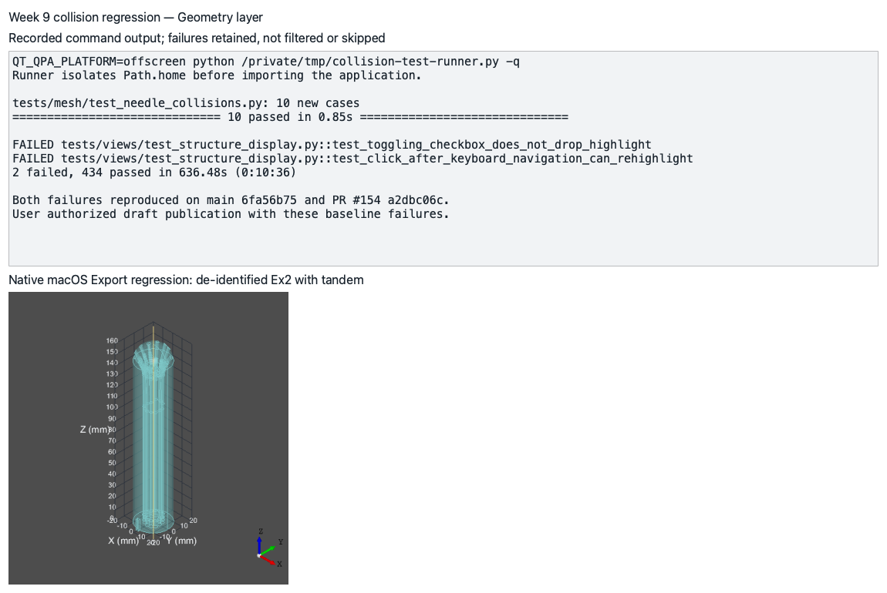
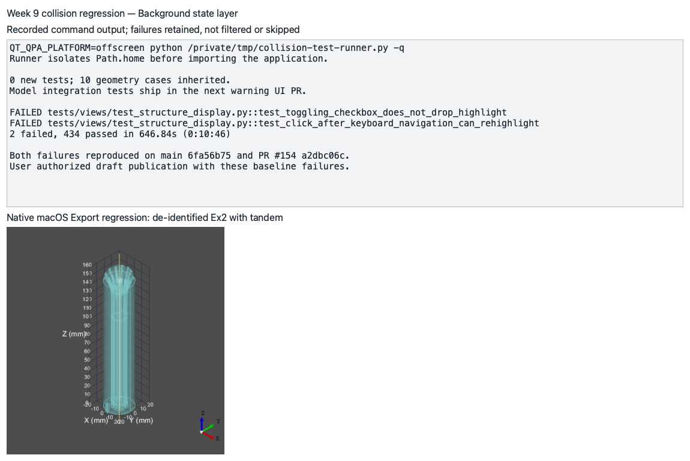
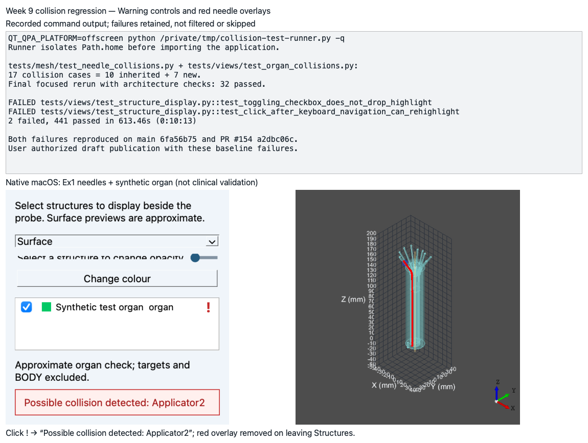

# Week 9, Gilles

_Individual log. One section per PR merged this week, each a copy of that PR’s Part A. See
[docs/logs/README.md](../README.md)._

## Stack #222 to #226, at a glance

| PR | On | Issue | Adds | Own diff | New tests | Suite |
|---|---|---|---|---|---|---|
| #222 | main | #161 | collision geometry | 7 files / 234 lines | 10 | 434 passed, 2 baseline failures |
| #223 | #222 | #161 | background collision state | 8 files / 184 lines | 0 | 434 passed, 2 baseline failures |
| #224 | #223 | #161 | warning controls and red needle overlays | 8 files / 389 lines | 7 | 441 passed, 2 baseline failures |
| #225 | #224 | #161 | UML and data-flow diagrams | 9 files / 87 lines | 0 | 441 passed, 2 baseline failures (inherited) |
| #226 | #225 | #161 | reference, design and test documentation | 5 files / 108 lines | 0 | 441 passed, 2 baseline failures (inherited) |

### Shared by every PR in this stack

- Diagrams: [system architecture](https://github.com/COSC-499-W2026/capstone-project-team-10/blob/docs/needle-collision-architecture/docs/architecture/diagrams/system-architecture.svg), [Level 0 DFD](https://github.com/COSC-499-W2026/capstone-project-team-10/blob/docs/needle-collision-architecture/docs/architecture/diagrams/existing-framework/dfd-0.svg), [Level 1 DFD](https://github.com/COSC-499-W2026/capstone-project-team-10/blob/docs/needle-collision-architecture/docs/architecture/diagrams/existing-framework/dfd-1.svg). Companion PR contains the completed flow.
- Scope: **issue #161, Gilles week 9; the intersection-warning portions of backend FR-SV-07 and frontend FR-SV-08 only. Distance measurement and clinical validation remain outside this stack.**
- Code quality checklist: **diff review, architecture check and session-start hook; Python changes have no blocking anti-slop findings. Fixed sampling and UI timings are explicit, so no blanket claim of no hardcoded values is made.**
- Baseline: **`test_toggling_checkbox_does_not_drop_highlight` and `test_click_after_keyboard_navigation_can_rehighlight` fail on unchanged main `6fa56b75` and independently on PR #154 commit `a2dbc06c`; neither is skipped or changed. Publishing with these failures was explicitly authorized.**
- Split: **companion documentation and the smaller file/line target exceptions were explicitly authorized; every PR remains below 10 files and 500 changed lines. Merge in dependency order, retargeting each successor to main.**
- Not applicable: **database, network backend API, authentication, test coverage percentage (none introduced or measured); teammate review and formal usability evaluation (not performed for this stack).**

### For PR #**222** (1 of 5, on main)

- As part of requirement **FR-SV-07 / FR-SV-08, intersection warnings only; issue #161**, the user needs to do **identify possible needle contact with organs while editing a plan**.
- Therefore, I implemented/generated code so that **collision geometry supports the collision-warning workflow**.

#### Backend

- The system uses **a pure geometry service** because **collision queries need deterministic model-mm inputs**. Benefits for using this pattern include **testing without widgets**. Possible risks include **sampling past contact**.
  - To mitigate **missed contact**, we implemented **at most 0.5 mm sample spacing with a 0.25 mm radius allowance**.
- The system adopts a **stateless query** approach to state management because **each NeedlePath supplies its own coordinates and radius**. This method is done by **querying a CollisionSurface triangle index**. Benefits for using this approach include **reusing the index for multiple needles**. Possible risks include **invalid mesh winding affecting containment**.
- The following traceability matrix shows the list of requirements completed in this milestone and their associated tests: **FR-SV-07 intersection portion → `test_needle_capsule_intersects_organ`, disconnected-gap and cavity tests (10 new cases)**.
- Not applicable: **UI integration and signal-flow diagrams (follow in the state/UI and companion architecture PRs); distance calculation (not implemented)**.

#### Review and design

- When I reviewed the **collision sampling and signed-angle containment** for this functionality, I did not find any problems with it because **literal cube, radius, disconnected-component and cavity cases passed**.
- The PR does not contain any temporary workaround because **collision state and presentation use dedicated domain/model/view responsibilities without changing exports**.
- The PR only contains small functions that are **4–22 lines for the new query methods; existing constructors receive wiring additions** long.
- Code quality checklist: **see Shared**.
- This work is written in **`src/classes/mesh/` and `tests/mesh/`** because **it owns collision geometry**.
- This work belongs in **the structure preview/check path** in the DFD because **it reports possible intersections without changing Export**.

#### Testing receipts

- The functionality works correctly because the happy path tests involving **10 new geometry cases (10 in the file), including crossings and enclosed needles** passed.
- I wrote tests to cover abnormal situations involving **disconnected components, a closed cavity and nonfinite path rejection** and they passed.
- I checked that these negative cases involving **removing the shaft radius from the query allowance** failed as expected.
- Among these tests, **the 10 literal geometry cases** are unit tests and integration tests are not required because **this PR introduces a pure geometry service; UI integration follows**.
- These tests are included in the directory **`tests/mesh/`**.
- This new test PR did not break anything else in the system because **the suite reports 434 passed, 2 baseline failures (424 passing cases inherited); the two failures match unchanged main and PR #154**.

  
### For PR #**223** (2 of 5, on #222)

- As part of requirement **FR-SV-07 / FR-SV-08, intersection warnings only; issue #161**, the user needs to do **identify possible needle contact with organs while editing a plan**.
- Therefore, I implemented/generated code so that **background collision state supports the collision-warning workflow**.

#### Backend

- The system uses **asynchronous data processing** because **surface queries must not run on the GUI thread**. This method is done by **CollisionTask on a separate single-worker pool after a 150 ms debounce**. Benefits for using this approach include **batching edits**. Possible risks include **late results from an old plan**.
  - To mitigate **stale results**, we implemented **revision checking in `accept` and immediate invalidation of warnings**.
- The system adopts a **stateful** approach to state management because **the UI needs current ROI-to-needle results**. This method is done by **CollisionModel owning collisions, unchecked organs and highlighted labels**. Benefits for using this approach include **keeping warnings outside printable geometry**. Possible risks include **silently ignoring hidden anatomy**.
  - To mitigate **hidden organs escaping checks**, we implemented **`organ_collision_surfaces` requesting the existing surface cache even in Outlines mode**.
- The following traceability matrix shows the list of requirements completed in this milestone and their associated tests: **FR-SV-07 → integration tests shipped in the next warning UI PR; this PR adds 0 cases and inherits 10 geometry cases**.
- Not applicable: **happy path, abnormal cases, negative cases, generated-test review, unit and integration tests, test directory (new integration coverage is in the warning UI PR)**.

#### Review and design

- When I reviewed the **CollisionModel invalidation and path snapshots** for this functionality, I did not find any problems with it because **the complete-stack integration tests cover stale results, hidden organs, dead space and the generated shaft**.
- The PR does not contain any temporary workaround because **collision state and presentation use dedicated domain/model/view responsibilities without changing exports**.
- The PR only contains small functions that are **3–18 lines for worker/check methods; 16 for organ surface access; existing constructors receive wiring additions** long.
- Code quality checklist: **see Shared**.
- This work is written in **`src/windows/models/` and `main_window.py`** because **it owns background collision state**.
- This work belongs in **the structure preview/check path** in the DFD because **it reports possible intersections without changing Export**.

#### Testing receipts

- This new test PR did not break anything else in the system because **the suite reports 434 passed, 2 baseline failures (434 passing cases inherited); the two failures match unchanged main and PR #154**.

  
### For PR #**224** (3 of 5, on #223)

- As part of requirement **FR-SV-07 / FR-SV-08, intersection warnings only; issue #161**, the user needs to do **identify possible needle contact with organs while editing a plan**.
- Therefore, I implemented/generated code so that **warning controls and red needle overlays supports the collision-warning workflow**.

#### Frontend

- The frontend uses **CollisionModel signals and ROI-keyed results** received from the backend because **warnings must follow current needle edits**. Benefits for using this pattern include **clearing stale emphasis immediately**. Possible risks include **warnings affecting printable geometry**.
  - To mitigate **export changes**, we implemented **temporary nonselectable red AIS overlays outside DisplayModel**.
- The frontend is designed using **PySide6 and OpenCASCADE** with design components for **the warning delegate, toast label and needle actor**. Therefore, changing the design of **the delegate** will automatically change the look and feel of all instances of that component throughout the system. Changes to the content will not affect the design because **needle names come from model results**.
- The frontend adopts accessibility principle **keyboard operation**. The aspects that demonstrate this principle in the system include **Enter activating a selected warning, checked by the real-widget test**.
- The following traceability matrix shows the list of requirements completed in this milestone and their associated tests: **FR-SV-08 warning/highlight portion → `test_warning_click_shows_toast_and_highlights_only_colliding_needles`; FR-SV-07 → the other model integration cases (7 new; 17 collision cases including 10 inherited)**.
- Not applicable: **distance display and clinical clearance assessment (outside scope)**.

#### Review and design

- When I reviewed the **warning click and overlay paths** for this functionality, I did not find any problems with it because **native Ex1 plus a synthetic organ showed Applicator2 in the toast and red framebuffer; leaving Structures cleared the overlay**.
- The PR does not contain any temporary workaround because **collision state and presentation use dedicated domain/model/view responsibilities without changing exports**.
- The PR only contains small functions that are **2–18 lines for warning/overlay methods; existing constructors receive wiring additions** long.
- Code quality checklist: **see Shared**.
- This work is written in **`src/windows/views/` and `tests/views/`** because **it owns warning controls and red needle overlays**.
- This work belongs in **the structure preview/check path** in the DFD because **it reports possible intersections without changing Export**.

#### Testing receipts

- The functionality works correctly because the happy path tests involving **7 new widget/model/actor cases (17 total collision cases with 10 inherited)** passed.
- I wrote tests to cover abnormal situations involving **hidden and unavailable organs, Outlines mode, stale results, moved/disabled needles and length changes** and they passed.
- I checked that these negative cases involving **omitting the generated shaft below the final dwell point** failed as expected.
- Among these tests, **the red actor property case** is a unit test and **the six real-model/widget worker cases** are integration tests.
- These tests are included in the directory **`tests/views/`**.
- This new test PR did not break anything else in the system because **the suite reports 441 passed, 2 baseline failures (434 passing cases inherited); the two failures match unchanged main and PR #154**.

  
### For PR #**225** (4 of 5, on #224)

- As part of requirement **FR-SV-07 / FR-SV-08, intersection warnings only; issue #161**, the user needs to do **identify possible needle contact with organs while editing a plan**.
- Therefore, I implemented/generated code so that **UML and data-flow diagrams supports the collision-warning workflow**.

#### Review and design

- When I reviewed the **UML and DFD sources against the source code** for this functionality, I did not find any problems with it because **the generated diagrams include the collision worker and display-only signals; build.py --check passes**.
- Code quality checklist: **see Shared**.
- This work is written in **`docs/architecture/`** because **it owns UML and data-flow diagrams**.
- Not applicable: **temporary workaround, function length, DFD process (no code changed)**.

#### Testing receipts

- The functionality works correctly because the happy path tests involving **`python docs/architecture/build.py --check`, the session-start hook and `git diff --check` (all exit 0)** passed.
- Not applicable: **abnormal cases, negative cases, generated-test review, unit and integration tests, test directory (no code changed; checks are commands)**.
- This new test PR did not break anything else in the system because **the suite reports 441 passed, 2 baseline failures (inherited) (441 passing cases inherited); the two failures match unchanged main and PR #154**.
### For PR #**226** (5 of 5, on #225)

- As part of requirement **FR-SV-07 / FR-SV-08, intersection warnings only; issue #161**, the user needs to do **identify possible needle contact with organs while editing a plan**.
- Therefore, I implemented/generated code so that **reference, design and test documentation supports the collision-warning workflow**.

#### Review and design

- When I reviewed the **reference and design notes against code and regression evidence** for this functionality, I did not find any problems with it because **the documents distinguish approximate intersection warnings from unimplemented distance measurement and clinical validation**.
- Code quality checklist: **see Shared**.
- This work is written in **the project reference, init guide note, design README and tests README** because **it owns reference, design and test documentation**.
- Not applicable: **temporary workaround, function length, DFD process (no code changed)**.

#### Testing receipts

- The functionality works correctly because the happy path tests involving **`python docs/architecture/build.py --check`, the session-start hook and `git diff --check` (all exit 0)** passed.
- Not applicable: **abnormal cases, negative cases, generated-test review, unit and integration tests, test directory (no code changed; checks are commands)**.
- This new test PR did not break anything else in the system because **the suite reports 441 passed, 2 baseline failures (inherited) (441 passing cases inherited); the two failures match unchanged main and PR #154**.
