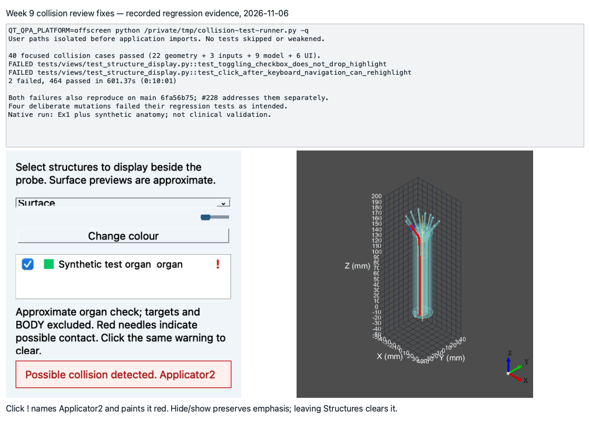

# Gilles — Week 9

## Part A

## Stack #222 to #226, at a glance

Merge order: **#222 → #243 → #223 → #224 → #225 → #226**.

| PR | Based on | Issue | Own change | Files / changed lines | New tests |
|---|---|---|---|---|---|
| #222 | main | #161 | Detect needle contact with reconstructed organ surfaces | 9 / 323 | 22 |
| #243 | #222 | #161 | Prepare hidden organ surfaces for collision checks | 5 / 133 | 3 |

Counts below refer to each PR’s own diff. The shared full-stack result is reported separately.

### Shared by every PR in this stack

- Scope: **issue #161, Gilles week 9; approximate organ-intersection warnings only. Targets and BODY, needle–needle detection, distance measurement and clinical clearance are excluded.**
- Code quality checklist: **diff and anti-slop review found no new blocking findings. Input contracts, duplicate/dead code, call frequency, branches/nesting, function responsibilities and sampling constants were reviewed. The repository exempts the existing OpenCASCADE shape-name warning.**
- Regression: **41 focused collision cases passed. The final full stack passed 465 tests with only `test_toggling_checkbox_does_not_drop_highlight` and `test_click_after_keyboard_navigation_can_rehighlight` failing, as on main `6fa56b75`. #228 fixes them separately; publishing with those failures was explicitly authorized. User paths were isolated before application imports. No tests were skipped or weakened.**
- Native evidence: **macOS Ex1 needles plus a synthetic organ showed Applicator2 in the corrected toast and red overlay. Hide/show preserved emphasis; leaving Structures cleared it. This is UI regression evidence, not clinical validation.**
- Split: **code PRs carry their own reference/test-index updates; the authorized diagram/reference companions hold shared evidence. All own diffs stay below 10 files and 500 changed lines; smaller-target exceptions were previously authorized.**
- Not applicable: **database, network API, authentication, formal usability evaluation and coverage percentage (none introduced or measured).**

### For PR #**222** (1 of 6, on main)

- As part of requirement **FR-SV-07 / FR-SV-08 intersection warnings; issue #161**, the user needs to do **identify possible needle contact with organs while editing a plan**.
- Therefore, I implemented/generated code so that **validate closed, consistently wound organ meshes and check complete needle paths**.

#### Backend

- The system uses **a pure geometry service with validated NeedlePath and CollisionSurface values** because **checking anatomy must remain independent of printable geometry**. Benefits include **testable inputs**; the risk is **unchecked geometry appearing clear**, mitigated by **validation and explicit unavailable status**.
- The system uses **synchronous pure geometry queries, called by the later worker PR**. The risk of **missing contact or stale results** is mitigated by **bounded sample spacing, registered frames and generation/revision checks in the owning layer**.
- The system adopts a **validated triangle index with immutable paths** approach. Benefits include **reusing tissue geometry while needles change**; invalid anatomy is refused instead of silently treated as clear.
- The system architecture diagram shows **domain geometry, application state and presentation**, with exports separate. [System architecture](https://github.com/COSC-499-W2026/capstone-project-team-10/blob/feat/needle-collision-geometry/docs/architecture/diagrams/system-architecture.svg).
- The Level 0 DFD keeps **physicist/TPS input and printable output unchanged**; Level 1 adds **the display-only anatomy check path**. The completed flow is in companion #225: [Level 0](https://github.com/COSC-499-W2026/capstone-project-team-10/blob/docs/needle-collision-architecture/docs/architecture/diagrams/existing-framework/dfd-0.svg), [Level 1](https://github.com/COSC-499-W2026/capstone-project-team-10/blob/docs/needle-collision-architecture/docs/architecture/diagrams/existing-framework/dfd-1.svg).
- Traceability: **FR-SV-07 intersection portion → cube contact, invalid topology/path and later-segment/chunk cases**.
- Not applicable: **database, backend API, security roles, coverage percentage (none introduced or measured)**.

#### Review and design

- When I reviewed **geometry against the requested feedback**, I checked **cube contact, invalid topology/path and later-segment/chunk cases** and corrected the reported behaviour or documentation.
- Code quality checklist: **see Shared**.
- This work is written in **domain geometry and tests/mesh** because **that layer owns this change**.
- The PR only contains small new functions that are **4–22 lines; existing constructors receive integration wiring** long.
- The PR does not contain a temporary workaround because **validated geometry, model state and UI actors keep their existing responsibilities**. This work belongs in **Structures preview/checks** in the DFD.

#### Testing receipts

- The functionality works correctly because **cube contact, invalid topology/path and later-segment/chunk cases passed (22 new; 0 inherited collision cases; 41 in the complete stack)**.
- I wrote tests for abnormal situations involving **invalid path radii and unsafe mesh topology** and they passed.
- I checked negative cases by deliberately breaking **mesh topology rejection**; the corresponding regression tests failed.
- Among these tests, **22 are unit geometry cases** in **tests/mesh/**.
- Regression: **the final full-stack run and native check are recorded in Shared; the two named baseline failures remain. Focused tests also ran on the independently prepared prerequisite/model layers.**
- Not applicable: **formal usability evaluation, coverage percentage (not performed)**.

  

### For PR #**243** (2 of 6, on #222)

- As part of requirement **FR-SV-07 / FR-SV-08 intersection warnings; issue #161**, the user needs to do **identify possible needle contact with organs while editing a plan**.
- Therefore, I implemented/generated code so that **supply registered organ meshes independently of display preferences, with a read-only snapshot option**.

#### Backend

- The system uses **the existing StructuresModel surface cache with explicit request/read-only access** because **checking anatomy must remain independent of printable geometry**. Benefits include **testable inputs**; the risk is **unchecked geometry appearing clear**, mitigated by **validation and explicit unavailable status**.
- The system uses **surface requests through the existing single reconstruction worker**. The risk of **missing contact or stale results** is mitigated by **bounded sample spacing, registered frames and generation/revision checks in the owning layer**.
- The system adopts a **patient-space mesh cache with explicit surface requests** approach. Benefits include **reusing tissue geometry while needles change**; invalid anatomy is refused instead of silently treated as clear.
- The system architecture diagram shows **domain geometry, application state and presentation**, with exports separate. [System architecture](https://github.com/COSC-499-W2026/capstone-project-team-10/blob/feat/organ-collision-inputs/docs/architecture/diagrams/system-architecture.svg).
- The Level 0 DFD keeps **physicist/TPS input and printable output unchanged**; Level 1 adds **the display-only anatomy check path**. The completed flow is in companion #225: [Level 0](https://github.com/COSC-499-W2026/capstone-project-team-10/blob/docs/needle-collision-architecture/docs/architecture/diagrams/existing-framework/dfd-0.svg), [Level 1](https://github.com/COSC-499-W2026/capstone-project-team-10/blob/docs/needle-collision-architecture/docs/architecture/diagrams/existing-framework/dfd-1.svg).
- Traceability: **FR-SV-07 intersection portion → hidden Outlines requests, frame refusal and read-only snapshots**.
- Not applicable: **database, backend API, security roles, coverage percentage (none introduced or measured)**.

#### Review and design

- When I reviewed **organ-surface inputs against the requested feedback**, I checked **hidden Outlines requests, frame refusal and read-only snapshots** and corrected the reported behaviour or documentation.
- Code quality checklist: **see Shared**.
- This work is written in **models and tests/views** because **that layer owns this change**.
- The PR only contains small new functions that are **18 lines; existing constructors receive integration wiring** long.
- The PR does not contain a temporary workaround because **validated geometry, model state and UI actors keep their existing responsibilities**. This work belongs in **Structures preview/checks** in the DFD.

#### Testing receipts

- The functionality works correctly because **hidden Outlines requests, frame refusal and read-only snapshots passed (3 new; 22 inherited collision cases; 41 in the complete stack)**.
- I wrote tests for abnormal situations involving **unregistered anatomy and read-only requests** and they passed.
- I checked negative cases by deliberately breaking **the read-only request guard**; the corresponding regression tests failed.
- Among these tests, **3 are integration cases** in **tests/views/**.
- Regression: **the final full-stack run and native check are recorded in Shared; the two named baseline failures remain. Focused tests also ran on the independently prepared prerequisite/model layers.**
- Not applicable: **formal usability evaluation, coverage percentage (not performed)**.

  
