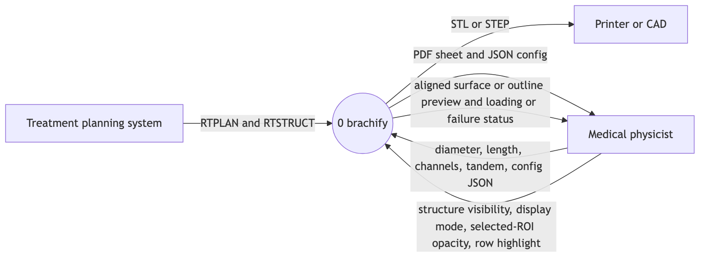
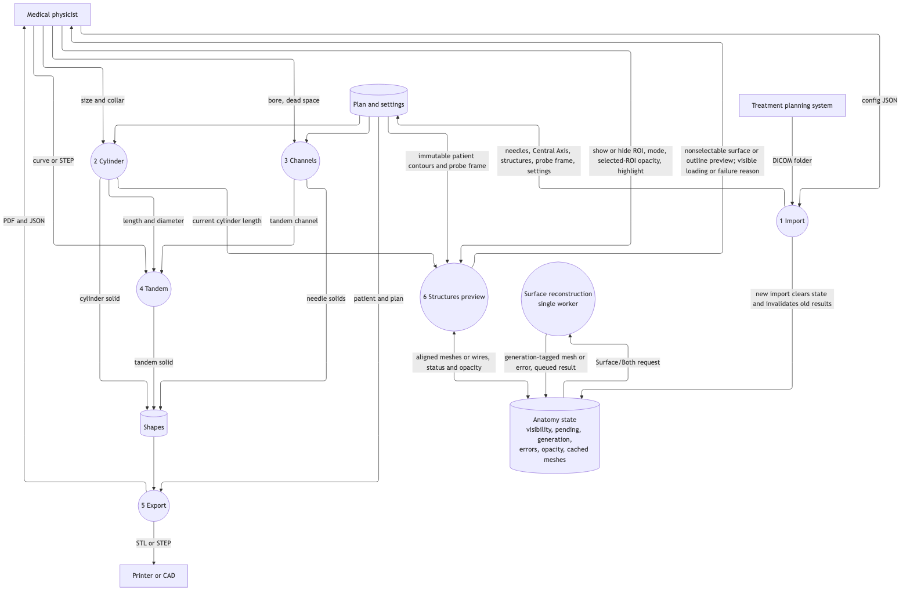
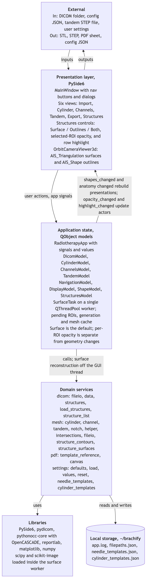

# Week 8, Team

_Team log. Part B, written once for the whole team, covering everyone's merged work this week.
The template is in [docs/logs/README.md](../README.md#team-log-part-b)._

**Authors:** Ariq Muldi (`ariqmuldi`).

**PRs covered:** #149 through #201, merged October 26 to November 1, 2026 in America/Vancouver
(#149 at 12:29 on October 27 to #201 at 22:45 on November 1). Evidence is pinned to `main` at
[`b02d8f0`](https://github.com/COSC-499-W2026/capstone-project-team-10/commit/b02d8f0de1cf17883fa5b3ac40f9a90f16e8c7a8).
That is 22 contributions: 21 merges into `main`, plus #199, merged into #198's branch and
landed by #198. Each merge commit was confirmed an ancestor of `b02d8f0`.
#164, #165, #166, #191, #192 and #193 merged only into branches that never reached `main`, and
#155 was closed. #200 and #201 replaced that colour work, so it is counted once there.
#147, the week 7 team log, merged on October 25 and belongs to week 7.

Individual receipts: [Ariq](../ariq/week-8.md), [Ahab](../ahab/week-8.md),
[Ehsan](../ehsan/week-8.md), [Gilles](../gilles/week-8.md).

## Contributions and review evidence

Files and lines are GitHub's per-PR counts, lines being additions plus deletions. **New tests**
counts `test_*` functions added, compared with each merge's first parent (for #198 and #199,
their parent branch), so a parametrized test is one function and nothing inherited is counted.
Where an individual log gives a different figure, the reason is noted under the table.
Approvers are teammates other than the author whose latest review approved.

### Structures tab: #149, #152, then #154 → #190 → #189, then #200 → #201

| PR | Author | Own contribution | Files | Lines | New tests | Approved by |
|---|---|---|---:|---:|---:|---|
| [#149](https://github.com/COSC-499-W2026/capstone-project-team-10/pull/149) | Ehsan | List only organs and tumours | 7 | 198 | 3 | Ariq, Gilles |
| [#152](https://github.com/COSC-499-W2026/capstone-project-team-10/pull/152) | Ehsan | Keep the BODY outline in that list | 6 | 118 | 2 (replacing 2) | Ariq, Ahab |
| [#154](https://github.com/COSC-499-W2026/capstone-project-team-10/pull/154) | Ehsan | Highlight the selected organ | 8 | 375 | 7 | Ariq, Ahab, Gilles |
| [#190](https://github.com/COSC-499-W2026/capstone-project-team-10/pull/190) | Ehsan | Highlight reference docs | 5 | 64 | 0 | Ahab, Ariq, Gilles |
| [#189](https://github.com/COSC-499-W2026/capstone-project-team-10/pull/189) | Ehsan | `highlight_changed` on the diagrams | 9 | 34 | 0 | Ahab, Ariq, Gilles |
| [#200](https://github.com/COSC-499-W2026/capstone-project-team-10/pull/200) | Ehsan | Structure colour override | 8 | 277 | 5 | Ariq, Gilles, Ahab |
| [#201](https://github.com/COSC-499-W2026/capstone-project-team-10/pull/201) | Ehsan | Black Structures tab copy | 6 | 52 | 1 | Gilles, Ahab |

### Tandem stack: #174 → #175 → #176 → #177 → #178 → #179 → #183

| PR | Author | Own contribution | Files | Lines | New tests | Approved by |
|---|---|---|---:|---:|---:|---|
| [#174](https://github.com/COSC-499-W2026/capstone-project-team-10/pull/174) | Ariq | Clear the tandem channel without errors | 8 | 207 | 3 | Ahab, Gilles, Ehsan |
| [#175](https://github.com/COSC-499-W2026/capstone-project-team-10/pull/175) | Ariq | Choose the tandem channel on the Tandem tab | 9 | 463 | 9 | Ahab, Gilles, Ehsan |
| [#176](https://github.com/COSC-499-W2026/capstone-project-team-10/pull/176) | Ariq | Channels list leaves out the tandem | 9 | 143 | 3 (1 replaced) | Ahab, Gilles, Ehsan |
| [#177](https://github.com/COSC-499-W2026/capstone-project-team-10/pull/177) | Ariq | Remove *Set as Tandem* | 9 | 198 | 1 (replacing 1) | Ahab, Gilles, Ehsan |
| [#178](https://github.com/COSC-499-W2026/capstone-project-team-10/pull/178) | Ariq | Warn before exporting with no tandem hole | 9 | 254 | 5 | Ahab, Gilles, Ehsan |
| [#179](https://github.com/COSC-499-W2026/capstone-project-team-10/pull/179) | Ariq | Import clears the previous plan's tandem | 7 | 194 | 1 | Ahab, Ehsan |
| [#183](https://github.com/COSC-499-W2026/capstone-project-team-10/pull/183) | Ariq | Follow-ups from Ahab's review | 9 | 231 | 6 | Ahab, Gilles, Ehsan |

### Custom applicator stack: #184 → #194 → #195 → #198 → #199

| PR | Author | Own contribution | Files | Lines | New tests | Approved by |
|---|---|---|---:|---:|---:|---|
| [#184](https://github.com/COSC-499-W2026/capstone-project-team-10/pull/184) | Ahab | Add a straight custom applicator | 9 | 499 | 11 | Ehsan, Gilles, Ariq |
| [#194](https://github.com/COSC-499-W2026/capstone-project-team-10/pull/194) | Ahab | Bend it by Theta and Phi | 8 | 233 | 5 | Ehsan, Gilles |
| [#195](https://github.com/COSC-499-W2026/capstone-project-team-10/pull/195) | Ahab | Remove a custom applicator | 8 | 393 | 7 | Ehsan, Ariq |
| [#198](https://github.com/COSC-499-W2026/capstone-project-team-10/pull/198) | Ahab | Edit a custom applicator | 9 own (12 landed) | 330 own (496 landed) | 6 | Gilles, Ariq |
| [#199](https://github.com/COSC-499-W2026/capstone-project-team-10/pull/199) | Ahab | Refuse numbers the export cannot cut | 8 | 174 | 3 | Gilles, Ariq |

### Viewport: three independent PRs

| PR | Author | Own contribution | Files | Lines | New tests | Approved by |
|---|---|---|---:|---:|---:|---|
| [#180](https://github.com/COSC-499-W2026/capstone-project-team-10/pull/180) | Gilles | Trackpad camera roll | 8 | 191 | 2 | Ariq, Ehsan |
| [#197](https://github.com/COSC-499-W2026/capstone-project-team-10/pull/197) | Gilles | Restore the grey background | 5 | 46 | 0 | Ehsan, Ariq |
| [#196](https://github.com/COSC-499-W2026/capstone-project-team-10/pull/196) | Gilles | Zoom-adaptive XYZ grid | 7 | 130 | 2 | Ehsan, Ariq |

- **#198's own diff** is `git diff --shortstat 43b1982 f32af07`, its branch before #199 merged
  into it. GitHub's 12 files and 496 lines include #199, so #199's lines are not counted twice.
- **Totals:** 82 new test functions, 4 replaced, so 246 functions at week 7's `eab39fc` became 324.
- **Logs that differ:** [Ahab's](../ahab/week-8.md) "20" and "12" new tests for #184 and #194
  count parametrized cases. [Ehsan's](../ehsan/week-8.md) #154 row (6 files, 4 tests) predates
  its review fixes. The landed merge `b87f58b` has 8 files and 7 functions.

## Part B: What Our Team Added and How the Changes Satisfy Software Engineering Principles

- This week, we decided to focus on **finishing the Structures tab (FR-SV-01: anatomy only,
  BODY kept, highlight, colour, legible copy), choosing the tandem channel on the Tandem tab,
  custom applicators (#112: add, bend, remove, edit, cut check) and viewport navigation** with
  the goal of **landing each in `main` with its own tests and a run of the app, with no
  numerical target agreed in advance (week 7 recorded no plan)**.
- The work was distributed so that **Ariq** focused on **templating and customizability: the
  tandem channel choice (#174–#183)**, **Ahab** focused on **templating and customizability:
  custom applicators (#184–#199)**, **Ehsan** focused on **structures and organs: the
  Structures tab (#149–#201)**, and **Gilles** focused on **structures and organs: the viewport
  that displays them (#180, #196, #197)**. We considered alternative workload distributions such
  as **none recorded**.
- Based on **22 contributions landed, each with at least two teammate approvals; `python -m
  pytest` at `b02d8f0` on macOS, 424 passed and 2 failed of 426 collected (315 at week 7's
  `eab39fc`); and `python docs/architecture/build.py --check` exiting 0 over seven diagrams**,
  we did not meet this goal due to the following challenges encountered: **two of #154's
  highlight tests fail on `main`
  (`test_toggling_checkbox_does_not_drop_highlight`, a deleted `QListWidgetItem`;
  `test_click_after_keyboard_navigation_can_rehighlight`, `highlighted` stays 2). Both also fail
  at #154's own merge `b87f58b`, so later PRs did not cause them. The highlight is otherwise in
  `main`**. Our plan for next week will be **to fix those two tests, add #200's
  `color_changed` to the diagrams, and split stacks before a PR reaches ten files. These are
  proposed in this log, not yet agreed by the team**.

  Evidence limits:

  - **Observed:** the full suite ran once in 418 s with `HOME` set to an empty folder, so no
    user config was read. That was on macOS only. It was not a run of the app.
  - **Reported:** each PR's app run and screenshots are in the individual logs. Ehsan's #154
    run (318 passed, 4 failed) predates `a2dbc06`, the review fix that added the two failing
    tests, so no recorded run shows them passing. Ahab's receipts report 17 failures because
    SciPy and scikit-image were missing from their environment. Those tests pass here.
  - **Diagram gap:** `StructuresModel.color_changed` from #200 is in the code and in §4.4 and §5.5
    of the source of truth, but in no diagram. #165 and #192 drew it but never reached `main`.
    `build.py --check` passes because it checks module names, not signals.
  - **PR size:** 21/22 PRs (95.5%) have fewer than 10 files, below the 99% target. #198 landed
    with 12 because it carried #199. Each PR's own diff is under 10. All 22 have fewer than 500
    lines, #184 at 499. 12/22 (54.5%) have fewer than 200 lines, inside the 50–75% target, and
    0/22 have fewer than 3 files. The 500-lines-per-file rule was not audited.
- By doing **#177 and #179**, **Ariq** found that the code base contained **similar logic
  implemented multiple times (the Channels tab's *Set as Tandem* beside #175's Tandem tab box)
  and many dependencies between modules (`import_view.py` resetting `TandemModel` fields one by
  one)**. Therefore, **Ariq** did **remove *Set as Tandem* in #177 and add
  `TandemModel.clear_for_new_plan` in #179**.
  By doing **a review of #175, #176 and #179**, **Ahab** found that the code base contained
  **changes in one component that required changes elsewhere: *Generate Tandem* did not
  refresh the off-axis warning, and a channel that became the tandem stayed selected and
  disableable on the Channels tab**.
  Therefore, **Ariq** did **fix both in #183**.

  Other bugs found this week, such as the silent export cut Ahab fixed in #199, are in the
  individual logs, since they are not one of these three problems. These receipts support
  specific fixes. They do **not** show that the whole repository has no duplication or
  coupling: views are still addressed by index, as the source of truth records.
- With everyone's newly merged work for this week, the system DFD looks like **the updated
  level 0 and level 1 below, changed only by #189**. The specific changes include **"row
  highlight" added to the physicist's Structures input at level 0, and "highlight" to the
  input into process 6 at level 1. A highlight recolours the preview and never reaches
  Export**. We considered alternative data flows such as **none recorded**.

  

  [Version-controlled SVG](https://github.com/COSC-499-W2026/capstone-project-team-10/blob/b02d8f0de1cf17883fa5b3ac40f9a90f16e8c7a8/docs/architecture/diagrams/existing-framework/dfd-0.svg).

  

  [Version-controlled SVG](https://github.com/COSC-499-W2026/capstone-project-team-10/blob/b02d8f0de1cf17883fa5b3ac40f9a90f16e8c7a8/docs/architecture/diagrams/existing-framework/dfd-1.svg).

- With everyone's newly merged work for this week, the system architecture diagram looks like
  **the updated snapshot below, changed only by #189**. The specific changes include **"row
  highlight" in the Structures controls, and `highlight_changed` beside `opacity_changed` as a
  model signal that updates existing actors without rebuilding them**. We considered
  alternative architectural components **none recorded; #154 records rejecting a rebuild of the
  anatomy on every click, which is why the highlight recolours existing actors**. We considered
  alternative dependencies **none recorded. No dependency was added this week**.

  

  [Version-controlled SVG](https://github.com/COSC-499-W2026/capstone-project-team-10/blob/b02d8f0de1cf17883fa5b3ac40f9a90f16e8c7a8/docs/architecture/diagrams/system-architecture.svg).

  The PNGs were rendered from the unchanged Mermaid sources at `b02d8f0` with mermaid-cli 11
  at scale 2, level 1 with the ELK layout as in week 7. #200's `color_changed` is missing from
  all of them, as the evidence limits above record.

No process or contract change was made. `git diff eab39fc b02d8f0` over `docs/workflows`,
`docs/contract`, `AGENTS.md` and `pull_request_template.md` is empty.
