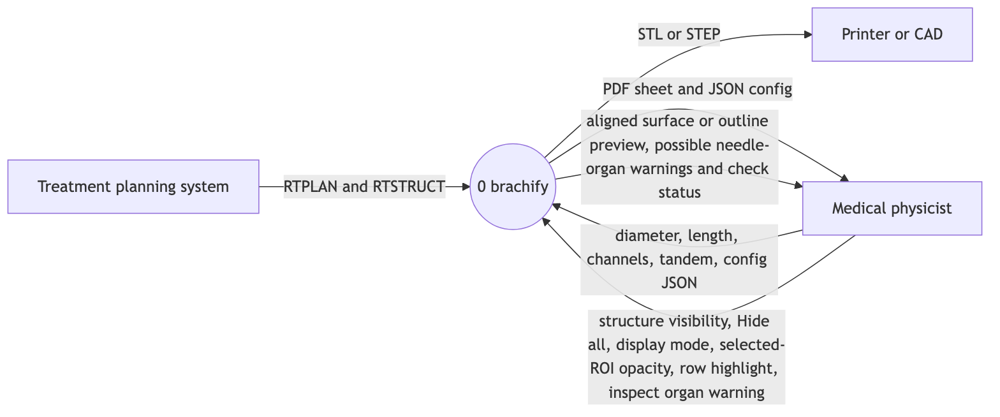
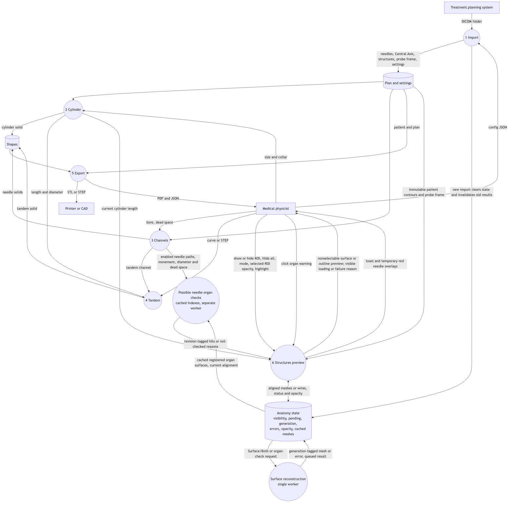
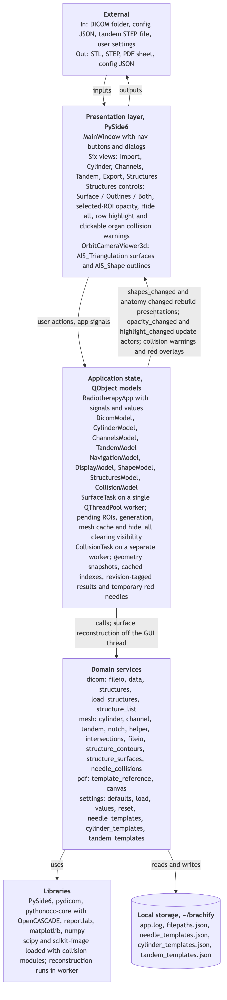

# Week 9, Team

_Team log. Part B, written once for the whole team, covering everyone's merged work this week.
The template is in [docs/logs/README.md](../README.md#team-log-part-b)._

**Authors:** Gilles Fricker (`Writable04`).

**PRs covered:** the 24 PRs below, merged during November 2–8, 2026, America/Vancouver
(`2026-11-02T08:00Z` inclusive to `2026-11-09T08:00Z` exclusive). All landed November 7–8 Pacific.
Evidence is pinned to `main` at [`fb6bef9`](https://github.com/COSC-499-W2026/capstone-project-team-10/commit/fb6bef997cbf259ab0fecd5af1cf8f88a9c0f10d), after week 8's
[`b02d8f0`](https://github.com/COSC-499-W2026/capstone-project-team-10/commit/b02d8f043dd08028dec18f3e917d6300fe3e5f78) cutoff.
Each merge passed `git merge-base --is-ancestor <merge commit> origin/main` at that snapshot.
#235 and #236 failed that check; their replacements #245 and #246 are counted once instead.
#203, the week 8 log, merged November 1 Pacific and is outside this week.

Individual receipts: [Ariq](../ariq/week-9.md), [Ahab](../ahab/week-9.md),
[Ehsan](../ehsan/week-9.md), [Gilles](../gilles/week-9.md).

## Contributions and review evidence

Files and lines are GitHub's final per-PR counts; lines are additions plus deletions.
Each row is its own diff, without inherited stack changes. New tests count added `test_*`
functions against the merge's first parent, not parametrized cases. Approvers are teammates
other than the author with a current, non-dismissed approving review; later comments do not
cancel approvals. No separate land PR is counted again.

### Tandem templates: #212 → #213 → #214 → #215 → #216 → #217 → #218 → #219 → #221 → #240

| PR | Author | Own contribution | Files | Lines | New tests | Approved by |
|---|---|---|---:|---:|---:|---|
| [#212](https://github.com/COSC-499-W2026/capstone-project-team-10/pull/212) | Ariq | Validate immutable tandem designs and template records | 9 | 301 | 7 | Ahab, Gilles, Ehsan |
| [#213](https://github.com/COSC-499-W2026/capstone-project-team-10/pull/213) | Ariq | Read and atomically save the versioned template library | 7 | 376 | 10 | Ahab, Ehsan |
| [#214](https://github.com/COSC-499-W2026/capstone-project-team-10/pull/214) | Ariq | Update and delete saved tandem templates | 9 | 221 | 7 | Ahab, Ehsan |
| [#215](https://github.com/COSC-499-W2026/capstone-project-team-10/pull/215) | Ariq | Save Generate settings from the Tandem tab | 9 | 395 | 5 | Ahab, Ehsan |
| [#216](https://github.com/COSC-499-W2026/capstone-project-team-10/pull/216) | Ariq | Load settings with height and rotation notices | 9 | 301 | 6 | Ahab, Ehsan |
| [#217](https://github.com/COSC-499-W2026/capstone-project-team-10/pull/217) | Ariq | Confirm template updates and deletion | 9 | 400 | 9 | Gilles, Ehsan |
| [#218](https://github.com/COSC-499-W2026/capstone-project-team-10/pull/218) | Ariq | Check whether a template builds on the cylinder | 9 | 205 | 3 | Ahab, Ehsan |
| [#219](https://github.com/COSC-499-W2026/capstone-project-team-10/pull/219) | Ariq | Test the loaded template in mesh and reference-sheet exports | 6 | 168 | 2 | Ahab, Ehsan |
| [#221](https://github.com/COSC-499-W2026/capstone-project-team-10/pull/221) | Ariq | Show the settings actually used by Generate | 7 | 129 | 2 | Ahab, Ehsan |
| [#240](https://github.com/COSC-499-W2026/capstone-project-team-10/pull/240) | Ariq | Share a neutral template confirmation dialog | 9 | 131 | 1 | Gilles, Ehsan |

### Needle–organ warnings: #222 → #243 → #223 → #224 → #225 → #226

| PR | Author | Own contribution | Files | Lines | New tests | Approved by |
|---|---|---|---:|---:|---:|---|
| [#222](https://github.com/COSC-499-W2026/capstone-project-team-10/pull/222) | Gilles | Check needle capsules against validated organ meshes | 9 | 325 | 7 | Ariq, Ehsan |
| [#243](https://github.com/COSC-499-W2026/capstone-project-team-10/pull/243) | Gilles | Prepare registered organ surfaces independently of visibility | 5 | 133 | 3 | Ehsan, Ariq |
| [#223](https://github.com/COSC-499-W2026/capstone-project-team-10/pull/223) | Gilles | Run revision-tagged collision checks with cached indexes | 9 | 437 | 9 | Ariq, Ehsan |
| [#224](https://github.com/COSC-499-W2026/capstone-project-team-10/pull/224) | Gilles | Show organ warning actions, toast and red needle overlays | 9 | 344 | 7 | Ariq, Ehsan |
| [#225](https://github.com/COSC-499-W2026/capstone-project-team-10/pull/225) | Gilles | Document collision data flow and model signals | 9 | 93 | 0 | Ariq, Ahab, Ehsan |
| [#226](https://github.com/COSC-499-W2026/capstone-project-team-10/pull/226) | Gilles | Document warning behaviour, scope and limitations | 6 | 103 | 0 | Ariq, Ehsan |

### Structures controls: #228, then #234 → #245 → #246

| PR | Author | Own contribution | Files | Lines | New tests | Approved by |
|---|---|---|---:|---:|---:|---|
| [#228](https://github.com/COSC-499-W2026/capstone-project-team-10/pull/228) | Ehsan | Preserve list items and fix checkbox/keyboard highlight regressions | 5 | 196 | 0 | Ariq, Ahab |
| [#234](https://github.com/COSC-499-W2026/capstone-project-team-10/pull/234) | Ehsan | Hide all structures and discard obsolete surface work | 9 | 282 | 4 | Ariq, Ahab |
| [#245](https://github.com/COSC-499-W2026/capstone-project-team-10/pull/245) | Ehsan | Document Hide all in the DFDs and UML | 9 | 65 | 0 | Ahab, Ariq |
| [#246](https://github.com/COSC-499-W2026/capstone-project-team-10/pull/246) | Ehsan | Document Hide all in the architecture and test index | 5 | 39 | 0 | Ahab, Ariq |

### Imported applicators: #238 → #239 → #241 → #242

| PR | Author | Own contribution | Files | Lines | New tests | Approved by |
|---|---|---|---:|---:|---:|---|
| [#238](https://github.com/COSC-499-W2026/capstone-project-team-10/pull/238) | Ahab | Remove imported applicators and their cached display shapes | 8 | 242 | 6 (2 replaced) | Gilles, Ariq |
| [#239](https://github.com/COSC-499-W2026/capstone-project-team-10/pull/239) | Ahab | Rename applicators while preserving their properties | 7 | 219 | 6 (1 replaced) | Gilles, Ariq |
| [#241](https://github.com/COSC-499-W2026/capstone-project-team-10/pull/241) | Ahab | Estimate edit-form parameters from an imported path | 6 | 209 | 8 | Gilles, Ariq |
| [#242](https://github.com/COSC-499-W2026/capstone-project-team-10/pull/242) | Ahab | Edit imported applicators with an explicit replacement notice | 9 | 376 | 10 (2 replaced) | Gilles, Ariq |

- **Unique test functions:** 112 added and 5 replaced/removed: 324 at `b02d8f0` became 431 at
  `fb6bef9`. Individual receipts may count parametrized cases or earlier branch runs; those
  figures are not added together or presented as new functions here.
- **Size:** 24/24 PRs have fewer than 10 files and 500 changed lines (largest: 9 files and
  437 lines). Only 9/24 (37.5%) are below 200 lines and 0/24 below three files, missing both
  50–75% targets. The separate 500-lines-of-code-per-file rule was not audited.

## Part B: What Our Team Added and How the Changes Satisfy Software Engineering Principles

- This week, we decided to focus on **getting in the last functional features, as confirmed
  by Gilles: tandem templates, imported-applicator editing, needle–organ warnings and
  Structures controls (the PR groups above)** with the goal of **landing those features in
  `main`; no numerical success target was recorded**.
- The work was distributed so that **Ariq** focused on **tandem template storage, controls
  and export checks (#212–#240 above)**, **Ahab** focused on **imported-applicator removal,
  renaming and editing (#238–#242)**, **Ehsan** focused on **Structures highlight fixes and
  Hide all (#228, #234, #245, #246)**, and **Gilles** focused on **needle–organ checks,
  warning controls and their documentation (#222–#226, #243)**. We considered alternative
  workload distributions such as **none recorded; Gilles confirmed no additional alternatives**.
- Based on **all 24 contributions reaching `fb6bef9` with at least two teammate approvals,
  585 passing tests in 820.48 seconds, and `python docs/architecture/build.py --check`
  exiting 0 over seven diagrams**, we met this goal because **the four feature groups are
  merged and the integrated suite passes, including both highlight tests that failed in
  week 8; this establishes the stated landing goal, not completion of every proposal item**.

  Evidence limits:

  - **Observed:** the macOS conda run used offscreen Qt and `pytest.main(['-q'])` from the
    repository root, redirecting `Path.home` before collection to a temporary directory.
    No tests were skipped or weakened. Week 8 recorded 424 passed and 2 failed of 426;
    this snapshot has 585 passing cases, a net increase of 159 collected cases.
  - **Reported:** native app runs and screenshots remain in the linked individual receipts.
    This log adds no fresh native viewport run. Collision evidence uses synthetic organs;
    it is not clinical validation, and no clearance distance or export blocking is implemented
    (source of truth §7.25, needle–organ limitations).
  - **Unfinished follow-up:** week 8's proposed `color_changed` diagram addition is still
    absent from every `.mmd`, although the signal exists in code. The diagram checker does
    not check every signal. The smaller-PR targets also remain unmet, as quantified above;
    no further team plan for these items was recorded in the clarification.
- By doing **a review of #217**, **Ahab** found that the code base contained **a dependency
  from the Tandem view into the Cylinder view solely to reuse a confirmation dialog**.
  Therefore, **Ariq** did **extract `windows/template_dialog.py` in #240, used by both views**.
  By doing **the tandem-library implementation in #213**, **Ariq** found that the code base
  contained **save steps duplicated line for line from the cylinder library**. Therefore, **Ariq** did **share `write_atomically` between both libraries**.

  These are specific reductions in coupling and duplication, not proof that the whole
  repository has none. Index-addressed views remain, as source of truth §4.3 records.
- With everyone's newly merged work for this week, the system DFD looks like **the updated
  level 0 and level 1 below (#225 and #245)**. The specific changes include **organ-warning
  inspection and check status, registered organ surfaces and enabled needle paths feeding
  a separate collision worker, revision-tagged results returning to Structures, temporary
  red preview overlays, and Hide all input; the collision flow has no export edge**.
  We considered alternative data flows such as **#234's new visibility signal or full model
  clear, rejected in favour of the existing `changed` signal and retained geometry cache;
  clearing the full model would discard the imported structures**.

  

  [Version-controlled SVG](https://github.com/COSC-499-W2026/capstone-project-team-10/blob/bdda7a02e77be254873bcac60c7536048d1a8d49/docs/architecture/diagrams/existing-framework/dfd-0.svg).

  

  [Version-controlled SVG](https://github.com/COSC-499-W2026/capstone-project-team-10/blob/bdda7a02e77be254873bcac60c7536048d1a8d49/docs/architecture/diagrams/existing-framework/dfd-1.svg).

- With everyone's newly merged work for this week, the system architecture diagram looks
  like **the updated snapshot below (#212, #214, #222, #223, #224 and #246)**. The specific
  changes include **tandem template settings and local JSON storage, the collision geometry
  service and separate worker/model, warning controls and overlays, and Hide all state**.
  We considered alternative architectural components **a separate edited-plan record in
  #242, rejected because it would duplicate state already held in `custom_specs`; #240
  also rejected combining both tabs' complete update/delete flows because only the dialog
  was shared and a broader abstraction would change Cylinder behaviour**. We considered
  alternative dependencies **none recorded or supplied by Gilles; `environment.yml` and
  `spec-file.txt` are unchanged between the two snapshots**.

  

  [Version-controlled SVG](https://github.com/COSC-499-W2026/capstone-project-team-10/blob/bdda7a02e77be254873bcac60c7536048d1a8d49/docs/architecture/diagrams/system-architecture.svg).

  The three PNGs were rendered with mermaid-cli 11 at scale 2 from the unchanged Mermaid
  sources at `fb6bef9`, and visually inspected. Their links and SVG sources share the image
  commit. Four existing diagram sources changed this week (these three and the UML);
  the three projected diagrams did not. The signal omission noted above remains.

No process or contract change was reported by Gilles. The diff from `b02d8f0` to `fb6bef9`
is empty for `docs/workflows`, `docs/contract`, `AGENTS.md` and `pull_request_template.md`.
